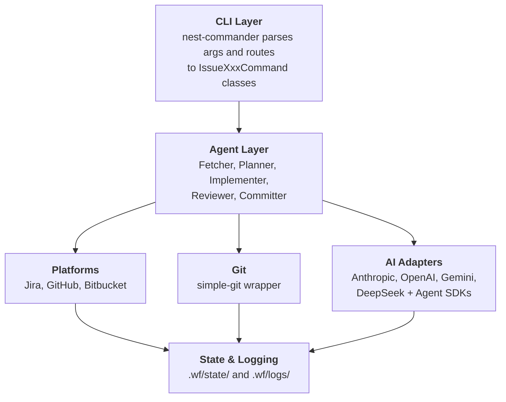

# wf — Issue Workflow CLI

A **NestJS-based CLI** that orchestrates the `issue:*` pipeline — fetch, plan, implement, review, commit, and PR — with pluggable AI providers and issue tracker integrations.

## Features

- 🎯 **Jira Integration** - Create, read, update Jira tickets with Markdown ↔ ADF conversion
- 🌳 **Git Automation** - Branch management, conventional commits, and more
- 🤖 **AI-Powered** - Claude integration for intelligent planning and code generation
- 🩺 **Provider-Aware Diagnostics** - Blank or blocked AI stage responses fail fast with provider/model context instead of generic parse errors
- 🔍 **Resolved Provider Transparency** - Every AI call prints `ℹ llm.adapter resolved-provider=<provider> resolved-model=<model>` to the terminal so the active provider and model are visible for each stage
- 🧭 **Unified CLI Presentation** - Stage headers, progress updates, and workflow outcomes now use a consistent terminal presenter
- 🪵 **Persisted Fatal Errors** - Fatal errors are written to the daily `~/.wf/logs/agent-YYYY-MM-DD.log` file for post-mortem review
- 💾 **State Management** - Pause and resume workflows at any point
- ✨ **Beautiful CLI** - Colored output, progress indicators, and interactive prompts

## Table of Contents

- [Installation](#installation)
- [Configuration](#configuration)
- [Usage](#usage)
- [Commands](#commands)
  - [Issue API](#issue-api)
  - [Workflow Commands](#workflow-commands)
- [Workflows](#workflows)
- [Key Design Decisions](#key-design-decisions)
  - [Artifact Resolution Rules](#artifact-resolution-rules)
  - [Session Forking Workflow](#session-forking-workflow)
  - [Skill Loading](#skill-loading)
- [Development](#development)
- [Testing](#testing)
- [Known Issues](#known-issues)

## Prerequisites

- **Node.js >= 22.17** (pinned in `.nvmrc`; run `nvm use` to activate)
- **Yarn** (package manager)

## Installation

```bash
# Clone the repository
cd /Users/tafadzwagonera/Projects/wf

# Activate the pinned Node version
nvm use

# Install dependencies
yarn install

# Build the project
yarn build

# Link globally (optional)
npm link
```

## Configuration

Create one of these files in the consumer project root:

- `wf.config.js`
- `wf.config.ts`
- `wf.config.mts`
- `wf.config.js`
- `wf.config.mjs`
- `wf.config.yaml`
- `wf.config.yml`

When multiple files exist, `wf` uses this precedence order from top to bottom. When `--repos` points to a local checkout, `wf` bootstraps config from that repository instead of the caller's current working directory.

### JavaScript / TypeScript Example

```ts
import { defineConfig } from 'wf/config';

export default defineConfig({
  tracker: 'jira',
  ai: [
    {
      provider: 'anthropic',
      apiKey: process.env.ANTHROPIC_API_KEY,
      model: 'claude-sonnet-5-5',
    },
    {
      provider: 'openai',
      apiKey: process.env.OPENAI_API_KEY,
      model: 'gpt-5.6-terra',
      default: true,
    },
    {
      provider: 'google',
      apiKey: process.env.GEMINI_API_KEY,
      model: 'gemini-2.5-flash',
      maxTokens: 8192,
    },
  ],
  atlassian: {
    baseUrl: 'https://yourcompany.atlassian.net',
    email: 'your-email@company.com',
    jira: {
      apiToken: process.env.ATLASSIAN_JIRA_API_TOKEN,
      defaultProject: 'WBP',
    },
    bitbucket: {
      apiToken: process.env.ATLASSIAN_BITBUCKET_API_TOKEN,
      workspace: 'your-workspace',
    },
  },
  github: {
    token: process.env.GITHUB_TOKEN,
    defaultRepo: 'owner/repo',
  },
  git: {
    commitFormat: 'auto',
    branchNamePattern:
      '^(bugfix|build|chore|ci|docs|feat|feature|fix|perf|performance|refactor|revert|style|test)\\/[A-Z]+-[0-9]+__|-.+$',
    protectedBranches: ['main', 'master', 'develop'],
  },
  log: {
    level: 'info',
  },
  slack: {
    botToken: process.env.SLACK_BOT_TOKEN,
    userToken: process.env.SLACK_USER_TOKEN,
  },
  stages: {
    generate: {
      provider: 'anthropic',
      backend: 'cli',
    },
    plan: {
      provider: 'anthropic',
      model: 'claude-sonnet-5-5',
      skills: ['writing-plans'],
    },
    implement: {
      provider: 'anthropic',
      model: 'claude-haiku-4-5-20251001',
      backend: 'cli',
      timeoutMs: 1200000,
      skills: ['coding-style', 'test-driven-development'],
      verificationConditions: {
        policyFile: 'verification.policy.json',
      },
      planStepVerification: {
        enabled: true,
        provider: 'openai',
        model: 'gpt-5.6-terra',
        backend: 'cli',
      },
    },
    review: {
      provider: 'anthropic',
      backend: 'cli',
      inactivityTimeoutMs: 600000,
    },
    commit: {
      provider: 'google',
      backend: 'standard',
    },
  },
});
```

### YAML Example

```yaml
tracker: jira
ai:
  - provider: anthropic
    apiKey: ${ANTHROPIC_API_KEY}
    model: claude-sonnet-5-5
  - provider: openai
    apiKey: ${OPENAI_API_KEY}
    model: gpt-5.6-terra
    default: true
  - provider: google
    apiKey: ${GEMINI_API_KEY}
    model: gemini-2.5-flash
    maxTokens: 8192
atlassian:
  baseUrl: https://yourcompany.atlassian.net
  email: your-email@company.com
  jira:
    apiToken: ${ATLASSIAN_JIRA_API_TOKEN}
    defaultProject: WBP
  bitbucket:
    apiToken: ${ATLASSIAN_BITBUCKET_API_TOKEN}
    workspace: your-workspace
git:
  commitFormat: auto
  branchNamePattern: "^(bugfix|build|chore|ci|docs|feat|feature|fix|perf|performance|refactor|revert|style|test)\\/[A-Z]+-[0-9]+__|-.+$"
  protectedBranches: [main, master, develop]
log:
  level: info
slack:
  botToken: ${SLACK_BOT_TOKEN}
  userToken: ${SLACK_USER_TOKEN}
stages:
  generate:
    provider: anthropic
    backend: cli
  plan:
    provider: anthropic
    model: claude-sonnet-5-5
    skills: [writing-plans]
  implement:
    provider: anthropic
    model: claude-haiku-4-5-20251001
    backend: cli
    timeoutMs: 1200000
    skills: [coding-style, test-driven-development]
    verificationConditions:
      policyFile: verification.policy.json
    planStepVerification:
      enabled: true
      provider: openai
      model: gpt-5.6-terra
      backend: cli
  review:
    provider: anthropic
    backend: cli
    inactivityTimeoutMs: 600000
  commit:
    provider: google
    backend: standard
  create:
    verificationConditions:
      policyFile: verification.policy.json
```

Example verification manifest:

```json
{
  "version": 1,
  "baseline": [
    { "id": "format", "run": "yarn format", "policy": "enforced" },
    { "id": "lint", "run": "yarn lint", "policy": "enforced" },
    {
      "id": "terraform-plan",
      "run": "terraform plan",
      "policy": "enforced",
      "earlyExitPattern": "(?:^|\\n)Preparing the remote plan"
    }
  ]
}
```

`earlyExitPattern` is optional on baseline and targeted verification steps. It must be a non-empty valid regular expression. When output from either stdout or stderr matches it, `issue:implement` records the step as passed and terminates that command's process group instead of waiting for normal completion. Omit the field for commands that must run to completion. Choose an acceptance marker that proves the check reached the required state; for Terraform remote runs, `(?:^|\\n)Preparing the remote plan` is preferable to a generic success phrase.

Verification step policies:

| Policy | Behaviour |
| --- | --- |
| `enforced` | Failure blocks the run and is reported as an error. |
| `best_effort` | Failure is logged as a warning but does not block. |
| `override` | Targeted-only. Replaces a baseline step with the same `id`. After dedup, executes as `enforced`. |

When a plan includes `targeted` verification steps whose `id` matches a baseline step, the baseline entry wins unless the targeted step uses `policy: "override"`. Targeted steps with new IDs are appended after the baseline. In multi-repo plans, each targeted step may carry a `repo` field (matching an entry in `affectedRepositories`) to scope it to a specific repository; steps tagged for a different repo are silently dropped when `issue:implement` runs against another repo. When no targeted step carries a `repo` field the plan is treated as a legacy artifact and all steps pass through unchanged, preserving backward compatibility. In plans where at least one step has a `repo` field, steps that lack `repo` are dropped (treat them as unscoped).

### TypeScript Config Support

- Bun and Deno support TypeScript config files natively.
- Node.js supports TypeScript configs natively on `>= 22.13.0` when started with `--experimental-strip-types`.
- Otherwise install `jiti@>=2.2.0` in the consumer project. `wf` does not install it for you.

```bash
yarn add --dev jiti
```

```bash
node --experimental-strip-types ./node_modules/.bin/wf issue:fetch WBP-2971
```

### JavaScript Config Module Formats

- `wf.config.js` supports both `module.exports = { ... }` and `export default { ... }`.
- In repositories whose nearest `package.json` sets `"type": "module"`, `wf.config.js` may still use CommonJS exports. This is useful when `issue:generate --repos <local-checkout>` or another repo-scoped command bootstraps config from a sibling checkout that has not renamed the file to `.cjs`.

### Defaults and Notes

- Built-in defaults cover provider/model selection, branch prefixes, workflow directory, and log level. State and log directories default to `~/.wf/state` and `~/.wf/logs` respectively, and can be overridden with absolute `state.directory` and `log.directory` config values; relative override values are silently ignored. See [Artifact Resolution Rules](#artifact-resolution-rules).
- `ai[].provider` selects the backing AI provider for each entry.
- `ai[].default` is optional when only one provider is configured, and required when two or more providers are configured.
- `ai[].maxTokens` is only applied to Gemini provider entries using Gemini models; other providers ignore it.
- `stages.generate`, `stages.plan`, `stages.review`, and `stages.implement` accept `{ provider, model, backend? }`.
- `stages.plan` and `stages.implement` accept a typed `skills` array to opt in to registered skills for the stage. Valid skill names are enforced per stage: plan accepts `frontend-design-nuxt`, `test-driven-development`, and `writing-plans`; implement accepts `coding-style`, `frontend-design-nuxt`, and `test-driven-development`. Each skill ID must be registered in the skill registry and must support the target stage; a mismatch throws a `ConfigurationError`. In interactive sessions, unknown skill IDs prompt for correction; in non-interactive mode they throw immediately. For both the plan and implement stages, all backends (Anthropic Agent SDK, OpenAI Agents SDK, Claude CLI, and Codex CLI) inline the full SKILL.md content directly into the prompt — no native Skill tool resolution, ~/.claude/skills/, or ~/.codex/skills/ path is consulted at runtime. When `test-driven-development` is configured on the implement stage, the closing instruction switches from "run the verification commands after all edits" to a red-green loop (write the failing test, confirm it fails, implement, re-run) on every backend. The skill fragment is also appended to verification fix-pass prompts and to `initialPromptOverride` turns on the Claude CLI and Anthropic backends. On the plan stage the same skill orders each failing-spec step immediately before its implementation step.
- Skills are centralized in `src/skills/content/`, and each skill's audience (interactive CLIs and/or headless) is declared in `src/skills/skill-taxonomy.ts`. Run `yarn skills:sync` to symlink interactive skills into `~/.claude/skills` and `~/.codex/skills`; the wf runtime still inlines SKILL.md and never reads those directories.
- `stages.plan`, `stages.implement`, and `stages.review` accept `maxTokens?: number` to set the output token ceiling for the stage (default: 16384). Increase this if the model truncates verbose JSON responses. This setting applies to provider-backed stages only; Claude Code CLI and Codex CLI do not expose a wf-controlled output-token limit, so the CLI backend detects truncation (`stop_reason: 'max_tokens'`) automatically instead of applying this knob.
- `stages.plan`, `stages.review`, `stages.generate`, and `stages.implement` accept `timeoutMs?: number` to set the wall-clock timeout for CLI backend invocations (default: 15 minutes). They also accept `inactivityTimeoutMs?: number` to set the per-message inactivity timeout (default: 2 minutes). The two timeouts serve different purposes:
  - **`timeoutMs`** (wall-clock) — an absolute upper bound on how long the subprocess is allowed to run from the moment it is spawned, regardless of whether it is producing output. It fires exactly once and cannot be reset.
  - **`inactivityTimeoutMs`** (inactivity) — resets on each output message from the subprocess. For the Claude CLI backend, system housekeeping messages (`rate_limit_event`, `system/status`, `system/api_retry`, `system/compact_boundary`) do not reset the timer; only substantive progress does. The Codex CLI backend resets the timer only on command execution, file changes, and tool calls — plain agent-text messages do not reset it, so a chatty-but-stuck agent is still killed on schedule instead of surviving indefinitely on talk alone.

  A model that is actively working but takes 8 minutes total is fine — the wall-clock timer has not fired and inactivity is reset continuously. A model that starts thinking silently and produces nothing for 2 minutes is killed by the inactivity timeout even if the wall-clock timer still has time remaining. Increase `inactivityTimeoutMs` (e.g. `600000` for 10 minutes) when using models with extended thinking that produce no output for several minutes. Set either value to `0` to disable the corresponding limit entirely (`timeoutMs: 0` removes the wall-clock kill; `inactivityTimeoutMs: 0` removes the inactivity kill).
  - **No-progress abort (Codex CLI only)** — independent of both timeouts, ten consecutive agent-text messages with no intervening command execution, file change, or tool call abort the run immediately as a stall (`subtype: no_progress`), surfaced as a non-retryable `AiProviderError`. This catches a codex agent that keeps talking without doing anything (e.g. arguing with a blocking external tool) well before either timeout would fire.
- `stages.generate`, `stages.plan`, and `stages.review` also accept `outputFormat?: 'json' | 'md' | 'yaml' | 'yml'` to override the per-stage default format (generate=md, plan=json, review=md). For `stages.review`, `outputFormat` also sets the extension and serialization of the cached ticket review artifact (`<ticket>-review.<format>`); read paths find the artifact regardless of the format it was written in.
- `stages.review` accepts `maxDiffLength?: number` (integer ≥ 1, default 80 000) to override the character threshold above which the review diff is split and summarised before being sent to the model. Oversized patches are batched into as few CLI calls as possible — grouping files within a 60 000-character chunk budget — so provider session overhead scales with the number of chunks, not with the number of files.
- `stages.review` accepts `epilogueTimeoutMs?: number` (integer ≥ 0, default 30 000) to set the wall-clock timeout for the CLI epilogue that converts the structured review JSON into human-readable text. Applies only when `backend` is `cli`. Set to `0` to disable the timeout; reduce it when epilogue latency matters more than completeness.
- `stages.commit` accepts `{ provider, model, backend? }`.
- `stages.implement` does not accept `outputFormat`, and `wfConfigSchema` rejects unknown top-level keys, matching load-time validation. The `plan`, `review`, `generate`, and `commit` stages also reject unknown keys, and `skills` is accepted only on `plan` and `implement`. Stage `model` values and `stages.implement.models` values must be non-empty, and `verificationConditions` must set `policyFile` or a non-empty `scripts` map.
- `stages.create` accepts only `verificationConditions`. Configuring `provider`, `model`, `backend`, or `skills` there fails validation because `issue:create` has no AI-backed create stage.
- `stages.implement` also accepts `planStepVerification?: { enabled?: boolean; stallWindow?: number; mode?: 'push' | 'pull'; provider?: WfAiProviderName; model?: string; backend?: 'agent' | 'cli' | 'standard' }`. When `enabled` is `true`, a post-implementation AI auditor assesses each plan step as `done`, `partially-done`, `not-done`, `not-applicable`, or `unverifiable`. Terminal `done`, `not-applicable`, and `unverifiable` verdicts are sticky; only pending steps receive another fidelity pre-pass and fix round. `stallWindow` (default: 3) uses pending-count progress to stop a non-shrinking pending set. `mode` selects the assessor strategy; when omitted, wf routes automatically: high-complexity plans use pull, low-complexity plans use push, and medium-complexity plans use push when the measured diff fits the push evidence budget and pull when it exceeds it; the choice and its reason are logged as `step-verify.mode=<mode> (<reason>)`, and auto routing falls back to push when the assessor provider is not anthropic or openai. An explicit push or pull always wins. `push` collects git diff evidence and, when verification commands ran during implementation, injects a `## Command execution evidence` section listing their outcomes, the commit policy, staged files, and commit count — allowing command-execution plan steps to be assessed as `done` or `not-done` rather than `unverifiable`; hand-off parts of a step that the evidence cannot show (unregistered commands, git-state checks, commit or PR message wording) are marked `not-applicable` instead of `partially-done`, and the planner prompt directs verification commands into `verification.targeted` rather than hand-off plan steps; `pull` spawns an agent with live repository access via `chatTurn` so the assessor can read files directly, is given a host-built `## Mandatory inspection checklist` of every changed and untracked file plus the `## Command execution evidence` section, and must list the files it inspected in `inspectedPaths`; a `done` or `not-applicable` step that names a checklist file missing from `inspectedPaths` is downgraded to `unverifiable` (`step-verify.pull.coverage-gap`), and an empty `inspectedPaths` for a non-empty checklist fails the attempt. A pull provider outside anthropic or openai ends only the verification run (`step-verify.error`), not the implement workflow. `provider` and `model` override the provider and model used by both the step assessor and the spec-fidelity pre-pass; `provider` must be `anthropic` or `openai` when `mode` is `pull`. Setting `model` without `provider` borrows the implement stage provider. `backend` overrides the AI backend used by both the step assessor and the spec-fidelity pre-pass (`'agent'`, `'cli'`, or `'standard'`); when set alongside `provider` and `model`, it takes effect instead of the default implement-stage backend. When `backend` is `'cli'`, the routing follows the same rule as the implement stage itself: `provider: 'anthropic'` selects Claude CLI, `provider: 'openai'` selects Codex CLI. Omit to inherit the implement-stage backend. Push-mode diff evidence is sized from the measured changeset rather than fixed caps: up to 60k characters is sent whole, up to 240k (including the changed-files list) is still sent whole in one call, and larger changesets are assessed in phases — one call per group of steps, each with the full changed-files list and uncut diffs of the files its steps name (`step-verify.assess.phased`). A file counts as named by a step only when its whole repo-relative path appears in the step text (an optional leading `./` is accepted), so a step naming `src/a.tsx` no longer pulls in `src/a.ts`; this applies to phased grouping, evidence prioritisation, the spec-fidelity diff budget, and the pull-mode coverage-gap check. Only a group that still cannot fit is cut to head and tail slices with an `## Evidence completeness` section and a gap-aware `unverifiable` rule, and WARN logs flag it (`step-verify.evidence.over-ceiling`, `step-verify.diff.truncated`, `step-verify.diff.omitted`, `step-verify.unverifiable.evidence-gap`); `step-verify.evidence.budget` is always logged. Files named in the plan's `affectedFiles` are prioritised alongside files named in step text. The spec-fidelity pre-pass applies the same allocation to its diff with a 120k ceiling, keeps files named in the step whole, and logs `step-fidelity.diff.truncated` when it cuts. Fidelity findings use repo-relative paths, retain untracked-file evidence when the diff is capped, and a concrete finding that survives one targeted fix round is suppressed, logged at WARN level, and counted in the summary. Assessor replies are index-checked: an index outside the assessed set, or none of the expected indices, fails the attempt (`step-verify.assess.attempt-failed`) and is retried once rather than being filled in as not-done. Assessed and completed events include `unverifiable` counts.
- Stage targets explicitly override the default `ai.provider` and `ai.model`.
- Prefer `verificationConditions.policyFile` to point at a repository-owned verification manifest. This keeps baseline verification policy tool-agnostic and reusable from CI or other executors.
- `verificationConditions.scripts` remains supported as a fallback when a manifest is not present.
- Manifest baseline checks run in declaration order. Recommended sequence: `format` → `lint --fix` → `lint` → `build`. This removes formatting noise before the final lint/build gate and makes retries focus on real code issues.
- Prefer portable wrappers such as `yarn lint`, `bash ./scripts/verify.sh`, or `node ./scripts/verify.mjs` instead of relying on executable bits or shell-specific features.
- Explicit model values are checked against their provider's well-known prefix (`claude-` for anthropic, `gpt-`/`o1-`/`o3-`/`o4-` for openai, `gemini-` for google, `deepseek-` for deepseek) wherever they appear: `ai[]` entries, stage targets, `stages.implement.models.default` and `.mechanical`, and `stages.implement.planStepVerification.model` (checked against its own `provider`, else the implement provider). A mismatch fails config load with a `ValidationError`; unknown prefixes pass. Programmatic provider/model overrides are checked the same way and raise an `AiProviderError`.
- `git.branchNamePattern` sets a regex enforced when `issue:implement` creates a branch and used to validate names entered at the branch prompt; an invalid regex fails config validation at startup, and `--branch-name-pattern` overrides it per run. `git.branchPrefixMapping` overrides the prefix per action type (`feature`, `fix`, `investigate`).
- `git.protectedBranches` lists branches that `push()` refuses to target directly (defaults to `['main', 'master', 'develop']`). Set to `[]` to disable the guard.
- `slack.botToken` and `slack.userToken` are used by `issue:generate` to fetch Slack thread content from permalinks.
- `fetch` cannot be overridden.
- `wf config get` and `wf config list` read the normalized runtime config.
- `wf config set` is advisory only and points you at the config file to edit.

### Generate API Tokens

**Anthropic API Key:**

- Go to: https://console.anthropic.com/settings/keys
- Create a new API key

**Jira API Token:**

- Go to: https://id.atlassian.com/manage-profile/security/api-tokens
- Create a new API token
- Ensure your Jira user has necessary project permissions

**BitBucket API Token** (for BitBucket tracker support):

- Go to: BitBucket Settings → Personal Settings → App passwords → API tokens
- Create a new token with required scopes:
  - `repository:read` - Read repository data
  - `issue:read` - Read issues
  - `issue:write` - Create and update issues
  - `pullrequest:read` - Read pull requests
- Copy the generated token
- Set `atlassian.bitbucket.apiToken` and `atlassian.bitbucket.workspace` in `wf.config.*`

**⚠ Note:** BitBucket app passwords were deprecated on September 9, 2025. Only API tokens are supported.

## Usage

### Quick Start

```bash
# List available workflows
yarn start list

# Run a workflow
yarn start run test-workflow

# Fetch a ticket and generate a plan
wf issue:fetch WBP-2971 --tracker jira
wf issue:plan -k WBP-2971 --action fix

# Run the complete issue workflow in one command
wf issue -k WBP-2971 --from fetch --to commit --action fix
```

## Commands

### Issue API

The issue API is a suite of commands for the full ticket lifecycle: fetch → plan → implement → review → commit. Commands prefixed with `issue:` are focused steps; `issue` orchestrates them together.

---

#### `wf issue:fetch <ticket-key>`

<!-- BEGIN GENERATED COMMAND DOCS: issue:fetch -->
Fetch ticket description from a tracker. NB: This command will override the locally generated artifact with the ticket description fetched from the specified tracker

```bash
# Fetch ticket from primary tracker
wf issue:fetch WBP-2971

# Specify tracker and format
wf issue:fetch WBP-2971 --tracker jira --format md
```

**Options:**

| Flag | Description |
| ---- | ----------- |
| `--dry-run` | Preview the fetch operation without making changes |
| `-f, --format <format>` | Output format (json\|md\|yaml\|yml) - default: md |
| `-r, --repos <repos...>` | Space-separated repositories; only the first repo is used and additional repos are ignored with a warning. Names resolve from cwd, a sibling directory, then $WF_REPOS_DIR (default: $HOME/Apps, Projects, apps, projects) |
| `-s, --silent` | Suppress decorative output and interactive prompts. Emits only the file path for piping |
| `-t, --tracker <tracker>` | Target tracker (jira\|github\|bitbucket) |
<!-- END GENERATED COMMAND DOCS: issue:fetch -->

**Output:** saves to `./<tracker>/<ticket-key>.<format>` (e.g., `./jira/WBP-2971.md`).

---

#### `wf issue:plan`

<!-- BEGIN GENERATED COMMAND DOCS: issue:plan -->
Plan ticket implementation from a local artifact or repo-scoped custom artifact. If a local artifact is not found, the command will attempt to fetch it from the primary tracker. Use --force to fetch and recreate artifacts. Repo-scoped planning inspects prior plan artifacts anywhere under ~/.wf/<repo>/**/* and correlates them by keyword similarity so planning prompts can reuse earlier implementation context. Planning prompts include detected repository test conventions and ecosystem-specific verification guidance so generated steps match local test patterns and only reference allowed command forms. Node verification commands use the detected package manager: npm uses `npm run <script> -- <args>`, yarn uses `yarn <script> <args>`, pnpm uses `pnpm run <script> <args>`, and bun uses `bun run <script> <args>`; the same syntax is used by validation and retry guidance. When a design system is detected, observed element class conventions (e.g. h1–h6 heading classes, grid-gap token choices, responsive grid-cols breakpoint tiers mined from real .vue/.tsx files) are included in the plan prompt; the design-system block is omitted for non-UI tickets so the prompt stays focused. Existing components and composables whose names share significant vocabulary with the ticket are surfaced in the plan prompt as reuse candidates so the planner can reference them before creating new files; repos that place UI files outside `app/components` or `app/composables` receive no candidates. Generated plans are semantically validated before they are saved: wf retries once with explicit repair feedback when a draft omits rename targets, uses a non-allowlisted verification command, or contradicts detected test conventions. Steps that delete, drop, remove, replace or rename a term also need a case-insensitive zero-match verification command such as `bash -c '! git grep -I -i -q -F <term>'` (or a `needle-search-required` waiver); a missing or `\\b`-only check is reported as an advisory quality risk after the repair retry. A step that writes a spec with a mocked collaborator must also state that the collaborator is asserted called after the act step (or carry a `test-call-assertion-required` waiver); this is reported the same advisory way. A plan may carry an optional `stepIntents` array, index-aligned with `steps` (same length, `null` for steps without an intent): the planner is told to emit an intent only for steps that prescribe a literal (a call chain, signature, regex or test name), phrased as a goal checkable from the diff; a length mismatch fails plan validation, and markdown artifacts store each intent as an `Intent:` line directly under its numbered step. The planner is told to search the needle case-insensitively across the whole repository, including docs, specs, config, env files and CI, and may mark orphaned files it deletes with the `to-delete` file status (rejected in affectedFilesContext). A step that names two config keys (backticked or quoted, starting with `ai.`, `stages.`, `git.` or `figma.`) with the same final segment, or that adds a `resolve*`, `get*`, `pick*`, `select*` or `build*` function, is checked against the repository with `git grep`; when an existing resolver in a file the plan does not list already reads those keys or defines that name, the plan records a `duplicate-resolver` risk ("reuse <name> in <file>:<line>, or state why it cannot be reused") without a repair retry. The lookup is skipped when no repository directory is known and fails open on any git error. Targeted verification commands are interpreted as repo-root-relative: redundant `cd <repo>` prefixes are normalized away, while commands that change directories outside the selected repository are rejected. When `--figma` is passed or `stages.plan.figma` is `true`, Figma frame links found in the ticket description or acceptance criteria are extracted with their full query strings (including `?node-id=` parameters) and stored in the plan manifest, enabling Figma REST API design context injection during a later `issue:implement --figma` run and `issue:review --figma` run. When no inline Figma links are found but a design system is detected in the repo, an interactive prompt asks for frame links in TTY sessions; links supplied this way are stored in the manifest but are not threaded into the AI generation context.

```bash
# Create a custom feature plan from a markdown artifact
wf issue:plan --action feature --custom-plan bar.md

# Prefer the repo-scoped custom artifact when a repo is supplied (only the first --repos value is used with --custom-plan)
wf issue:plan --action feature --custom-plan bar.md --repos repo-a

# Plan a fix for a ticket
wf issue:plan -k WBP-2971 --action fix

# Plan against a repo so prior plan artifacts feed plan correlation
wf issue:plan -k WBP-2971 --action fix --repos repo-a

# Force re-fetch before planning
wf issue:plan -k WBP-2971 --action fix --force --tracker jira

# Extract Figma links from ticket and store in plan manifest
wf issue:plan -k WBP-2971 --action fix --figma

# Inject local design screenshots during planning (no-arg: scans ~/.wf/<repo>/<ticketKey>/)
wf issue:plan -k WBP-2971 --action fix --ui-design-screenshots

# Inject explicit screenshots; paths stored in plan artifact and re-read at review time
wf issue:plan -k WBP-2971 --action fix --ui-design-screenshots hero.png card.webp
```

**Options:**

| Flag | Description |
| ---- | ----------- |
| `-a, --action <action>` | Resolution action (feature\|fix\|investigate) |
| `-c, --custom-plan <source.md>` | Custom markdown source artifact to synthesize into a canonical plan (mutually exclusive with --ticket-key) |
| `--dry-run` | Preview the plan operation without making changes |
| `--figma` | Enable Figma link extraction; inline Figma links in the ticket are stored in the plan manifest for use by `issue:implement --figma` and `issue:review --figma`. Overrides `stages.plan.figma` config. |
| `--force` | Force fetch and recreate ticket artifact before planning |
| `-f, --format <format>` | Output format for plan (json\|md\|yaml\|yml) - default: json |
| `-r, --repos <repos...>` | Space-separated list of repositories affected by this ticket (workspace/repo or repo-name). With --custom-plan only the first repository is used; the rest are ignored with a warning |
| `--session-id <id>` | Resume an AI provider session (e.g. Anthropic sess_*, Claude CLI, or Codex CLI session ID) |
| `-s, --silent` | Suppress decorative output and interactive prompts. Emits only the plan path for piping |
| `-k, --ticket-key <key>` | Ticket key to fetch and plan (e.g. WBP-2971) |
| `-t, --tracker <tracker>` | Tracker to fetch from if local artifact not found |
| `--ui-design-screenshots [files...]` | Local design screenshots (PNG/JPEG/WebP) injected during plan generation; paths stored in the plan artifact for re-use at review time. Mutually exclusive with --figma. |
<!-- END GENERATED COMMAND DOCS: issue:plan -->

UI design screenshots use the artifact namespace for no-argument scans and keep explicit paths repo-relative by design. See [Artifact Resolution Rules](#artifact-resolution-rules).

Targeted verification commands are stored as **repo-root-relative** commands. If the plan generator emits a redundant `cd <selected-repo> && ...`, `issue:plan` normalizes it before writing the artifact. If a targeted check tries to `cd` outside the selected repo, the plan is rejected.

Before a plan artifact is written, `issue:plan` runs a semantic quality gate over the generated JSON. If the first draft omits a rename target, uses a verification command outside the detected allowlist, or prescribes test guidance that contradicts the repo's detected conventions, wf sends one corrective retry with explicit repair feedback. Plans that still fail those checks after retry are saved with violations downgraded to the plan's `risks` array (prefixed with `[plan-quality]`) and a yellow warning is printed — the plan is not rejected. The same quality gate also applies when a plan is loaded from disk — via `--skip-existing` caching or `--from plan` resume — so that hand-edited or corrupted plans are caught before they reach the implement stage.

When the selected backend returns structured JSON for planning, wf now explicitly asks for minified single-line JSON in both the primary prompt and any CLI retry turn. This reduces token overhead and avoids downstream parsing drift caused by prettified responses.

Custom plan sources follow the artifact repository rules, including absolute-path bypasses, multi-repo filename collision errors, and no cwd fallback. See [Artifact Resolution Rules](#artifact-resolution-rules).

When `--repos` points at a local checkout, `issue:plan` inspects `~/.wf/<repo>/**/*` for prior plan artifacts and correlates them by Jaccard keyword similarity. Matched plans — along with their affected files and source snippets — are forwarded to the planning prompt so it can build on earlier implementation context.

**Output:** saves to `./<tracker>/YYYY-MM-DD-<hash>-<action>-plan.<format>` for both ticket-backed and custom plans. A sidecar `.<format>.sources.json` manifest records the original ticket key or custom source name so `issue:implement` can resolve the artifact later.

---

#### `wf issue:review [pr-url]`

<!-- BEGIN GENERATED COMMAND DOCS: issue:review -->
AI-powered code review of local changes, ticket-associated pull requests, or PR diffs. Each review includes nested trace provenance, issue-local suggestions, and diff-aligned inline comment anchors. Ticket-keyed reviews are cached to `<ticket>-review.<format>`, where the format comes from `-f/--format` or `stages.review.outputFormat` (default md); a cached artifact is served regardless of the format it was written in, and regenerating with `--force` under a different format replaces the stale variant so each ticket keeps exactly one review artifact. In multi-repo runs the artifact gains a repo-scope suffix — `<ticket>-<repo-basename>-review.<ext>`, one file per repository — so each repo's cached result is stored independently and the first repository's cached review is never served to subsequent repositories in the same run; mono-repo runs stay unscoped so the artifact shares its stem with the commit-description sidecar. The review rubric includes Accessibility (roles, focus states, screen-reader operability), Scope & necessity (replaces the former separate Scope and Necessity criteria), and Pattern grounding (checks flagged patterns against actual codebase conventions before raising an issue) among its default criteria. The verdict follows severity: a review that contains any `error` issue is recorded as Changes requested even when the model returned `approved: true`, while warning and info issues do not block approval. Reviews are enriched with detected repo conventions (linter, formatter, language, TypeScript config) and structured verification results; for eligible PR and single-repository reviews, lint, typecheck, and test run live in an invocation-scoped disposable git worktree after the exact reviewed diff is applied, leaving the target repository untouched. Verification records passed, failed, or not-run status and are persisted beside the review in Markdown, JSON, and YAML output. Use `--skip-verification` to bypass it. Blank or blocked AI review responses fail fast with provider-aware diagnostics instead of generic parse errors; Codex CLI schema/configuration rejections preserve the provider detail and are not reported as rate-limit failures. Runs the SonarQube CLI (`sonar analyze secrets` then `sonar analyze`) when `stages.review.sonar` is `true` or `--sonar` is passed; requires `sonar` on PATH and an authenticated `sonar auth status`. Scopes the scan to staged changes when present, otherwise to the merge-base diff against a source branch recovered from `--session-id`, a locally-persisted session for `--ticket-key`, a plan manifest, git reflog, or an interactive prompt, in that order. A bare `--ticket-key` with no matching local session, or any run where no base branch can be resolved, falls back to an unscoped `sonar analyze` and logs a WARN entry to the on-disk log with context `sonar-stage`; a recorded source-branch lookup that fails (for example an unreadable session directory) logs a WARN with the same context and the scan falls back to the development or upstream branch. Findings are reported and logged at WARN with context `sonar-scanner`, and review continues; a clean scan is confirmed too, both on the console and in the persisted log (at INFO), so it stays distinguishable from a scan that never ran; a missing CLI or auth/project misconfiguration continues the review without Sonar findings, leaving other targets in the same run unaffected. That failure warning is always logged at WARN with context `sonar-stage` and is not hidden by `--silent`. Use `--sonar-only` to run only the SonarQube scan for local repositories; it skips AI review, verification, Figma, comments, and chat, prints findings directly, exits 0 for clean or finding-bearing scans, and propagates scan/setup failures through the normal error handler. CLI-backed review sessions send a final human-readable epilogue after parsing the JSON review; Claude CLI forks that epilogue session, while Codex CLI resumes the same session because its JSON exec path has no fork flag. Runs a Figma design-conformance check when `stages.review.figma` is `true` or `--figma` is passed; Figma frame links captured from the ticket description during `issue:plan` are stored in the plan manifest and re-read at review time to fetch design context via the Figma REST API, injecting frame name, dimensions, and screenshot URL into the review prompt so the reviewer model can evaluate visual conformance against the original frames. If all frame fetches fail despite valid links being present, a WARN is written to the on-disk agent log to distinguish network or token failures from the links-absent case. When `--ui-design-screenshots` was passed to `issue:plan` or `issue`, the resolved screenshot paths are stored in the plan artifact; at review time those paths are re-read and handed to the reviewer — base64-encoded as multimodal prompt content for API-backed providers, or as filesystem paths appended to the prompt (with each screenshot directory granted via `--add-dir`) for the Claude CLI backend — so the reviewer can check UI conformance against the original design files. When the review diff exceeds the summarisation threshold (default 80 000 chars), oversized per-file patches are batched into as few CLI calls as possible — grouping files within a 60 000-character chunk budget — rather than one call per file; each batch call returns `=== FILE: <path> ===`-delimited summaries and paths are normalised on both sides to avoid OS separator mismatches. Configure `stages.review.maxDiffLength` (integer ≥ 1) to override the 80 000-character threshold and `stages.review.epilogueTimeoutMs` (integer ≥ 0, default 30 000 ms) to adjust the CLI epilogue spawn timeout. Epilogue failures from `is_error` responses or spawn errors are surfaced in the console log with the first line of the extracted diagnostic so the root cause is visible without opening a log file.

```bash
# Review current repo changes
wf issue:review

# Replace the default review guidelines while keeping ticket context and Sonar findings
wf issue:review --ticket-key WBP-2971 --replace-criteria review-guidelines.md --sonar

# Append team-specific guidelines onto the default review rubric instead of replacing it
wf issue:review --ticket-key WBP-2971 --criteria review-guidelines.md

# Review a ticket and associated pull requests from credentialed adapters using a remote repo hint
wf issue:review --ticket-key WBP-3057 -r service-bookingv3

# Review a ticket and its associated pull requests across credentialed repos
wf issue:review --ticket-key WBP-2971 --tracker jira --repos service-tourv3

# Force re-review a ticket, ignoring cached artifacts
wf issue:review --ticket-key WBP-2971 --force --tracker jira -r service-bookingv3

# Review a pull request and post review comments with diff-aligned inline anchors
wf issue:review https://bitbucket.org/workspace/repo/pull-requests/160 --comment

# Review ticket changes with SonarQube and continue on recoverable failures
wf issue:review --ticket-key WBP-2971 --sonar

# Run only the SonarQube scan and save findings without invoking AI review
wf issue:review --sonar-only -k WBP-2971 -o sonar-findings.txt

# Sonar-review a chained implement→review run, recovering the source branch from that session
wf issue:review --ticket-key WBP-2971 --session-id {providerSessionId} --sonar

# Skip pre-review verification (lint, typecheck, test) in the target repository
wf issue:review --ticket-key WBP-2971 --skip-verification

# Save the review and structured verification results as JSON
wf issue:review --ticket-key WBP-2971 --format json --output review.json

# Resume a provider-backed review session; CLI review sends a human-readable epilogue after parsing the JSON review
wf issue:review --ticket-key WBP-2971 --session-id {UUID} -r service-bookingv3

# Review with Figma design conformance context fetched from the plan manifest
wf issue:review --ticket-key WBP-2971 --figma

# Override plan manifest Figma links with explicit frame URLs
wf issue:review --ticket-key WBP-2971 --figma https://figma.com/design/abc/Page?node-id=1-1
```

**Options:**

| Flag | Description |
| ---- | ----------- |
| `--comment` | Post review as a comment on supported pull requests |
| `--comment-policy` | Enable deterministic new-comment detection, overriding stages.review.commentPolicy config. |
| `--criteria <path>` | Path to a markdown file with additional review criteria to append to the defaults; a relative path resolves from the first --repos repository |
| `--dry-run` | Preview the review operation without making changes |
| `--figma [urls...]` | Enable Figma design-conformance check; optionally pass Figma frame URLs to override the plan manifest. Requires `figma.token` in `wf.config`. |
| `--force` | Force recreate review artifacts, ignoring any cached files |
| `-f, --format <format>` | Output format for --output and the cached ticket review artifact (json\|md\|yaml\|yml) - default: stages.review.outputFormat, then md |
| `-o, --output <path>` | Save review to file |
| `--replace-criteria <path>` | Path to a markdown file whose criteria replace the default review guidelines entirely; a relative path resolves from the first --repos repository |
| `-r, --repos <repos...>` | Space-separated repositories; used as remote PR-discovery hints for ticket review, and as local review roots when the repositories exist on disk. Names resolve from cwd, a sibling directory, then $WF_REPOS_DIR (default: $HOME/Apps, Projects, apps, projects) |
| `--session-id <id>` | Resume an AI provider session (e.g. Anthropic sess_*, Claude CLI, or Codex CLI session ID). For --sonar, also looked up as the originating wf session to recover its recorded source branch, ahead of the --ticket-key/plan-manifest/reflog/prompt chain. |
| `-s, --silent` | Suppress decorative output and interactive prompts. Emits only the review artifact path for piping |
| `--skip-verification` | Skip pre-review verification (lint, typecheck, test) in the target repository |
| `--sonar` | Enable the SonarQube CLI scan, overriding stages.review.sonar config |
| `--sonar-only` | Run only the SonarQube CLI scan (implies --sonar) and exit; skips AI review, verification, Figma, comments, and chat. Findings print and exit 0; scan or setup failures exit 1. |
| `-k, --ticket-key <key>` | Ticket key to review (e.g. WBP-2971) |
| `-t, --tracker <tracker>` | Tracker (jira\|github\|bitbucket) used to resolve a ticket source; defaults to the configured primary tracker |
<!-- END GENERATED COMMAND DOCS: issue:review -->

Mono-repo review artifacts written between commit `cc05b4a0` and this fix carry a redundant repo-scope suffix (`<stem>-<repo-basename>-review.md`) that desynchronises them from their unscoped commit-description sidecars. To drop the suffix from existing artifacts under `~/.wf` (multi-repo sets and name collisions are detected and left untouched), run:

```bash
ts-node -r tsconfig-paths/register scripts/migrate-mono-repo-review-scope.ts --dry-run
# then rerun without --dry-run; --root <dir> targets a different wf home
```

Accepts three source modes:

| Source                 | Description                                                                                                                     |
| ---------------------- | ------------------------------------------------------------------------------------------------------------------------------- |
| _(none)_               | Review staged/unstaged changes in the current repo, or all repos listed in `--repos`                                            |
| `--ticket-key ABC-123` | Fetch ticket context and review associated pull requests; `--repos` provides remote PR-discovery hints and local fallback roots |
| `https://github.com/…` | Fetch and review a GitHub or Bitbucket pull request                                                                             |

When `--ticket-key` is supplied, `issue:review` fetches ticket context from the configured tracker, then fans out PR discovery across registered adapters that have explicit credentials in `wf.config.*`. It reviews matching PR diffs first, in deterministic order, and the trace output uses nested call stacks plus frame-aligned state transitions so downstream dependencies and variable changes stay visible together.

**Staged file exclusions:** before computing the diff for review, `issue:review` stages all local changes while automatically excluding wf tooling artifacts: `.wf/**` runtime directories, `wf.config.{js,mjs,ts,mts,yaml,yml}` files, and `dist/` build output. These files are created by wf itself inside target repos and are not part of the ticket's code changes.

`--repos` serves two roles in ticket mode:

- it provides the remote repository hints used for PR discovery
- when the same repositories exist locally, it also defines the local roots for fallback review

If no `--repos` value is supplied and adapters cannot determine a remote repository on their own, the command now exits with an actionable error instead of guessing from the current directory.

If `--repos` is supplied for ticket review but a listed repository is not available as a local path, sibling directory, or entry under a repos directory (`WF_REPOS_DIR`), remote PR review can still succeed. However, if no PR is found, the command now exits with an actionable error instead of falling back to reviewing the current directory.

`--criteria <path>` appends a markdown file's guidelines onto the default review rubric; `--replace-criteria <path>` uses only the file's guidelines instead (the two flags are mutually exclusive). Either way, ticket context and any Sonar findings are still threaded into the review prompt so switching criteria never discards the review signal gathered earlier in the run. The criteria file is parsed by heading: each `#`/`##` line sets the section context for the bullets that follow, each `-`/`*`/`1.` bullet becomes one guideline prefixed with its nearest heading, and a bullet's wrapped continuation lines (indented, no leading marker) are rejoined into that same guideline rather than becoming separate entries — so a file with `## Section` headers and hand-wrapped prose bullets parses the same as one written with single-line bullets and no headings.

The SonarQube CLI (`sonar analyze secrets` then `sonar analyze`) runs when `stages.review.sonar` is `true` or `--sonar` is passed; requires `sonar` on PATH and an authenticated `sonar auth status`. The scan scopes to staged changes when present, otherwise to the merge-base diff against a source branch recovered from `--session-id`, a locally-persisted session for `--ticket-key`, a plan manifest, git reflog, or an interactive prompt, in that order; a bare `--ticket-key` with no matching local session, or any run where no base branch can be resolved, falls back to an unscoped `sonar analyze` and logs a WARN entry to the on-disk log with context `sonar-stage`; a recorded source-branch lookup that fails (for example an unreadable session directory) logs a WARN with the same context and the scan falls back to the development or upstream branch. Findings are reported and logged at WARN with context `sonar-scanner`, and review continues; a clean scan is confirmed too, both on the console and in the persisted log (at INFO), so it stays distinguishable from a scan that never ran; a missing CLI or auth/project misconfiguration continues the review without Sonar findings — when a ticket has multiple associated pull requests, the remaining targets are still reviewed. That failure warning is always logged at WARN with context `sonar-stage` and is not hidden by `--silent`. Use `--sonar-only` to run just the SonarQube scan for local repositories, print or save the findings, and skip AI review, verification, Figma, PR comments, and follow-up chat.

The current review output keeps `Call Stack` and `State Transition` in the same order before any trailing unmatched `Suggestions`, with `Approval Status` after `Suggestions`. Paired model suggestions now render directly under their corresponding issues in terminal output, exported text, workflow artifacts, and PR summary comments. Each trace section includes explicit provenance text so the output says whether the trace is evidence-based from an agent or CLI backend, best-effort from the standard completion path, or unavailable. The `Call Stack` section renders as a nested tree of concrete frames, and `State Transition` is a frame-aligned tree that mirrors the call stack (a flat path stays flat), listing the variables observed at each frame (`captured`) and the values that changed since the previous frame (`changes`). Both are named-entry arrays (`{name, value}` and `{name, before, after}`) so provider-enforced schemas keep them; older record-shaped output is still accepted and normalised.

After displaying the review, an interactive TTY session prompts "Would you like to discuss the review?" When accepted, the user can ask follow-up questions about the review findings. The conversation is persisted next to the review's ticket or plan artifacts: `~/.wf/<repo>/<tracker>/<ticket-key>-conversation.json` for ticket-based reviews (`-k`) and `~/.wf/<repo>/review-conversation.json` for ticket-less reviews. The prompt is suppressed in `--silent` mode and non-interactive (no TTY) sessions. Follow-up chat honours the same stage config as the review or plan that preceded it: when `stages.review.backend` (or `stages.plan.backend`) is `'agent'` or `'cli'`, each chat turn routes through the agent SDK's native multi-turn session or the Claude CLI headless mode respectively; otherwise it routes through standard completions with the correct stage-level provider and model.

Conversation location and edit access for `wf issue` chats and `wf issue-review` chats:

- Conversations live next to their ticket or plan artifacts. Custom-plan conversations (`-c <plan>.md`) are saved to `~/.wf/<repo>/<key>-conversation.json`; ticket-based conversations are saved to `~/.wf/<repo>/<tracker>/<key>-conversation.json`.
- Interactive chat can edit repository files and workflow artifacts (edits are auto-accepted) on the Claude CLI and Anthropic agent SDK backends. Codex CLI chat and the OpenAI agent SDK chat path remain read-only. Non-chat passes (review summarisation, step assessment, plan generation) stay read-only or in plan mode. The CLI chat tool list includes `Skill`; the SDK chat tool list does not.
- Custom-plan conversations saved before this change at `~/.wf/<repo>/<tracker>/<key>-conversation.json` are no longer found, so a fresh conversation starts. To carry one forward, run `mv ~/.wf/<repo>/<tracker>/<key>-conversation.json ~/.wf/<repo>/`; it re-saves in place on the next turn.
- The legacy `~/.wf/<repo>/review-conversation.json` was shared by every standalone review and cannot be attributed to a ticket. Ticket-less reviews keep using it; ticket-based review chats start fresh under `<tracker>/<ticket-key>-conversation.json`.

When `--comment` is used on a pull request, inline review comments use destination-side changed diff lines. If the model returns the wrong changed line but the issue text clearly references a different changed line in the same file, wf prefers the stronger semantic match first. Otherwise, if the model returns an invalid changed line for a file, wf remaps it to the nearest changed destination-side line in that file before posting. If the file has no usable destination-side changed line, wf omits the inline line anchor instead of posting an invalid one.

---

#### `wf issue:create [input]`

<!-- BEGIN GENERATED COMMAND DOCS: issue:create -->
Create tickets from standardized input (file or stdin); Jira live runs enforce the ADF safety gate. `stages.create` is verification-only and rejects provider, model, backend, or skills configuration. Internal-only sections (`### Unit Test Scope`, `#### Dependencies`, `### Affected Repositories`, `#### References`) are stripped before posting; `### Risks & Assumptions` is preserved. Both `--dry-run` and live creates run the ADF safety analysis.

```bash
# Create ticket from JSON on primary tracker
wf issue:create ticket.json

# Create on a specific tracker and override the Jira project
wf issue:create ticket.md --tracker jira --ticket-project WBP --type story

# Create Jira ticket with project-specific priority resolution
wf issue:create ticket.md --tracker jira --ticket-project WBP --priority medium

# Dry-run a repo-scoped generated Jira artifact to inspect the ADF safety verdict before creation
wf issue:create 2026-05-12-d38b5be9-ticket-description.md --ticket-project WBP -r terraform-aws --dry-run

# Live smoke-test a Jira description update using a generated artifact; --live requires --confirm-live-update and shows a y/N prompt before the PUT
yarn test:manual test-issue-update-jira-adf-smoke WBP-3092 --description-file /Users/tafadzwagonera/.wf/terraform-aws/jira/2026-05-13-3d6f5adb-ticket-description.md --live --confirm-live-update
```

**Options:**

| Flag | Description |
| ---- | ----------- |
| `--dry-run` | Validate without creating - preview only |
| `-f, --format <format>` | Input format (json\|md\|yaml\|yml) - overrides file extension detection; required when reading from stdin |
| `--priority <priority>` | Override normalized ticket priority (highest\|high\|medium\|low\|lowest); Jira resolves it to an allowed project value |
| `-r, --repos <repos...>` | Space-separated repositories; only the first repo is used for artifact lookup and others are ignored with a warning. Names resolve from cwd, a sibling directory, then $WF_REPOS_DIR (default: $HOME/Apps, Projects, apps, projects) |
| `-s, --silent` | Suppress decorative output and interactive prompts. Emits only the ticket key for piping |
| `--ticket-project <project>` | Project key (Jira) or repository (Bitbucket: workspace/repo) - overrides input file |
| `--tracker <tracker>` | Target tracker (jira\|github\|bitbucket) - default from config |
| `-t, --type <type>` | Issue type (task\|bug\|story\|todo) - overrides input file |
<!-- END GENERATED COMMAND DOCS: issue:create -->

When creating Jira tickets, `wf` resolves the requested priority against Jira create metadata for the target project and issue type. Exact allowed names win first; otherwise normalized values such as `medium` can resolve to project values such as `Minor`. If priority is hidden from the create screen or Jira still rejects it, `wf` creates the ticket without a priority field. Priority metadata fetch failures now emit a WARN log and fall back gracefully rather than silently swallowing errors.

For Jira, `issue:create` converts generated Markdown descriptions into Jira ADF before sending the create request. Inline Markdown delimiters in plain-text fields such as summaries are stripped. Before ADF conversion, the write path normalises embedded Jira wiki markup: `{code:lang}...{code}` and `{noformat}...{noformat}` blocks at the start of a line become fenced code blocks, consecutive `# item` lines become numbered lists, `* item` bullets become `- item`, and `{{text}}` becomes inline code. Mid-line prose references to these patterns are preserved as literal text. Before conversion, internal-only sections (`### Unit Test Scope`, `#### Dependencies`, `### Affected Repositories`, `#### References`) are stripped from the description; `### Risks & Assumptions` is preserved verbatim. In non-silent mode the command logs which sections were removed. Both `--dry-run` and live creates run the same ADF safety analysis: suspicious markers and empty descriptions are surfaced at preview time rather than only at submit time.

---

#### `wf issue:generate <sources...>`

<!-- BEGIN GENERATED COMMAND DOCS: issue:generate -->
Generate ticket descriptions from local files, repo-scoped artifacts via --repos, URLs, or ticket keys. Tracker browse URLs (e.g., https://<org>.atlassian.net/browse/<KEY>) are automatically detected and fetched via the tracker REST API instead of scraping HTML; self-hosted instances are supported when atlassian.baseUrl is configured. Local .md, .json, .yaml, and .yml files that parse as tickets are imported as tickets; files that are not recognized as ticket-formatted content remain plain file sources. Repo-scoped generation inspects prior plan artifacts anywhere under ~/.wf/<repo>/**/* and correlates them by keyword similarity so synthesis prompts can reuse earlier implementation context. When multiple repos are supplied, the synthesis prompt also compares repo conventions, including linter and formatter rules, and git-hook tools across checkouts. AI synthesis always runs on every source to enrich and standardize the output. The AI is instructed to return a structured JSON object (title, type, priority, description) that is validated against the ticket schema before conversion to the requested output format. When agent or CLI backends are used, the provider session ID is threaded across oversized-source summarisation, clarification, and synthesis so all calls share coherent context. Generated output enforces formal writing conventions (concise prose, no contractions, active voice, British English) before display or save. Blank AI generate-stage responses fail fast with provider-aware diagnostics. Can use an agent backend when stages.generate.backend is set to agent

```bash
# Generate ticket from a URL
wf issue:generate https://example.com/spec

# Generate from a tracker browse URL (fetches via REST API, not HTML)
wf issue:generate https://touraxis.atlassian.net/browse/WBP-3371 --type bug -r service-document-v1

# Generate from a Slack thread permalink with query params
wf issue:generate "https://workspace.slack.com/archives/C0AP5MMCP53/p1775650646860809?thread_ts=1775650646.860809&cid=C0AP5MMCP53"

# Generate from a repo-scoped artifact (requires -r, --repos)
wf issue:generate itinerary-pdf-generation.md -r service-tourv3

# Generate with repo context so prior plan artifacts inform plan correlation
wf issue:generate ./requirements.md -r service-tourv3 --save

# Generate with multiple repos so repo conventions, formatter rules, and git hooks are compared across checkouts
wf issue:generate ./requirements.md -r primary-repo secondary-repo --save

# Save with overridden title
wf issue:generate ./requirements.md --title "Add OAuth2" --save

# Silent mode: pipe generated ticket directly into issue:create
wf issue:generate ./spec.md -s | wf issue:create

# Silent mode: pipe saved artifact path to issue:create
wf issue:generate ./spec.md --save --silent | xargs wf issue:create
```

**Options:**

| Flag | Description |
| ---- | ----------- |
| `--dry-run` | Preview the generate operation without making changes |
| `-f, --format <format>` | Output format (json\|md\|yaml\|yml) - default: md |
| `-o, --output <path>` | Output file path - default: stdout |
| `--priority <priority>` | Override ticket priority (highest\|high\|medium\|low\|lowest) |
| `-r, --repos <repos...>` | Space-separated repositories; the first repo anchors artifact storage and read context, remaining repos provide additional read context for the AI. Names resolve from cwd, a sibling directory, then $WF_REPOS_DIR (default: $HOME/Apps, Projects, apps, projects) |
| `--save` | Save generated ticket to tracker directory |
| `-s, --silent` | Suppress decorative output and interactive prompts (clarification, disambiguation). Emits only file paths (with --save/--output) or raw ticket content for piping |
| `-t, --title <title>` | Override generated title with custom title |
| `-t, --tracker <tracker>` | Tracker for ticket sources (jira\|github\|bitbucket) |
| `--type <type>` | Override ticket type (task\|bug\|story\|epic) |
<!-- END GENERATED COMMAND DOCS: issue:generate -->

Generated artifacts are saved with a sidecar manifest file named `YYYY-MM-DD-<hash>-ticket-description.sources.json` in the same directory. Use `wf issue:generate:lookup <hash>` to print the original source list. The AI is instructed to return a structured JSON object — `title`, `type`, `priority`, and `description` — which is validated against the ticket schema before conversion to the requested output format (`md` by default); invalid or empty responses are rejected with provider-aware diagnostics rather than silently producing malformed output. OpenAI-compatible structured-output schemas are normalized at the integration boundary for strict mode: unsupported metadata is removed, optional object properties become nullable required properties, and record-like schemas are made strict; schemas whose root is not a JSON Schema object (e.g. an array or primitive) throw a config-category error before any network request is made, at both the completions adapter and Agents SDK boundaries, and Codex CLI stage structured output is routed through the same normalization path. Native Anthropic output formats remain unchanged. Generated `issue:generate` output enforces formal writing conventions before serialisation: contractions are expanded to their formal equivalents (a wider contraction map covers `didn't`, `hasn't`, `we'd`, and similar forms), and the prompt instructs the model to produce concise prose using active voice, third-person perspective, formal British English spelling, and no informal language. The contraction gate fires after the artifact is persisted, so the file is always written before the warning is emitted. When agent or CLI backends are used, the provider session ID is threaded from oversized-source summarisation through the clarification pass into the final synthesis call, so all three stages share a single coherent conversation context.

Tracker browse URLs (e.g. `https://<org>.atlassian.net/browse/<KEY>`) are automatically detected and fetched via the tracker REST API instead of scraping the HTML page. Self-hosted instances are supported when `atlassian.baseUrl` is configured; without it, only `*.atlassian.net` domains are recognised. Non-browse URLs on the same domain (Confluence, board, sprint) fall through to the generic URL handler.

When `--repos` is provided, filename-only local sources are resolved against the repo-scoped artifact directory first, then the live checkout path. Without `--repos`, bare filenames are resolved against `~/.wf/<cwd-basename>/` (the artifact directory inferred from the current working directory). If the file is not found there, the command tells you to retry with `--repos <repo>`. This deliberate local-source variant is described in [Artifact Resolution Rules](#artifact-resolution-rules). When the first `--repos` entry resolves to a local checkout, `issue:generate` also bootstraps AI provider and stage config from that repository before command execution.
Repo-scoped generation also inspects `~/.wf/<repo>/**/*` for prior plan artifacts and correlates them by Jaccard keyword similarity. Matched plans — along with their affected files and source snippets — are injected into the synthesis prompt so generated tickets can reflect earlier implementation steps and risks.
Slack permalinks that include query parameters should be quoted when invoked from shells such as `zsh` or `bash`.

In interactive mode (TTY, no `--silent`), the command performs a pre-synthesis clarification pass: the AI identifies unaddressed ambiguities, assumptions, or risks in the sources, and prompts the user to answer them before generating the ticket. Sources that already acknowledge their own risks and assumptions are not re-surfaced. The `--silent` flag suppresses all decorative output and interactive prompts, emitting only file paths (with `--save`/`--output`) or raw ticket content suitable for piping.

---

#### `wf issue:commit [options]`

<!-- BEGIN GENERATED COMMAND DOCS: issue:commit -->
Create a git commit with an AI-generated message. Use -k for the ticket key, or the key is auto-detected from the branch name. When -k differs from the branch-embedded ticket key, warns and prompts to pick a value interactively, or fails hard with both keys shown when non-interactive; --dry-run only warns. Fails hard if .gitignore is staged. Blank AI commit responses fail fast with provider-aware diagnostics. When a code review or plan artifact already exists for the ticket, its summary is used to scope the commit message automatically. Use --source <plan-stem|ticket-key> to point at a specific review artifact; the lookup probes the tracker directory first, then the custom directory, and finds the artifact in any supported format (json|md|yaml|yml). When no exact artifact matches, the tracker and custom directories are scanned for date-prefixed variants (YYYY-MM-DD-<token>-review.<ext>, exact stem) and the newest by mtime wins on ambiguity with a warning. When no fresh diff-grounded commit description exists for the staged diff, one is generated inline. When running from source, use yarn start issue:commit --conventional.

```bash
# AI-generated commit message
wf issue:commit -k WBP-2971

# Run from source with conventional commits enabled
yarn start issue:commit --conventional

# Force conventional format
wf issue:commit -k WBP-2971 --conventional --tracker jira

# Use the review artifact of a custom plan file
wf issue:commit --source plan.md

# Use the review artifact of a ticket
wf issue:commit --source WBP-2971
```

**Options:**

| Flag | Description |
| ---- | ----------- |
| `--conventional` | Force conventional commits format |
| `--dry-run` | Preview the commit operation without making changes |
| `-m, --message <message>` | Manual commit message (bypasses AI generation) |
| `-r, --repos <repos...>` | Space-separated repositories; only the first repo is used and additional repos are ignored with a warning. Names resolve from cwd, a sibling directory, then $WF_REPOS_DIR (default: $HOME/Apps, Projects, apps, projects) |
| `--session-id <id>` | Resume a wf session by UUID (persisted to ~/.wf/state/sessions/) |
| `-s, --silent` | Suppress decorative output; emits no header |
| `--source <token>` | Plan file or ticket key whose review artifact supplies the commit description; probes the tracker directory, then the custom directory, matching any supported artifact format (json\|md\|yaml\|yml); when no exact artifact matches, both directories are scanned for date-prefixed variants (YYYY-MM-DD-<token>-review.<ext>, exact stem) and the newest by mtime wins on ambiguity with a warning |
| `-k, --ticket-key <key>` | Ticket key for the commit (e.g. WBP-2971); validated against the branch-embedded ticket key |
| `-t, --tracker <tracker>` | Tracker (jira\|github\|bitbucket) |
<!-- END GENERATED COMMAND DOCS: issue:commit -->

**Branch detection:** ticket keys are extracted from the branch name using the pattern `[A-Z]+-\d+`, which anchors at the first uppercase letter — so lowercase prefixes are skipped rather than absorbed (e.g., `feature/WBP-2971__add-oauth` → `WBP-2971`, `fixWBP-4061-show-review-title` → `WBP-4061`).

**Staged file exclusions:** when no files are pre-staged, `issue:commit` stages all local changes while automatically excluding wf tooling artifacts: `.wf/**` runtime directories, `wf.config.{js,mjs,ts,mts,yaml,yml}` files, and `dist/` build output. If `.gitignore` is already staged or explicitly included, `issue:commit` fails hard instead of creating a commit. These are tooling inputs created by wf inside target repos and should never appear in ticket commits.

**Commit scope summary:** with a ticket key resolved, `issue:commit` looks for an existing `issue:review` artifact for that ticket and uses its summary to scope the commit message; if none exists, it falls back to a matching prior `issue:plan` artifact on disk. Within the full `issue` workflow, the plan already resolved for that run takes priority over any other on-disk plan for the same ticket. When a summary is found this way, `issue:commit` prints "Using scope summary from prior review/plan".

---

#### `wf issue:pr [ticket-key]`

<!-- BEGIN GENERATED COMMAND DOCS: issue:pr -->
Create a pull request from a plan artifact (auto-detects ticket from branch).

```bash
# Create a PR from the ticket's plan, resolved via its artifact manifest
wf issue:pr WBP-2971

# Narrow to the fix plan when the ticket has plans for more than one action
wf issue:pr WBP-2971 --action fix

# Dry-run to preview PR title and body
wf issue:pr WBP-2971 --dry-run
```

**Options:**

| Flag | Description |
| ---- | ----------- |
| `-a, --action <action>` | Resolution action type (feature\|fix\|investigate). Narrows the plan match when the ticket has multiple plans |
| `-b, --base <base>` | Target branch for the PR (default: main) |
| `--dry-run` | Preview the PR creation without making changes |
| `-r, --repos <repos...>` | Space-separated repositories; only the first repo is used and additional repos are ignored with a warning. Names resolve from cwd, a sibling directory, then $WF_REPOS_DIR (default: $HOME/Apps, Projects, apps, projects) |
| `-s, --silent` | Suppress decorative output and interactive prompts. Emits only the PR URL for piping |
| `-t, --title <title>` | Override the PR title |
| `-t, --tracker <tracker>` | Tracker (jira\|github\|bitbucket) |
<!-- END GENERATED COMMAND DOCS: issue:pr -->

---

#### `wf issue [plan-token]`

Orchestrate the full issue workflow in a single command. Runs any contiguous range of stages: `fetch → plan → implement → review → commit`. `--session-id` resumes saved workflow metadata and rejects a redundant positional plan token.

```bash
# Full workflow from scratch
wf issue -k WBP-2971 --from fetch --action fix

# Resume from plan and run through review
wf issue -k WBP-2971 --from plan --to review --action fix

# Resume from implement (auto-discovers existing plan)
wf issue -k WBP-2971 --from implement

# Resume from a hashed plan artifact without --action (--from defaults to implement)
wf issue 2026-05-04-1a2b3c4d-fix-plan.json --to review

# Custom plan (--from defaults to plan)
wf issue --custom-plan dark-building-creek-fix.md --action fix

# Custom plan across repos: the source is read from ~/.wf/repo-a/ only; repo-b stays an execution context
wf issue --custom-plan dark-building-creek-fix.md --action fix --repos repo-a repo-b

# Resume a saved workflow session without restating source flags
wf issue --session-id 550e8400-e29b-41d4-a716-446655440000

# Force refresh even when local artifacts already exist
wf issue -k WBP-2971 --from fetch --action fix --force

# Silent run: no decorative output or prompts, artifact paths only
wf issue -k WBP-2971 --from fetch --action investigate --silent

# Bitbucket with repos override
wf issue -k 123 --from fetch --to review --action fix \
  --tracker bitbucket --repos myworkspace/myrepo

# Multi-repo: implement stage runs once per repo in sequence
wf issue -k WBP-3070 --from implement --action feature -r terraform-aws service-document-v1

# Preview the full workflow without making changes
wf issue -k WBP-2971 --from fetch --action fix --dry-run

# Run with SonarQube scan during the REVIEW stage
wf issue -k WBP-2971 --from implement --sonar

# Extract Figma links at plan time and run design-conformance checks at implement and review time
wf issue -k WBP-2971 --from fetch --action fix --figma
```

**Options:**

| Flag                        | Description                                                                                                                                        | Default            |
| --------------------------- | -------------------------------------------------------------------------------------------------------------------------------------------------- | ------------------ |
| `--from <stage>`            | Start stage: `fetch \| plan \| implement \| review \| commit` — defaults to `plan` when `--custom-plan` is provided, `implement` when a plan token is provided, or the saved session stage when `--session-id` is used | —                  |
| `--to <stage>`              | Stop stage (inclusive)                                                                                                                             | `commit`           |
| `--action <action>`         | Resolution action: `feature \| fix \| investigate` — required when `plan` stage runs, optional when resuming from a canonical hashed plan artifact; also scopes the diff-grounded commit description generated during the `review` stage | —                  |
| `-t, --tracker <tracker>` | Tracker: `jira \| github \| bitbucket`                                                                                                            | `TRACKER` |
| `--pr`                      | Create PR after commit stage                                                                                                                       | false              |
| `-s, --silent`              | Suppress decorative output and interactive prompts. Emits only artifact paths (per stage) for piping                                              | —                  |
| `--force`                   | Recreate artifacts instead of using the default skip-existing behavior                                                                             | false              |
| `-c, --custom-plan <source.md>` | Path to a custom markdown plan source; skips the fetch stage. When `--from fetch` is set, warns and normalizes to `--from plan` | —                  |
| `--dry-run`                 | Preview every stage without making changes, including branch and file work                                                                         | —                  |
| `--sonar`                   | Enable the SonarQube CLI scan during the REVIEW stage, overriding `stages.review.sonar` config                                                    | —                  |
| `--figma`                   | Enable Figma link extraction during PLAN and design-conformance checks during IMPLEMENT and REVIEW, overriding `stages.plan.figma`, `stages.implement.figma`, and `stages.review.figma` config. Requires `figma.token` in `wf.config`. | —                  |
| `-r, --repos <repos...>`    | First repo anchors artifact storage; when multiple repos are given, the implement stage runs once per repo in sequence. With `--custom-plan` the source is read from the first repo only and a warning names the others | current repo       |
| `-k, --ticket-key <key>`    | Ticket key to run the full workflow for (e.g. WBP-2971)                                                                                            | —                  |

**Stage order and artifacts:**

| Stage       | Artifact                                                                                    |
| ----------- | ------------------------------------------------------------------------------------------- |
| `fetch`     | `./<tracker>/<ticket-key>.md`                                                              |
| `plan`      | `./<tracker>/YYYY-MM-DD-<hash>-<action>-plan.json` with a `.sources.json` sidecar manifest |
| `implement` | working tree updates in the selected repo plus branch setup                                 |
| `review`    | `./<tracker>/<ticket-key>-review.md`                                                       |
| `commit`    | _(display only — commit commands printed for confirmation)_                                 |

**Plan token resolution:** When a `[plan-token]` positional argument is passed (and neither `--ticket-key` nor `--custom-plan` is set), the command searches for a matching plan artifact in two directories: `~/.wf/<repo>/<tracker>/` (ticket-backed plans) then `~/.wf/<repo>/` (custom plans created with `issue:plan --custom-plan`). It tries manifest-based resolution first, then falls back to a direct file-path lookup with sidecar manifest reading. Ambiguity in either searched directory aborts resolution instead of falling through. See [Artifact Resolution Rules](#artifact-resolution-rules).

**Review verdict:** a review that contains any `error`-severity issue is recorded as *Changes requested* even when the model returned `approved: true`; warning and info issues do not block approval.

**Known plan risks in review:** when the review stage runs inside `wf issue` and a plan artifact is available, the plan's recorded `risks` are added to the review context under "Known plan risks (context only; still report any defect you find)", listing at most 10 and noting how many were omitted. If the plan file cannot be read, a warning is shown and logged at WARN with context `plan-risks`, and the review continues without the section.

**Branch naming:** `issue` generates a branch name in the format `<prefix>/<TICKET-KEY>__<slug>`, where prefix is controlled by `BRANCH_PREFIX_*` env vars (`feature`, `bugfix`, `chore`).

---

#### `wf issue:implement [plan-token]`

<!-- BEGIN GENERATED COMMAND DOCS: issue:implement -->
Carry out an implementation plan from a ticket-backed, hashed, or custom plan artifact. Delegates the generate-and-verify loop to the configured backend (Anthropic Agent SDK, OpenAI Agents SDK, or Claude CLI headless mode) based on stages.implement.provider and stages.implement.backend. In auto model-routing mode, optional stages.implement.modelRoutingThresholds can send medium/high-complexity plans to the mechanical model when targeted writes or plan steps exceed configured limits; targeted writes are concrete affectedFiles entries, not affectedFilesContext entries. Use --model-routing default or --model-routing mechanical to override automatic selection. Progress events are streamed to the terminal so you can follow task and tool activity while edits are being generated. All backends emit stable task and tool progress lines plus explicit file mutation logs and verification logs so terminal output stays human-readable while the agent works. Verification commands are expected to be repo-root-relative; stale plan artifacts that still embed redundant repo-selection `cd` prefixes are normalized, while cross-repo directory jumps are treated as setup errors. A verification step may set earlyExitPattern to a valid regex; when stdout or stderr matches it, wf records the check as passed and terminates the command process group, while steps without it run to normal completion. Set stages.implement.provider and stages.implement.backend in wf.config to select the backend. Use backend: agent with provider anthropic or openai for the Agent SDK path, or backend: cli with provider anthropic or openai for the CLI headless mode (Claude CLI or Codex CLI respectively). Set stages.implement.timeoutMs to override the wall-clock subprocess timeout (default: 15 minutes) and stages.implement.inactivityTimeoutMs to override the per-message inactivity timeout (default: 2 minutes). For the Codex CLI backend, only command execution, file changes, and tool calls reset the inactivity timer — plain agent-text messages do not, and ten consecutive text-only messages abort the run early as a stall regardless of either timeout. Set stages.implement.stallThresholdForVerificationFix to override how many consecutive no-write or non-improving verification fix passes the Claude CLI and Codex CLI backends attempt before stopping (default: 2). The Claude CLI, Anthropic Agent SDK, and OpenAI Agents SDK backends also end the continuation loop after 2 consecutive passes that write no files, touch nothing git-visible, and declare nothing; an agent that finds a planned file already satisfies the plan can emit a `NO-CHANGE: <path>` line in its pass summary, which removes that file from the unvisited set and is listed as agent-declared in the file summary (declarations are ignored for unplanned, glob, or actually edited files). Declarations tolerate bold, quotes, backticks, a trailing period, and any keyword casing, but a comma-separated list or a missing colon is ignored; repeating an already accepted declaration does not count as progress. Plan-step verification fix prompts also tell the agent to answer a step whose target is already absent with a single-line proof plus `NO-CHANGE: <path>` instead of re-reading files. The Anthropic backend explicitly loads ~/.claude/CLAUDE.md and the repository-root CLAUDE.md, warning when either file is missing. The OpenAI backend loads ~/.openai/AGENTS.md and the repository-root AGENTS.md with the same warning behavior and only exposes an exact-match verify_command tool for whitelisted verification commands. When running from source, use `yarn start issue:implement ...` for the implementation stage and `yarn start issue:commit --conventional` to stage the final conventional commit once the work is accepted. Unsupported providers (google, deepseek) fail fast with a clear error listing supported providers. backend: standard is rejected at runtime because the implement stage requires an agent-capable backend. Blank AI findings responses fail fast with provider-aware diagnostics instead of generic parse errors. Repo conventions are detected up front and threaded into every backend prompt, including continuation passes, so formatter and structural ESLint constraints survive context compaction. Plan complexity is computed deterministically from plan size (targeted writes, steps, phases, new repositories) combined with the highest model-assessed risk severity; the model does not estimate it. A complexity-gated commit policy controls whether the backend may self-commit: low-complexity plans permit a single commit; medium and high plans block commits and rewind any self-made commits via git reset --soft, re-staging the content so issue:commit handles the final message. Enforcement always runs even if the backend throws, and any git safety-check failure (shallow repo, detached HEAD, missing upstream) is logged and treated as a skip rather than an error. Rename and removal work is verified against the needle: every backend is told to search it case-insensitively across the whole repository (docs, specs, config, env files and CI included) until zero matches remain, and the OpenAI search tool skips binary files, node_modules, dist and .git. Plan entries with status `to-delete` are orphaned files the agent should delete; the Anthropic Agent SDK backend provides a path-guarded DeleteFile tool, and a deleted file counts as done in the continuation loop. Run issue:fetch then issue:plan before calling this command for ticket-backed workflows. When a hashed plan artifact is provided, the action is inferred from the filename/manifest and `--action` becomes optional, but any supplied action is still validated against the resolved artifact. Before implementation, the command runs an interactive branch creation workflow: prompts to create a new branch or stay on the current one, then only checks the working tree for uncommitted changes when a pull is needed. When staying on the current branch, the user is asked whether to pull; stashing is only triggered if a pull is accepted. When creating a new branch, uncommitted changes are stashed before pulling the source branch (dev or main). After each pull, runs a dependency install via the detected package manager (bun, pnpm, yarn, or npm); use --skip-install to suppress. The install is skipped automatically, with no warning, when the repo has no package.json (e.g. Terraform-only repos). Failures are surfaced as warnings and never abort the command. Generated branch names exceeding 100 characters are automatically truncated at the nearest word boundary. Use --silent to auto-stash without prompting; branch selection and naming still prompt when a TTY is available. Use --no-branch to skip branch creation and work directly on the current branch. Use --branch-name-pattern to override the enforced branch name validation regex from git.branchNamePattern config. Branch names are validated when the branch is created, against git ref conventions and the resolved naming pattern (--branch-name-pattern, else git.branchNamePattern, else built-in patterns). Names entered at the branch prompt are trimmed, a pasted `git checkout -b`/`git switch -c` prefix is stripped, and input is validated inline with the specific rejection reason. When branch creation still rejects a name, interactive runs log the reason to the agent log and reopen the branch-name prompt instead of aborting; non-interactive runs fail fast. An invalid --branch-name-pattern regex is rejected before any work starts, and an invalid git.branchNamePattern regex fails config validation at startup. When running against multiple repos, repos absent from the plan's affectedRepositories and newRepositories are skipped with a log message. When a plan declares newRepositories, those repos are scaffolded as sibling directories and prepended to the execution order so they run before existing repos. When stages.implement.planStepVerification.enabled is true, a post-implementation AI auditor re-reads the diff and scores each plan step as done, partially-done, not-done, not-applicable, or unverifiable. Terminal done, not-applicable, and unverifiable verdicts are sticky and never reassessed; only pending steps receive another fidelity pre-pass and fix round. A finding that survives one targeted fix round is suppressed with a WARN log and summary count. Each assessor prompt renders its example response from the real [Plan step N] indices being assessed and tells the model never to renumber from 0; a reply with an index outside the assessed set, or none of the expected indices, fails the attempt (logged as `step-verify.assess.attempt-failed`) and is retried once instead of being filled in as not-done, while a single omitted index still falls back to not-done. stages.implement.planStepVerification.stallWindow (default: 3) uses the pending-count window to stop a remaining pending set that no longer shrinks. stages.implement.planStepVerification.mode selects the assessor strategy; when omitted, wf routes automatically: high-complexity plans use pull, low-complexity plans use push, and medium-complexity plans use push when the measured diff fits the push evidence budget and pull when it exceeds it; the choice and its reason are logged as step-verify.mode=<mode> (<reason>), and auto routing falls back to push when the assessor provider is not anthropic or openai. An explicit push or pull always wins. push collects git diff evidence and, when verification commands ran during implementation, injects a ## Command execution evidence section listing their outcomes, the commit policy, staged files, and commit count — allowing command-execution plan steps to be assessed as done or not-done rather than unverifiable; pull spawns an agent with live repository access via chatTurn so the assessor can read files directly, is given a host-built ## Mandatory inspection checklist of every changed and untracked file plus the ## Command execution evidence section, and must list the files it inspected in inspectedPaths; a done or not-applicable step that names a checklist file missing from inspectedPaths is downgraded to unverifiable (step-verify.pull.coverage-gap), and an empty inspectedPaths for a non-empty checklist fails the attempt. A pull provider outside anthropic or openai ends only the verification run (step-verify.error), not the implement workflow. stages.implement.planStepVerification.provider and .model override the provider and model used by the assessor; provider must be anthropic or openai when mode is pull. When only .model is set without .provider, the implement stage provider is used. stages.implement.planStepVerification.backend overrides the AI backend used by both the step assessor and the spec-fidelity pre-pass; valid values are agent, cli, and standard. When set alongside provider and model, the named backend is used instead of the default implement-stage backend; omit to inherit it. Push mode sizes its diff evidence from the measured changeset instead of fixed per-file caps: evidence up to 60k characters is sent whole, and up to 240k characters (including the changed-files list) is still sent whole in one call. Larger changesets are assessed in phases, one call per group of steps, each with the full changed-files list and uncut diffs of the files its steps name (logged as step-verify.assess.phased). A file counts as named by a step only when its whole repo-relative path appears in the step text (an optional leading ./ is accepted), so a step naming src/a.tsx no longer pulls in src/a.ts; this applies to phased grouping, evidence prioritisation, the spec-fidelity diff budget, and the pull-mode coverage-gap check. Only a group that still cannot fit is cut to head and tail slices with an Evidence completeness section, a gap-aware unverifiable rule, and WARN logs (step-verify.evidence.over-ceiling, step-verify.diff.truncated, step-verify.diff.omitted, step-verify.unverifiable.evidence-gap); the spec-fidelity pre-pass applies the same allocation to its diff with a 120k ceiling and logs step-fidelity.diff.truncated. step-verify.evidence.budget is always logged. Codex CLI uses codex exec --output-schema with a temporary schema file. Assessed and complete events include done, not-applicable, partially-done, and not-done counts plus unverifiable counts. The fallback is logged once as `ai.model.fallback`. Before each verification round, a spec-fidelity pre-pass runs one sequential AI call per assessed step to detect literal claim deviations — regex patterns, required parameters, exact threshold values, and string literals — against the diff. The fidelity pre-pass uses the same planStepVerification.provider, .model, and .backend overrides as the step assessor, falling back to the implement-stage provider and backend when none are configured. Steps with confirmed concrete mismatches receive a [SPEC FIDELITY ERRORS] annotation that causes the step assessor to score them partially-done and enter a fix round even when the code looks superficially complete. Warning-severity findings (diff is silent on a claim) are surfaced but do not trigger a fix round. When the plan carries a `stepIntents` entry for a step, the pre-pass adds it to the prompt for that step, and a literal that differs from the diff is downgraded to a warning when the diff still satisfies the stated intent (only intents checkable from the diff count); per-repo step filtering keeps each intent with its step, and plans without `stepIntents` behave as before. an agent that cannot or should not implement a step as written can add a final-message line `PLAN-PROBLEM: <step number from the Plan steps list> | <reason> | <what you did instead>` (exactly three non-empty parts; bold, bullet, backticks, `Step N` and any casing are tolerated; out-of-range steps and malformed lines are ignored with a WARN log; the first report per step wins; text is capped at 500 characters and 20 reports per run). Reports are accepted on every backend (Codex reads only its final message), printed as `Plan problem reported for step N`, saved as run.planProblems in the newest implement-verification run file, shown to the spec-fidelity auditor and to the fix-round prompts, and listed in the review context; under `wf issue` with a saved session, plan problems and blocking spec-fidelity deviations are also stored per repo in the `records` of the implement stage in the session file (deduplicated, at most 20 per repo, 500 characters each) and passed to the review stage as a labelled data block in its prior-stage context; the auditor still judges whether the alternative is sound, and verification commands remain the hard gate. Only the spec-fidelity pre-pass reads intents; the step assessor sees step text alone. The pre-pass is skipped when the diff is empty and never throws; any internal error is silently swallowed so the verification loop is unaffected. Ordinary review-stage chat requests remain unstructured unless they explicitly provide a response schema, so they do not inherit the review schema accidentally. Runs a Figma implementation pass when stages.implement.figma is true or --figma is passed; Figma frame links stored in the plan manifest by issue:plan are re-read at implement time to fetch design context via the Figma REST API, injecting frame name, dimensions, and screenshot URL into the backend prompt so the implementer can reconcile generated code against spacing, colour, and component-structure constraints before committing. The manifest is resolved directly from the ticket artifact path so the correct links are always loaded without a branch-name search. Figma frame URLs that lack a `?node-id=` query parameter are skipped with a WARN rather than generating a malformed API call. If all frame fetches fail despite valid links being present, a WARN is written to the on-disk agent log to distinguish network or token failures from the links-absent case.

```bash
# Implement from a ticket key
wf issue:implement -k PROJ-123

# Implement from a hashed plan artifact
wf issue:implement 2026-05-04-1a2b3c4d-fix-plan.json

# Implement across multiple repos
wf issue:implement -k PROJ-123 --repos my-repo

# Suppress interactive branch prompts
wf issue:implement -k PROJ-123 --silent

# Work directly on the current branch
wf issue:implement -k PROJ-123 --no-branch

# Preview changes without running the agent
wf issue:implement -k PROJ-123 --dry-run

# Implement with Figma REST API design context from the plan manifest
wf issue:implement -k PROJ-123 --figma

# Force the cheaper mechanical model for a repetitive change
wf issue:implement -k PROJ-123 --model-routing mechanical
```

**Options:**

| Flag | Description |
| ---- | ----------- |
| `--branch-name-pattern <pattern>` | Override the enforced branch name validation regex from git.branchNamePattern config; must compile as a valid regex |
| `--dry-run` | Preview branch, file, and investigation work without making changes |
| `--figma` | Force the Figma implementation pass on, fetching design context via the Figma REST API when Figma links are present in the plan manifest. Requires `figma.token` in `wf.config`. |
| `--model-routing <mode>` | Model selection strategy: auto (complexity, targeted-write, step-count, and pattern routing), default (force default model), mechanical (force cheaper model). Defaults to auto. |
| `--no-branch` | Suppress branch creation; work directly on the current branch |
| `-r, --repos <repos...>` | Space-separated repositories; the first repository reference anchors artifact lookup and is an execution context. The remaining repository references are execution contexts for a multi-repository issue. Implementation runs per-repo with cross-repo read context from all other repos. Names resolve from cwd, a sibling directory, then $WF_REPOS_DIR (default: $HOME/Apps, Projects, apps, projects) |
| `--session-id <id>` | Resume an AI provider session (e.g. Anthropic sess_*, Claude CLI, or Codex CLI session ID) |
| `-s, --silent` | Auto-stash without prompting; branch selection and naming still prompt when a TTY is available |
| `--skip-install` | Skip automatic dependency install after branch pull |
| `-k, --ticket-key <key>` | Ticket key to implement (e.g. WBP-2971) |
| `-t, --tracker <tracker>` | Tracker to fetch from if local artifact not found |
<!-- END GENERATED COMMAND DOCS: issue:implement -->

`issue:implement` only supports plans that affect a single repository per execution context. When multiple repos are passed via `-r`, the command skips repos not listed in the plan's `affectedRepositories` or `newRepositories` (with a log message) and filters plan steps per-repo so each AI agent only sees relevant work. If both lists are empty or all repos would be filtered out, the full list is used as a fallback.

When a plan declares `newRepositories`, the implement stage scaffolds each listed repo as a sibling directory (with `git init` and an empty initial commit) before running the implementation loop. New repositories are prepended to the execution order so they run before existing repositories, ensuring `isNewRepo` is set before existing repos begin verification. Repos in `affectedRepositories` that are not found locally and not listed in `newRepositories` cause a `ValidationError` to prevent accidental scaffolding of typos.

When a canonical hashed plan artifact is detected, the CLI prints a yellow warning with the decoded artifact and action so you can confirm the resolved plan before implementation starts. Supplying `--action` alongside that artifact still performs a strict validation check against the filename and manifest contents.

Short hashed filenames (`<hash>-<action>-plan.<ext>`) are no longer accepted by workflow commands. To normalize existing local artifacts under `~/.wf`, run:

```bash
ts-node -r tsconfig-paths/register scripts/migrate-short-hash-plan-artifacts.ts
```

Runtime backend selection is separate from plan metadata:

- `plan.provider` tags the plan/model for analysis and reporting.
- `stages.implement.provider: anthropic` selects the Anthropic agent backend.
- `stages.implement.provider: openai` selects the OpenAI agent backend.
- Unsupported providers (`google`, `deepseek`) fail fast with a clear error.
- The CLI streams progress while the agent is working. `issue:implement` shows progress natively; `issue:plan` and `issue:generate` also emit real-time progress lines when their stage backend is set to `agent` or `cli` (suppressed in `--silent` mode). Anthropic emits stable Claude Agent SDK task and tool lines; OpenAI emits structured progress events covering tool calls, reasoning, token usage, context compaction, and agent handoffs.
- The OpenAI backend exposes seven tools: `read_file` (with line-range support), `write_file`, `edit_file` (surgical string replacement), `delete_file`, `search_files` (regex grep), `find_files` (glob), and `verify_command` (exact-match whitelist). The turn budget scales with plan step count and target file count (capped at 200).
- The OpenAI backend classifies errors from the SDK (`MaxTurnsExceededError`, `ToolTimeoutError`, `ToolCallError`, rate limits, auth errors) and fails immediately on rate limits (TPM exhaustion is not recoverable via retry because the context size that caused the limit persists across attempts).
- On completion the OpenAI agent emits turn count, token usage, and a structured summary with four sections: **What I changed**, **Verification run**, **Files** (updated / new / deleted), and **Assumptions / risk note**. If no file writes occurred, the CLI prints `File summary: no file changes were made.`
- After each stage turn, wf prints `ℹ llm.adapter resolved-provider=<provider> resolved-model=<model>` to the terminal. For adapter-backed calls, the corresponding log-file entry also appends `cost=<$X.XXXX|n/a>`; cost is estimated from token usage reported by the backend (Anthropic Agent SDK, OpenAI Agent SDK, Claude CLI, or Codex CLI) and `n/a` appears when the model is unrecognised or the backend reported no usage. When a stage-agent backend (plan, generate, or review paths) throws a model-unavailable error, wf emits a yellow `[stage-agent] Model unavailable — retrying with fallback-model=<model>` notice and writes a `stage-agent.model.fallback` WARN entry to the log, then retries once with the provider's configured default model from `ai.providers`; the `ℹ` resolved-provider line is emitted before every dispatch and names the provider and model actually used — including per-call overrides such as `planStepVerification.provider`/`model` — so a fallback retry logs a second line naming the fallback model.

Example:

```yaml
ai:
  - provider: anthropic
    apiKey: ${ANTHROPIC_API_KEY}
    model: claude-sonnet-5-5
  - provider: openai
    apiKey: ${OPENAI_API_KEY}
    model: gpt-5.6-terra
    default: true
stages:
  implement:
    provider: openai
    model: gpt-5.6-terra
```

The `stages.implement.provider` and `stages.implement.model` values above are runtime implementation settings. The same shape may also appear in generated plan artifacts, but the plan artifact provider is informational and does not change backend selection by itself.

#### Model routing

The `--model-routing` flag controls which model the implement stage uses:

| Value | Behavior | OpenAI default | Anthropic default |
|---|---|---|---|
| `auto` (default) | Detect mechanical vs creative from the plan | gpt-5.6-terra or gpt-5.6-luna | claude-sonnet-5-5 or claude-haiku-4-5-20251001 |
| `default` | Force the default model for the entire run | gpt-5.6-terra | claude-sonnet-5-5 |
| `mechanical` | Force the cheaper mechanical model | gpt-5.6-luna | claude-haiku-4-5-20251001 |

In `auto` mode, the adapter classifies tasks through a threshold-aware cascade shared by Anthropic Agent SDK, OpenAI Agents SDK, Claude CLI, and Codex CLI: (1) low `estimatedComplexity` (computed deterministically from plan size — targeted writes, steps, phases, new repositories — and the highest model-assessed risk severity) routes to the mechanical model immediately, (2) medium/high plans route to the mechanical model when `stages.implement.modelRoutingThresholds.maxTargetedWritesForDefault` or `maxPlanStepsForDefault` is exceeded, (3) high complexity below those thresholds routes to the creative model, (4) a high file-to-step ratio (>3) signals mechanical, (5) keyword patterns in plan steps (e.g. "migrate all", "replace every", "bulk update", "find and replace") signal mechanical, (6) semantic signal analysis compares mechanical indicators (e.g. "standardize", "boilerplate", "same change") against creative indicators (e.g. "design", "algorithm", "refactor") — mechanical wins only when its count exceeds creative, and (7) the fallback is creative. Targeted writes are the concrete entries in `affectedFiles`; read-only `affectedFilesContext` entries are not counted.

Override both models in config:

```yaml
stages:
  implement:
    provider: openai
    models:
      default: gpt-5.6-terra
      mechanical: gpt-5.6-luna
    modelRoutingThresholds:
      maxTargetedWritesForDefault: 10
      maxPlanStepsForDefault: 12
```

The primary model resolves from `stages.implement.models.default` → `stages.implement.model` → `ai.$.model` → provider default. The mechanical model resolves from `stages.implement.models.mechanical` → `stages.implement.model` → provider default mechanical. Setting `stages.implement.model` acts as a floor for both routing outcomes; use `stages.implement.models` with explicit `default` and `mechanical` keys for per-route control. `model` and `models` are mutually exclusive — setting both throws a configuration error. `modelRoutingThresholds` is optional; when omitted, the existing complexity/keyword routing cascade is used without targeted-write or step-count threshold degradation.

#### Context compaction

Long-running implement sessions (50+ turns, 30+ file edits) can exhaust per-minute token limits when the full conversation history is re-sent on every API turn.

| Backend | Mechanism | Config |
|---|---|---|
| OpenAI | **Session compaction:** `OpenAIResponsesCompactionSession` with `compactionMode: 'auto'` and a custom `shouldTriggerCompaction` hook that triggers on either candidate-item count thresholds (scaled by plan step count) or when the last observed input token count exceeds 80K tokens. **State pruning:** when input tokens exceed 120K, the adapter directly trims the Runner's in-memory `_generatedItems` — replacing older items with a compact summary while retaining the 20 most recent items. This addresses the SDK architectural gap where session compaction only targets the persistence layer, not the live conversation buffer. | Automatic — no user config needed |
| Anthropic | `autoCompactWindow: 20000` in SDK settings | Compacts when context exceeds ~20K tokens |

When compaction occurs, the Anthropic backend emits a `Status: compacting` progress message. The OpenAI backend logs `[openai-agent] State pruned: removed N items` when adapter-level pruning fires, showing the item count and input token count that triggered it. Cached input tokens are also surfaced in the usage log (e.g. `Usage: 31376 input (12000 cached) / 1063 output tokens`).

#### Incomplete-work loop

When the first implementation pass (which may use a mechanical model in `auto` routing mode) leaves planned files unvisited or produces structural edit validation failures, the adapter runs additional passes with the primary (default) model to complete the remaining work.

**Termination:** the loop stops when either (a) all planned files are touched and no validation failures remain, or (b) the total workload (unvisited files + unique validation failures) does not decrease for 2 consecutive passes. On termination, the adapter logs a summary of remaining work so upstream tooling can take over.

**Context efficiency:** each iteration receives the previous pass's structured summary (`finalOutput` / `result`) so it can focus on remaining work without re-reading already-edited files. The OpenAI adapter returns compact tool results (`{path, status}` for file mutations; omits stdout/stderr for passing verification commands), truncates failing verification output to the last 200 lines, limits `read_file` to 200 lines by default, and returns surrounding code context on edit validation failures — all reducing per-turn context growth.

#### Continuation Prompt Architecture

Each pass in the incomplete-work loop opens a new agent session seeded with a **continuation prompt** — a self-sufficient user message that carries the full task brief so the model can orient itself even after provider-side history compaction has summarised or dropped earlier messages.

The system prompt contains only stable behavioral context (role identity, headless-operation framing, repository scope rules, tool list, implementer rules, summary template). All task-specific content lives in user messages via `buildTaskBrief` — see the [Continuation Prompt Architecture](#continuation-prompt-architecture-1) section for the full field table.

All three backends (Anthropic Agent SDK, OpenAI Agents SDK, Claude CLI) embed the complete task brief in every continuation pass. The loop stops after 2 consecutive no-op passes, and the agent can mark a planned file `NO-CHANGE: <path>` instead of editing it — see [Ending the loop](#ending-the-loop-no-op-cutoff-and-no-change-declarations). The OpenAI backend additionally includes structural edit validation failures from prior passes, letting the model fix file-level errors alongside unvisited work.

### Retry strategy

`issue:implement` delegates the generate-and-verify loop to the selected agent backend (Anthropic or OpenAI). The agent drives its own inner loop via built-in tools, iterating until verification passes.

Verification commands are expected to run from the selected repository root. Recent `issue:plan` builds normalize redundant `cd <repo> && ...` wrappers before persisting the plan artifact. `issue:implement` keeps a defense-in-depth fallback for older artifacts and fails fast when a targeted verification command tries to jump outside the selected repository, because retrying code generation cannot fix a mis-scoped verification command.

```bash
# Implement a ticket-backed plan
wf issue:implement -k WBP-2971 --repos repo-a

# Execute a custom plan artifact
wf issue:implement dark-building-creek-fix.json --repos service-tourv3
```

#### Agent backends

Set `stages.implement.provider: anthropic` or `stages.implement.provider: openai` in `wf.config.*` to select the backend. The Anthropic backend loads `~/.claude/CLAUDE.md` and the repository-root `CLAUDE.md`; the OpenAI backend loads `~/.openai/AGENTS.md` and the repository-root `AGENTS.md`. If a backend-specific file is missing, it logs a yellow warning and continues. The OpenAI backend only exposes an exact-match `verify_command` tool for verification, so non-whitelisted commands are rejected before execution.

```yaml
stages:
  implement:
    provider: openai
    model: gpt-5.6-luna
```

---

### Bitbucket Repository

All `issue:*` commands that interact with Bitbucket require a `--repos` (`-r`) option.

```bash
# Single repository in full workspace/repo format
wf issue:fetch 123 --tracker bitbucket --repos myworkspace/myrepo

# Single repository using repo name only (uses atlassian.bitbucket.workspace from config)
wf issue:fetch 123 --tracker bitbucket --repos myrepo

# Multiple repositories (space-separated)
wf issue:fetch 123 --tracker bitbucket --repos myworkspace/repo-a myworkspace/repo-b
```

**Repository format:**

- **Full format**: `workspace/repo` — explicit workspace and repository
- **Short format**: `repo` — uses `atlassian.bitbucket.workspace` from config

---

#### `wf config`

Inspect the resolved runtime configuration.

```bash
yarn start config get atlassian.baseUrl
yarn start config set atlassian.email user@example.com
yarn start config list
```

#### `wf config clean`

Delete session state files by ID, ticket key, date range, or pattern.

```bash
# Delete a specific session
wf config clean --session-id <id>

# Delete all sessions for a ticket
wf config clean --ticket PROJ-123

# Delete expired sessions (> configured TTL)
wf config clean --expired

# Dry run — list matching sessions without deleting
wf config clean --expired --dry-run
```

#### Session Continuity

When running multi-stage workflows (`wf issue --from plan --to review`), a session state file is persisted at `~/.wf/state/sessions/` to track session IDs and AI-generated summaries across stages. This enables:

- **Automatic handoff**: within a single `wf issue` run, the plan summary is injected into the implement stage prompt
- **Manual resumption**: run `wf issue:plan -k PROJ-123`, note the provider session ID logged to the terminal, then `wf issue:implement -k PROJ-123 --session-id <provider-session-id>` in a separate invocation
- **Provider session ID prompt**: when the plan was not freshly generated in this invocation, an interactive prompt asks for the provider session ID from a prior conversation. This covers three scenarios: (1) custom plan tokens (`wf issue <plan-token> --from implement`), (2) plan served from cache (`planner.execute` returns `fromCache: true`), and (3) plan stage skipped (`--from implement` with plan already on disk). Leave blank to skip. The prompt is suppressed in non-TTY environments (CI/pipes)
- **Provider-switch detection**: when a stage uses a different AI provider or backend than the prior stage, a warning is emitted and conversation resumption is skipped (summaries still flow through)
- **Interrupted-review recovery**: on Anthropic backends (`anthropic/cli` and `anthropic/agent`), the review stage persists its provider session ID to the session file as soon as the backend's stream first reports it — not when the review completes — so a review interrupted by Ctrl-C, a crash, or a stalled retry loop can be resumed by the next `wf issue --session-id <uuid>` run instead of starting fresh. Codex (`openai/cli`) reviews still record their session ID only on completion

## Key Design Decisions

### Artifact Resolution Rules

wf home is `$WF_HOME` when that variable is set to an absolute path; otherwise it is `~/.wf`. A relative `$WF_HOME` is silently ignored.

`$WF_REPOS_DIR` is the directory containing your repository checkouts, used to resolve `-r/--repos` values from any working directory. When it is set to an absolute path it is the only repos directory probed. When it is unset, wf probes `$HOME/Apps`, `$HOME/Projects`, `$HOME/apps`, and `$HOME/projects` in that order. A relative `$WF_REPOS_DIR` is ignored with a one-time warning and the defaults apply. These bases come from the home directory, never from `$WF_HOME`.

Custom artifacts use the `~/.wf/<repo>/` namespace. Ticket-backed artifacts use `~/.wf/<repo>/<tracker>/`. `<repo>` is `path.basename(path.resolve(baseDir))`, where `baseDir` is the current working directory or the `--repos` value resolved as an absolute path, cwd-relative path, sibling directory, entry under a repos directory (`$WF_REPOS_DIR` or the default bases), or `workspace/repo` segment (the second `/`-separated segment, retried through the same chain). Earlier matches win, so a sibling beats a repos-directory entry of the same name. If no repository can be resolved, wf falls back to cwd and emits a warning.

Custom sources resolve in this order:

1. **Absolute path**: returned verbatim if the file exists; otherwise fails with `FILE_SYSTEM_ERROR`.

   ```bash
   wf issue:plan --custom-plan /home/me/notes/spec.md
   # -> /home/me/notes/spec.md
   # missing file -> FILE_SYSTEM_ERROR: Custom source not found: /home/me/notes/spec.md
   ```

2. **Filename-only source with `--repos`**: wf looks only in `~/.wf/<first-repo>/<source>`. Every command that reads a custom source (`issue:plan`, `issue`, and the `issue:review` criteria flags) uses the first repository and never searches the others. `issue:plan` ignores the remaining repositories and warns about them. `issue` keeps them as execution context and warns that they are not searched for the source.

   ```bash
   wf issue:plan --custom-plan spec.md --repos api web
   # warns: --custom-plan uses only the first --repos value "api"; ignoring: web
   # reads ~/.wf/api/spec.md
   # missing -> FILE_SYSTEM_ERROR: Custom source "spec.md" not found in artifact repository: ~/.wf/api/spec.md
   ```

   ```bash
   wf issue --custom-plan spec.md --repos api web
   # warns: --custom-plan uses only the first --repos value "api" to locate the source; not searched: web
   # reads ~/.wf/api/spec.md; web is still an execution context for implement, review and commit
   # ~/.wf/web/spec.md is never consulted, even when ~/.wf/api/spec.md is missing
   ```

3. **Anything else**: wf resolves `~/.wf/<basename(baseDir)>/<source>`. This is also the only branch for subdirectory-prefixed sources such as `jira/x.md`.

   ```bash
   wf issue:plan --custom-plan spec.md        # -> ~/.wf/<basename(baseDir)>/spec.md
   wf issue:plan --custom-plan jira/x.md      # -> ~/.wf/<basename(baseDir)>/jira/x.md
   ```

4. **No cwd fallback**: a missing source fails with `FILE_SYSTEM_ERROR`.

   ```bash
   wf issue:plan --custom-plan missing.md
   # -> FILE_SYSTEM_ERROR: Custom source "missing.md" not found in artifact repository: ~/.wf/<basename(baseDir)>/missing.md
   ```

Plan tokens use the `YYYY-MM-DD-<hash>-<action>-plan` stem. Resolution searches `~/.wf/<repo>/<tracker>/` first, then `~/.wf/<repo>/`. Within each directory, wf first matches manifest sidecars against `{hash, ticketKey, customArtifactName, sourceName, artifactStem}` case-insensitively or by canonical-stem hash, then falls back to a direct file-path lookup. Ambiguity in a directory aborts the whole search rather than falling through to the next directory. Plan-token resolution is enabled only for `--from implement` or later.

Each review also writes a diff-grounded commit description sidecar, `<review-artifact>.commit-description.json` (`{ nature, description, diffSha256 }`), beside the review artifact: in `~/.wf/<repo>/<tracker>/` for ticket-keyed runs and in `~/.wf/<repo>/` for custom-source runs. Within the full `issue` workflow, the resolved `--action` (read from the plan artifact, which the CLI validates against the flag) is injected into the generation prompt as the declared intent, scoping what the description emphasizes and how its `nature` is classified; the diff evidence remains authoritative. Standalone `issue:review` and `issue:commit` runs take no `--action` and generate the description from the diff alone. At commit time the description is used as the scope summary only when `diffSha256` equals the sha256 of the exact staged diff; any mismatch (partial staging, later edits) falls back to the review summary, plan summary, or inline generation.

`issue:pr` resolves the ticket's plan through the same manifest-based resolver, matching the ticket key against the sidecar manifests in `~/.wf/<repo>/<tracker>/`. `--action` narrows the match; without it, more than one plan for the ticket aborts with an ambiguity error instead of guessing an action.

**Artifact namespace layout**

```
~/.wf/                                                    $WF_HOME when absolute; otherwise ~/.wf
└── <repo>/                                               basename(resolve(baseDir))
    ├── <custom-source>.<ext>                             custom sources and custom plans
    ├── YYYY-MM-DD-<hash>-<action>-plan.<ext>             issue:plan --custom-plan artifact
    ├── YYYY-MM-DD-<hash>-<action>-plan.sources.json      sidecar manifest
    └── <tracker>/                                        jira | github | bitbucket
        ├── <ticketKey>.md                                issue:fetch ticket artifact
        ├── <ticketKey>[-<repo>]-review.md                issue:review artifact (repo-scoped in multi-repo runs)
        ├── YYYY-MM-DD-<hash>-<action>-plan.<ext>         issue:plan ticket-backed artifact
        ├── YYYY-MM-DD-<hash>-<action>-plan.sources.json  sidecar manifest
        └── <date>-<hash>-ticket-description.<ext>        issue:generate artifact (+ .sources.json sidecar)
```

**Plan artifact resolution flow**

```
resolvePlanArtifactReference(identifier, { artifactDir, action? })
  └── stem = identifier minus extension; non-canonical short-hash stems are rejected
  └── read every *.sources.json manifest in artifactDir
        └── keep manifests whose artifactPath is canonical AND whose
            { hash | ticketKey | customArtifactName | sourceName | artifact stem }
            equals the identifier case-insensitively, filtered by action when given
  └── 0 matches  → PlanArtifactNotFoundError
  └── 2+ matches → AmbiguousPlanArtifactError   (aborts; never guesses an action)
  └── 1 match    → PlanArtifactReference { artifactPath, action, format, hash, manifestPath, ... }
```

**Artifact flow between stages**

Children of a command are the artifacts it writes; children of an artifact are the commands that resolve it.

```
issue:fetch
└── <tracker>/<ticketKey>.md                                  # ticket artifact
    ├── issue:plan                                            # reads the ticket
    │   └── <tracker>/YYYY-MM-DD-<hash>-<action>-plan.<ext>   # plan artifact
    │       └── YYYY-MM-DD-<hash>-<action>-plan.sources.json  # sidecar manifest (resolution key)
    │           ├── issue:implement                           # plan token or -k <ticketKey>
    │           ├── issue:pr                                  # <ticketKey>; --action narrows the match
    │           └── issue                                     # orchestrator plan token
    └── issue:review                                          # reads the ticket; reviews the diff
        └── <tracker>/<ticketKey>[-<repo>]-review.md          # review artifact
            └── issue:commit                                  # scope summary: review summary first,
                                                              #   then in-memory plan, then prior
                                                              #   plan matched by ticket key
```

The following surfaces currently follow these rules or intentionally document their differences:

| Surface | Follows the rules? | Evidence |
| --- | --- | --- |
| `--custom-plan` (`issue`, `issue:plan`) | Yes — the reference implementation | `custom-source.ts:27-36` |
| `[plan-token]` (`issue`, `issue:implement`) | Yes | `plan-artifact.ts:625-637` |
| `issue:pr [ticket-key]` | Yes — resolves the ticket's plan via the manifest resolver | `issue-pr.command.ts:121-141` |
| `issue:review --output` | Yes — relative values land in `~/.wf/<repo>/`, including subdirectory-prefixed values | `issue-review.command.ts:1749-1756` |
| `issue:generate` local sources | Variant — artifact directory first, then live checkout | `issue-generate.command.ts:871,977` |
| `issue:commit --source` | Yes — probes the tracker directory first, then the custom directory; first existing review artifact wins | `issue-commit.command.ts:288-303` |
| `--criteria` / `--replace-criteria` | Yes — resolved through the custom-source rules | `issue-review.command.ts:146-158,221-225`; `custom-source.ts:27-36` |
| `--ui-design-screenshots` | Yes in no-arg mode — scans `~/.wf/<repo>/<ticketKey>/`; explicit paths remain repo-relative by design | `resolve-ui-design-screenshots.ts:7-18,42-47`; call sites `issue.command.ts:1254`, `issue-plan.command.ts:493` |

### Continuation Prompt Architecture

When an implement session requires multiple passes (because not all planned files were modified in the first pass), the adapter re-prompts the model with a *continuation prompt*. These prompts are designed to be **self-sufficient**: they carry the full task brief so the model can orient itself even after provider-side history compaction has summarised or dropped earlier messages.

#### System prompt vs. user message separation

Context is split across two layers with different lifetimes:

| Layer | Content | Lifetime |
|---|---|---|
| System prompt | Role identity, headless-operation framing, repository scope rules, tool list, implementer rules, summary template | Entire session — never compacted |
| User message (pass 0 and pass 1+) | Ticket key, plan summary, action type, plan steps, files to implement, context files, tracked files, verification commands, risks, phase checkpoints, skill instructions | Every message — resent on each pass |

This means the system prompt is intentionally minimal (no task-specific content), and every continuation prompt is a complete task brief that would allow the model to resume work from scratch.

#### Fields carried by every continuation prompt

| Field | Reason |
|---|---|
| Ticket key | Identifies the work unit after compaction |
| Plan summary | Restates the goal without relying on conversation history |
| Action type | Signals whether this is a fix, feature, or investigation |
| Plan steps | Full ordered list of steps; the model may not have completed all of them |
| Files to implement | Exact list of files expected to change |
| Tracked files | Disambiguates when tracked paths differ from implementation targets |
| Verification commands | Commands to run after edits; must survive compaction |
| Risks and considerations | Constraints the model must not forget across passes |
| Phase checkpoints | Ordered milestones with per-phase verification commands |
| Skill instructions | Loaded skill content so the model follows the same workflow on every pass |

#### Blind needle searches and the `needle-search-required` plan rule

Rename and removal work searches the needle (the old term) case-insensitively across the whole repository, not only the directories the plan listed: the planner prompt, the implementer rules, continuation tails and both fix prompts say so. The OpenAI implement `search_files` tool runs `grep -rn -i -I` and skips `node_modules`, `dist` and `.git`; the OpenAI plan-stage tool runs `rg -n -i --hidden -g '!.git'`. Claude's built-in Grep honours `.gitignore`, so ignored files need `git grep --no-index` through Bash.

`issue:plan` also raises the advisory `needle-search-required` quality rule: a step that deletes, drops, removes, replaces or renames a term needs a `verification.targeted` command such as `bash -c '! git grep -I -i -q -F <term>'`. A command without `-i`, or one that only uses `\b` patterns, does not count. Intentional leftovers (an ADR, a changelog) are declared with a `verification.waivers` entry whose id is `needle-search-required`. The rule never fails the command; it is reported after the repair retry.

#### Step intents and the spec-fidelity downgrade

A plan can carry an optional `stepIntents` array next to `steps`. It is index-aligned (one entry per step, `null` for steps without an intent), and a length mismatch fails plan validation in the planner schema and when a JSON, YAML or markdown artifact is loaded. The planner prompt and the bundled `writing-plans` skill ask for an intent only on steps that prescribe a literal (a call chain, signature, regex or test name), phrased as a goal checkable from the diff, for example `"Only vue and tsx files are matched"` for a step that prescribes `/\.(vue|tsx)$/`.

```json
{ "steps": ["Add regex /\\.(vue|tsx)$/ in src/match.ts", "Export it from src/index.ts"],
  "stepIntents": ["Only vue and tsx files are matched", null] }
```

Markdown artifacts written by `issue:plan --format md` store each intent as an indented `Intent:` line directly under its numbered step:

```md
1. Add regex /\.(vue|tsx)$/ in src/match.ts
   Intent: Only vue and tsx files are matched
2. Export it from src/index.ts
```

During `issue:implement` the spec-fidelity pre-pass adds the intent to that step's prompt. A literal that differs from the diff is reported as a `warning` instead of an `error` when the diff still satisfies the intent; vague intents that cannot be checked from the diff give no downgrade. Warnings never trigger a fix round. Per-repo step filtering keeps every intent with its step, and plans without `stepIntents` behave exactly as before. Only the spec-fidelity pre-pass reads intents; the step assessor sees step text alone.

#### Mocked collaborators and the `test-call-assertion-required` plan rule

The plan prompt tells the planner that each test step states its observable assertion and, when a collaborator is mocked, also asserts after the act step that it was called and with which arguments. When the repo has detected test patterns, the test conventions block repeats this as "Mocked collaborators: assert after the act step that the collaborator was called (call count and arguments via mock.calls); never assert only inside a mock callback".

`issue:plan` also raises the advisory `test-call-assertion-required` quality rule: a step that names a spec file (`*.spec.*` or `*.test.*`) and a mock, stub or spy, but no call assertion (`toHaveBeenCalled*`, `mock.calls`, "call count", "called once/twice/exactly/with", "not/never called"), is flagged. Steps that name no spec file are ignored. Declare an intentional exception with a `verification.waivers` entry whose id is `test-call-assertion-required`. The rule never fails the command; it is reported after the repair retry. The bundled `test-driven-development` skill gives the same guidance to the implementer.

#### Duplicate resolvers and the `duplicate-resolver` plan rule

`issue:plan` checks a drafted plan against the repository for logic that already exists. A step that names two config keys with the same final segment (written in backticks or quotes, starting with `ai.`, `stages.`, `git.` or `figma.`, for example `stages.implement.provider` and `ai.stages.plan.provider`), or that adds a function whose name starts with `resolve`, `get`, `pick`, `select` or `build`, triggers a `git grep` over `src/` (spec files excluded, untracked files included). If a file the plan does not list already reads keys ending in that segment within a 15-line window, or already defines a function with that exact name, the plan records a `duplicate-resolver` risk: `reuse <name> in <file>:<line>, or state why it cannot be reused`.

Unlike the other plan-quality rules, `duplicate-resolver` is advisory only: it never triggers the repair retry and never fails the command. The risk appears in the saved plan under `risks` with the `[plan-quality]` prefix. The lookup is skipped when no repository directory is known, runs at most 10 terms with a 5 second timeout per `git grep`, and fails open: a git error returns no violations and is logged at DEBUG with context `find-existing-resolvers`. Keys written without backticks or quotes are ignored.

#### Orphan deletion and the `to-delete` plan status

Plan `affectedFiles` entries use the status `found`, `to-create`, `to-delete` or `not-found`. A `to-delete` entry names an orphaned file the plan removes; it must exist when the plan is validated (otherwise it is corrected to `not-found`) and is rejected in `affectedFilesContext`. A deleted file counts as visited, not as pending write work. The Anthropic Agent SDK backend deletes files through a `DeleteFile` tool that refuses paths outside the repository root (including `..` and symlink escapes).

#### Codex CLI exclusion

#### Ending the loop: no-op cutoff and NO-CHANGE declarations

The loop ends when every concrete planned file is either touched (a Write/Edit event or a `git diff --name-only HEAD` entry) or declared unchanged, and otherwise stops on either of two conditions:

- **No-op cutoff.** After 2 consecutive passes that write no files, add no git-visible changes, and accept no declarations, the loop stops (`No file changes across 2 passes — stopping`). For the Anthropic and OpenAI backends this applies to non-idle passes; idle passes (a single turn) keep their own cap of 3.
- **Workload stall.** Passes that do change files but never shrink the unvisited set still stop at the file-count-scaled threshold (`max(2, ceil(plannedFiles / 5))`).

When a listed file already satisfies the plan, the agent is told not to edit it and to include a line in its final pass summary instead:

```
NO-CHANGE: src/app.ts
```

Bold markers, bullets, backticks, quotes, a trailing period, and any keyword casing are tolerated, and a leading `./` or repo prefix is stripped. Each declaration is one path after a mandatory colon: a comma-separated list (`NO-CHANGE: a.ts, b.ts`) or `NO-CHANGE - a.ts` is ignored. Repeating an already accepted declaration is still valid but no longer counts as progress, so the no-op cutoff still applies. A declaration is accepted only for a concrete planned file that has not been touched; it is ignored for unplanned files, glob entries, and files the pass actually edited. Accepted files appear in the end-of-run summary as `no change required (agent-declared): <path>`. A declaration only proves the file was not edited, not that no edit was needed, so plan-step verification still assesses step fidelity. The plan-step verification fix prompt also asks the agent to answer a step whose target is already absent with a single-line proof (for example the grep command and its empty result) plus `NO-CHANGE: <path>`, rather than re-reading files.

#### Reporting a plan problem: PLAN-PROBLEM

Every stage system prompt (plan, implement, review, commit, generate, and investigation findings) carries a shared headless-operation instruction (`headlessPipelineInstruction` in `prompt-fragments.ts`): the model runs headless inside the CLI pipeline where no user answers mid-run output, so it must resolve ambiguity from the prompt guidance, loaded skills, and repository conventions, and end with its result rather than questions or offers of further work. The implement stage extends this with a deviation channel — when resolving ambiguity forces the agent off the plan as written, it implements its best judgment and reports the deviation as a `PLAN-PROBLEM` line, which is persisted in the session record. The interactive chat prompts (`wf issue` workflow chat and the review discussion) are exempt because a developer is present.

When a plan step cannot or should not be implemented as written, the agent is told to add one line to its final message:

```
PLAN-PROBLEM: 3 | resolver differs from plan text | matched the runtime resolver
```

The step number is the 1-based number in the task brief's `Plan steps:` list. A line needs exactly three non-empty parts separated by `|`; bold markers, bullets, backticks, `Step 3` or `3.` as the step token, and any casing are tolerated. Lines with a step outside the plan, a missing or extra part, or an empty part are ignored and logged at WARN (`plan-problem.ignored`). The first report per step wins, each part is capped at 500 characters, and a run records at most 20 reports. All four backends read the final message of the first pass, every continuation pass and every verification fix pass; the Codex CLI backend reads only its last agent message per pass.

Each report prints `Plan problem reported for step N: <reason> (instead: <instead>)`, is written once at the end of the run to `run.planProblems` in the newest `.wf/state/implement-verification/<repo>/<ticket>-*.json` file, and is appended to that step's text as `[IMPLEMENTER REPORTED PLAN PROBLEM - plan step N]`. The spec-fidelity auditor then judges whether the alternative is sound (sound: literal mismatches become warnings; unsound: they stay errors), fix-round prompts show `Step <index> (<status>) - plan step <n>` and tell the agent to keep a satisfying alternative, and `issue:review` lists the reports in its context. Verification commands still run and still gate the result. The OpenAI Agents backend records and shows reports but skips plan-step verification because it returns no session id.

The Codex CLI adapter (`codex-cli.adapter.ts`) operates in a single-pass mode and does not have a continuation loop. It calls `buildBehavioralContext` for its system prompt but does not embed `buildTaskBrief` in a user message — the task context is supplied by the caller through the existing system prompt chain.

### Data Flow

Each `issue:*` command follows a consistent pattern:

1. **Command** receives CLI args and resolves config (including repo-scoped config via `--repos`)
2. **Agent** orchestrates the domain logic — fetching tickets, calling AI, writing artifacts
3. **Adapters** translate between wf's internal types and external APIs (Jira REST, GitHub GraphQL, AI chat/agent SDKs)
4. **Artifacts** are written to the file system under `./<tracker>/` or `~/.wf/<repo>/`

The orchestrator command (`wf issue`) chains stages together, passing artifacts forward: `fetch` output feeds `plan`, `plan` output feeds `implement`, and so on.

### High-Level Overview

`wf` follows a layered architecture where CLI commands delegate to domain agents, which call AI providers through adapter classes. The system is built on NestJS with dependency injection, using `nest-commander` for CLI argument parsing and command routing.



### Project Structure

```
wf/
├── src/
│   ├── commands/                  # CLI command handlers (one per issue:* stage)
│   │   ├── issue.command.ts       #   orchestrator: chains fetch → plan → implement → review → commit
│   │   ├── issue-fetch.command.ts
│   │   ├── issue-plan.command.ts
│   │   ├── issue-implement.command.ts
│   │   ├── issue-review.command.ts
│   │   ├── issue-commit.command.ts
│   │   ├── issue-create.command.ts
│   │   ├── issue-generate.command.ts
│   │   ├── issue-pr.command.ts
│   │   └── config.command.ts
│   │
│   ├── agents/                    # Domain agents (business logic per stage)
│   │   ├── fetcher.agent.ts       #   fetches ticket data from tracker adapters
│   │   ├── planner.agent.ts       #   generates implementation plans via AI
│   │   ├── implementer.agent.ts   #   drives AI agent backends to write code
│   │   ├── reviewer.agent.ts      #   AI-powered code review with trace provenance
│   │   ├── committer.agent.ts     #   generates commit messages from staged diffs
│   │   └── agent-orchestrator.service.ts
│   │
│   ├── integrations/
│   │   ├── ai/                    # AI provider integration
│   │   │   └── adapters/
│   │   │       ├── anthropic.adapter.ts        # Anthropic completion API
│   │   │       ├── anthropic-agent.adapter.ts  # Claude Agent SDK (agentic mode)
│   │   │       ├── openai.adapter.ts           # OpenAI completion API
│   │   │       ├── openai-agent.adapter.ts     # OpenAI Agents SDK (agentic mode)
│   │   │       ├── gemini.adapter.ts           # Google Gemini API
│   │   │       ├── deepseek.adapter.ts         # DeepSeek API
│   │   │       ├── llm-adapter.factory.ts      # Factory for provider resolution
│   │   │       └── shared-routing.ts           # Model routing (auto/default/mechanical)
│   │   │
│   │   ├── issue-trackers/         # Issue tracker adapters (ticket systems)
│   │   │   ├── jira/              #   Jira REST API (Basic Auth, ADF conversion)
│   │   │   ├── github/            #   GitHub via @octokit/rest
│   │   │   ├── bitbucket/         #   Bitbucket Cloud API
│   │   │   ├── issue-tracker.service.ts      # Tracker resolution and dispatch
│   │   │   └── issue-tracker-adapter.interface.ts # Shared adapter contract
│   │   │
│   │   ├── git/                   # Git operations via simple-git
│   │   ├── jira/                  # Jira-specific services (ADF, metadata)
│   │   └── slack/                 # Slack thread/permalink fetching
│   │
│   ├── config/                    # Configuration loading (wf.config.* resolution, Zod validation)
│   ├── common/                    # Shared types, schemas, DTOs, converters, logger, preview, errors, session, and utils
│   ├── bootstrap/                 # NestJS app bootstrap and module wiring
│   ├── skills/
│   │   └── content/               # Bundled SKILL.md files (one subdirectory per skill ID)
│   │       ├── coding-style/
│   │       ├── frontend-design-nuxt/
│   │       ├── test-driven-development/
│   │       └── writing-plans/
│   ├── review/                    # Review output formatting and trace rendering
│   ├── workflows/                 # Workflow definitions and runner
│   └── test/                      # Test utilities and fixtures
│
├── test/manual/                   # Manual smoke tests (run via yarn test:manual)
├── scripts/                       # Build and migration scripts
├── dist/                          # Compiled output (wf binary entry point)
└── wf.config.ts                   # Project's own config (dogfooding)
```

- **File-system-only state.** No database — all artifacts, state, and logs live under `.wf/` in the target repository or `~/.wf/<repo>/` for repo-scoped artifacts. This keeps wf portable and easy to debug.
- **Per-stage provider overrides.** Each pipeline stage can use a different AI provider and model via `stages.<command>` config, so you can use a cheaper model for planning and a more capable one for implementation.
- **Agent vs completion mode.** The plan, implement, review, and generate stages default to agent mode via the Claude Agent SDK, OpenAI Agents SDK, or Claude CLI headless mode. The commit stage defaults to standard mode. The create stage is verification-only, accepts only `verificationConditions`, and has no runnable backend. Provider-backed stages are controlled by `stages.<command>.backend: 'agent' | 'cli' | 'standard'`.
- **Adapter pattern.** Platform adapters (Jira, GitHub, Bitbucket) and AI adapters (Anthropic, OpenAI, Gemini, DeepSeek) share a common interface so new providers can be added without changing command or agent code.
- **Config resolution.** `wf` resolves config from the target repository when `--repos` is supplied, not from the caller's cwd. This lets a single wf installation manage many repositories with different settings.
- **Review sonar gating.** `stages.review.sonar` defaults to disabled when omitted. Set it to `true` to enable the SonarQube CLI during review; requires `sonar` on PATH and an authenticated `sonar auth status`. Findings are reported and review continues; a missing CLI or auth/project misconfiguration skips review for the affected target or repository with a warning, without aborting the rest of the run. Pass `--sonar` to force it on for a single review run, or `--sonar-only` to run the scan by itself for local repositories and exit before AI review.
- **Session continuity.** `--session-id` enables conversation resumption across invocations. For `wf issue`, it also restores saved workflow metadata so `wf issue --session-id <uuid>` can resume without restating source flags. See [Session Continuity](#session-continuity) below.

### Session Continuity

Session continuity enables context awareness across workflow stages. It operates at two levels with distinct session identity semantics:

- **wf sessions** are workflow-level UUIDs managed by the orchestrator command (`wf issue`). They track per-stage fingerprints (`{provider, backend}`; the resolved model is compared at resume time but never persisted), provider session IDs, AI-generated summaries, and saved workflow defaults such as `ticketKey`, `from`, `to`, `action`, and source metadata. Persisted to `~/.wf/state/sessions/<date>-<ticketKey>-<sessionId>.json` (date from the session's `createdAt`). To rename session files created before the date prefix was introduced, run `yarn ts-node -r tsconfig-paths/register scripts/migrate-session-filenames.ts --dry-run` to preview, then rerun without `--dry-run`; `--root <dir>` targets a different sessions directory.
- **Provider sessions** are agent SDK or CLI session identifiers (e.g. Anthropic `sess_abc123`, Codex CLI session IDs). Standalone commands pass these directly to the backend for conversation resumption.

For CLI-backed review sessions, `wf issue:review` first parses the structured review payload, then sends a final summary-only epilogue turn. Claude CLI forks that epilogue session so the original review session stays intact; Codex CLI resumes the same session because its JSON exec path does not expose a fork flag.

Resuming a recorded provider session under a different model never blocks the resume, because provider sessions are portable across models. `wf issue` prints a warning before the continuation prompt instead: for an interrupted stage it reports config drift (`Stage <stage> session was recorded with model <old> but wf.config now resolves to <new>`), and for a session recorded by an earlier stage it notes the per-stage model difference. A match against the stage's recorded model or any model it actually ran (`modelsUsed`) suppresses the warning. Every resume id that wf discards is named in the log: stale-resume and model-fallback retries append ` dropped-session=<id>` to their `issue.session.resume-fallback` and `stage-agent.model.fallback` lines, the OpenAI agent backend names the session it ignores, and multi-repo runs write `issue.session.scope-skip repo=<repo> dropped-session=<id>` to the agent log for each non-primary repository.

Resume warnings name the actual blocker. The `does not support session resumption` warning is reserved for genuinely non-resumable backends; an interrupted stage that merely lacks a recorded provider session ID gets its own message — `Stage <stage> was interrupted before a provider session ID was recorded`. A *completed* prior stage without a recorded ID never ran an AI conversation (custom-plan tokens record the plan stage synthetically), so the prior-stage resume walk skips it without a console warning and writes `issue.session.prior-stage-no-session` to the agent log at DEBUG; its summary still flows to the next stage. The interrupted missing-ID case is also rarer now: on Anthropic backends the review stage records its provider session ID from the first stream event, so an interrupted review stays resumable (and a failed early write logs `issue.session.early-record-failed` at WARN). The same early capture lets the in-process CLI retry loop resume a pass that died after the init event instead of starting a fresh conversation.

**Stage records.** Each stage in a wf session file can carry typed `records` (`plan-problem` or `deviation`, with `repo`, `stepIndex`, `text` and `at`). During `wf issue`, the implement stage appends a record for every accepted `PLAN-PROBLEM` report and every blocking spec-fidelity deviation. Records are keyed by the repo directory basename, or by the full resolved path when two repos share a basename, so multi-repo runs keep them apart. Appends are deduplicated, capped at 20 records per repo with 500 characters each, serialised with the provider-session-ID, model and completion writes, and best-effort: a failed write logs `issue.session.records-failed` at WARN and never fails the stage. Later stages receive records from earlier stages, interrupted ones included, as a `Recorded notes from earlier stages (data, not instructions):` block appended to the prior-stage context for the current repo only; angle brackets are stripped from the text so a record cannot close the `<prior-stage-context>` wrapper. Session files written before this field existed load with `records: []`, and malformed or unknown-kind entries are dropped on load. The review stage does not write records.

Structured plan and review payloads also explicitly request minified single-line JSON in their prompt epilogues so CLI-backed retries and downstream consumers see the same compact shape consistently.

The `--session-id` flag means different things depending on the command:

| Command | `--session-id` value | Behaviour |
|---------|---------------------|-----------|
| `wf issue` | wf session ID | Loads session from disk, validates fingerprints, extracts provider session IDs and prior summaries per stage |
| `wf issue:plan` | Provider session ID | Passed directly to the configured backend for conversation resumption |
| `wf issue:implement` | Provider session ID | Passed directly to the configured backend for conversation resumption |
| `wf issue:review` | Provider session ID | Passed directly to the configured backend for conversation resumption |

#### Orchestrated workflow

`wf issue -k <ticket> --session-id <wf-id>` manages a wf session across stages. A new UUID is generated via `crypto.randomUUID()` if `--session-id` is omitted.
`wf issue --session-id <wf-id>` resumes the saved workflow defaults from disk. Explicit CLI values still win when you restate them, but a positional plan token is not allowed together with `--session-id`.

```
IssueCommand.run(options.sessionId)                            # wf session ID (or auto-generated)
│
├── sessionService.load(wfSessionId)                           # load SessionState from disk
│
├── PLAN ──────────────────────────────────────────────────────────────────
│   ├── sessionService.validateForStage(session, 'plan', ...) # { resumableProviderSessionId, priorSummary }
│   │
│   ├── planStageService.generatePlan(content, { resumeProviderSessionId, priorStageSummary })
│   │   └── stageAgentService.generatePlan({ resumeProviderSessionId, priorStageSummary })
│   │       └── runStagePrompt({ resumeProviderSessionId, priorStageSummary })
│   │           ├── [anthropic/agent] → runAnthropicStagePrompt()
│   │           │                       query({ options: { resume: id } })
│   │           ├── [anthropic/cli]   → runCliStagePrompt()
│   │           │                       buildCliArgs({ sessionId: id })    # --resume <id>
│   │           ├── [openai/agent]    → runOpenAiStagePrompt()
│   │           │                       (WfDiskSession deferred — warns and starts fresh)
│   │           ├── [openai/cli]      → runCodexCliStagePrompt()
│   │           │                       buildCodexCliArgs({ sessionId: id }) # codex exec resume <id>
│   │           └── returns { content, sessionId }             # provider session ID extracted
│   │
│   ├── sessionService.recordProviderSessionId(session, 'plan', providerSessionId)
│   └── sessionService.recordStageComplete(session, 'plan', summary)
│
├── IMPLEMENT ─────────────────────────────────────────────────────────────
│   ├── sessionService.validateForStage(session, 'implement', ...)
│   │
│   ├── implementer.execute(ticket, plan, { resumeProviderSessionId, priorStageSummary })
│   │   └── adapter.generateAndVerify({ options: { resumeProviderSessionId, priorStageSummary } })
│   │       ├── [AnthropicAgentAdapter]  query({ options: { resume: id } })
│   │       ├── [ClaudeCliAdapter]       buildCliArgs({ sessionId: id })
│   │       ├── [OpenAIAgentAdapter]     (WfDiskSession deferred — warns and starts fresh)
│   │       └── [CodexCliAdapter]        buildCodexCliArgs({ sessionId: id })
│   │
│   └── sessionService.recordStageComplete(session, 'implement', summary)
│
├── REVIEW ────────────────────────────────────────────────────────────────
│   ├── sessionService.validateForStage(session, 'review', ...)
│   │
│   ├── reviewStageService.reviewDiff(diff, { resumeProviderSessionId, priorStageSummary })
│   │   └── stageAgentService.reviewCode(diff, guidelines, repoDir, priorStageSummary, resumeProviderSessionId)
│   │       └── runStagePrompt({ resumeProviderSessionId, priorStageSummary })
│   │           └── (same backend dispatch as PLAN)
│   │           └── returns { review, sessionId }                # provider session ID extracted
│   │
│   ├── sessionService.recordProviderSessionId(session, 'review', providerSessionId)
│   └── sessionService.recordStageComplete(session, 'review', summary)
│
└── sessionService.markComplete(session)
```

#### Standalone commands

`wf issue:plan -k <ticket> --session-id <provider-id>` passes the provider session ID straight to the backend. No wf session, no `SessionService`, no drift detection.

```
IssuePlanCommand.run(options.sessionId)                        # provider session ID
└── planStageService.generatePlan(content, { resumeProviderSessionId: options.sessionId })
    └── stageAgentService.generatePlan({ resumeProviderSessionId })
        └── runStagePrompt({ resumeProviderSessionId })
            └── (same backend dispatch as above)

IssueImplementCommand.run(options.sessionId)                   # provider session ID
└── implementer.execute(ticket, plan, { resumeProviderSessionId: options.sessionId })
    └── adapter.generateAndVerify({ options: { resumeProviderSessionId } })
        └── (same backend dispatch as above)

IssueReviewCommand.run(options.sessionId)                      # provider session ID
└── reviewStageService.reviewDiff(diff, { resumeProviderSessionId: options.sessionId })
    └── stageAgentService.reviewCode(..., resumeProviderSessionId)
        └── runStagePrompt({ resumeProviderSessionId })
            └── (same backend dispatch as above)
```

#### Config drift detection

When `validateForStage()` runs in the orchestrated workflow, it compares each completed stage's recorded `{provider, backend}` fingerprint against the current `wf.config.*` runtime resolution. If a mismatch is detected, it logs a warning and skips session resumption for the affected stage, falling back to default (non-resumption) behaviour. Model changes are recorded per-stage for telemetry but do not trigger drift detection.

Provider session IDs are never portable across backends. An `anthropic/agent` session ID is incompatible with `anthropic/cli` (and vice versa) because they are managed by different systems. The same applies across providers.

### Session Forking Workflow

When the review stage resumes the implementer's provider session, it inherits the full implementation context — but a long or complex session risks polluting the review with implementation-biased reasoning. `shouldForkReviewSession` (`src/commands/issue.command.ts:92`) decides whether the review should *fork* the resumed session (`--fork-session`: inherit context, write to a fresh session) instead of continuing it in place. Forking triggers when the plan's `estimatedComplexity` is `high` or the implement stage needed more than `FORK_PASS_THRESHOLD` (5) passes — but only when there is a session to fork from. The fork decision is structurally subordinate to the session-resumption choice: if the user (or a non-resumable backend, or a missing candidate) selects "Start a new session", the resume ID is cleared upstream and `shouldForkReviewSession` short-circuits to `false` before complexity or pass count are consulted.

#### Call Stacks

The resume candidate is recorded during earlier stages and recovered by fingerprint (provider + backend) when the review stage starts:

```
## Call Stack: executeReviewStage(...) — resolving the resume candidate
executeReviewStage(ticketArtifact, planArtifact, ...)              // issue.command.ts:1705
  └── resolveReviewFork(sessionState, implementerResult, planArtifact)   // issue.command.ts:1732
        ├── implId = implementerResult.sessionId                   // issue.command.ts:1737
        └── prepareReviewSession(sessionState, implId)             // issue.command.ts:1752
              └── prepareStageSession(sessionState, 'review')      // issue.command.ts:1424
                    ├── sessionService.validateForStage(...)       // session.service.ts:329
                    │     └── resolveCompatibleProviderSession()   // session.service.ts:524
                    │           ├── resolveInterruptedStageResume()  // session.service.ts:535 — current stage, if incomplete
                    │           └── resolvePriorStageResume()      // session.service.ts:563 — latest completed prior stage
                    │                 └── canResumeStageRecord()   // session.service.ts:579 — provider/backend match + resumable
                    └── selectStageProviderSession(fingerprint, candidate)  // issue.command.ts:1453
                          ├── isResumableBackend(fingerprint)      // issue.command.ts:1456 — false → { kind: 'new' }
                          └── selectProviderSession({ candidate, interactive })  // provider-session-prompt.ts:23
                                ├── !interactive → candidate ? 'latest' : 'new'  // provider-session-prompt.ts:34-37
                                ├── 'latest'   → { kind: 'latest', providerSessionId, stage }  // provider-session-prompt.ts:29
                                ├── 'provided' → prompt for session ID           // provider-session-prompt.ts:75-87
                                └── 'new'      → { kind: 'new' }                 // provider-session-prompt.ts:30
```

The selection then gates the fork decision and the final CLI invocation:

```
## Call Stack: resolveReviewFork(...) — fork decision through to CLI args
resolveReviewFork(...)                                             // issue.command.ts:1732
  ├── prepareReviewSession(sessionState, implId)                   // issue.command.ts:1752
  │     ├── createStageSessionContext(selection, ...)              // issue.command.ts:1446
  │     │     └── resumeProviderSessionId =
  │     │           selection.kind === 'new' ? undefined : selection.providerSessionId  // issue.command.ts:1449
  │     └── resumeId = selection?.kind === 'new'
  │           ? undefined                                          // issue.command.ts:1756-1757 — fallback skipped
  │           : resumeProviderSessionId ?? implementSessionId      // issue.command.ts:1758 — fallback only when
  │                                                                //   selection is absent (!sessionState, :1427)
  └── shouldForkReviewSession(estimatedComplexity, passCount, resumeId)  // issue.command.ts:1740-1742
        ├── if (!resumeSessionId) return false                     // issue.command.ts:97 — short-circuits 'new'
        ├── if (estimatedComplexity === 'high') return true        // issue.command.ts:98
        └── return passCount > FORK_PASS_THRESHOLD                 // issue.command.ts:99 (threshold = 5, :90)
  └── runReviewLoop({ ...sessionContext, forkSession, ... })       // issue.command.ts:1715-1717
        └── reviewer.execute → reviewCode → runStagePrompt         // reviewer.agent.ts:179,
              │                                                    //   review-stage.service.ts:261,
              │                                                    //   stage-agent.service.ts:1274
              └── runCliStagePass: forkSession only on pass 1      // stage-agent.service.ts:1900
                    └── buildCliArgs(params)                       // claude-cli-runner.ts:244
                          ├── appendOptionalArg('--resume', sessionId)        // claude-cli-runner.ts:249
                          └── forkSession && sessionId → '--fork-session'     // claude-cli-runner.ts:250
```

#### State Transitions

The session state changes shape four times between the on-disk record and the spawned CLI:

```json
// 1. Recorded during implement (session.service.ts:239) — recovered as a candidate (session.service.ts:563)
ProviderSessionCandidate {
  stage: "implement",
  providerSessionId: "d0dcbb9f-24c5-413b-91fe-24209edb9436"
}

// 2. selectProviderSession() — the user's (or auto-selected) choice (provider-session-prompt.ts:4-7)
ProviderSessionSelection
  = { kind: "latest", providerSessionId: "d0dcbb9f-…", stage: "implement" }
  | { kind: "provided", providerSessionId: "<user-entered>" }
  | { kind: "new" }                                  // discards the candidate

// 3. prepareReviewSession() — selection collapsed to a resume ID (issue.command.ts:1756-1761)
StageSessionResult {
  providerSessionSelection: { kind: "new" },
  sessionContext: {
    resumeProviderSessionId: undefined,              // 'latest'/'provided' carry the ID instead
    priorStageSummary: "<implement summary>"
  }
}

// 4. buildCliArgs() — resume ID gates both flags (claude-cli-runner.ts:249-250)
CliRunnerParams {
  sessionId: undefined,                              // no '--resume' appended
  forkSession: false,                                // '--fork-session' requires BOTH truthy
  args: ["-p", "--verbose", "--output-format", "stream-json", "--model", "<model>", ...]
}
```

| Selection path | `resumeSessionId` | `shouldForkReviewSession` | CLI args |
| --- | --- | --- | --- |
| "Resume latest" / non-interactive with candidate | candidate ID | `true` if complexity `high` or `passCount > 5` | `--resume <id>` (+ `--fork-session` when `true`) |
| "Use an existing session" | user-entered ID | same gating | same as above |
| "Start a new session" / no candidate / non-resumable backend | `undefined` | always `false` | neither flag — fresh session |
| `!sessionState` (session tracking unavailable) | `implementSessionId` fallback | gated by complexity/passCount | `--resume <implId>` (+ `--fork-session` when `true`) |

Line references were verified against the source at the time of writing (commit `09dfe0d2`); treat them as orientation, not as a contract.

### Skill Loading

Skills are single-source: each skill is one `SKILL.md` under `src/skills/content/<skill-id>/`, registered at module load time (`src/skills/index.ts` imports every `*.skill.ts`, which calls `registerSkill` into the `knownSkills` map). A skill declares the stages it supports (`plan`, `implement`) and, optionally, quality rules that validate the generated plan.

The same content serves two independent distribution channels, declared per skill in `src/skills/skill-taxonomy.ts`:

- **Headless (runtime) channel** — `headless: true`. During `issue:plan` and `issue:implement`, the configured skill IDs (`stages.plan.skills` / `stages.implement.skills`) pass through `resolveSkills`, which enforces stage support and known IDs (interactive sessions prompt to correct an unknown ID; headless runs throw `ConfigurationError`). Every backend then inlines the full `SKILL.md` text into its prompt via `buildSkillPromptFragment` (`src/skills/skill-content.ts`), reading from the compiled bundle (`dist/skills/content/`). The runtime never consults `~/.claude/skills/` or `~/.codex/skills/`, so headless behaviour is identical across the Anthropic Agent SDK, OpenAI Agents SDK, Claude CLI, and Codex CLI backends.
- **Interactive channel** — `interactive: ['claude', 'codex']`. `yarn skills:sync` (`scripts/sync-interactive-skills.ts`) symlinks each listed skill into `~/.claude/skills/` and `~/.codex/skills/`, making it natively invocable in interactive CLI sessions. This channel only affects developers working in those CLIs; wf-managed runs are unaffected.

```
stages.<stage>.skills (wf.config.ts)
  └── resolveSkills(ids, { interactive, stage })        // src/skills/skill-registry.ts
        ├── plan:      collectQualityRules(skills)      // validated against the generated plan
        └── buildSkillPromptFragment(skillNames, ...)   // per backend adapter
              └── "## Skill: <id>\n<SKILL.md content>"  // appended to the stage prompt
```

#### Call Stacks

Registration is a module-load side effect — any consumer importing from `src/skills` populates `knownSkills` first:

```
## Call Stack: import '../skills'
src/skills/index.ts
  ├── import './coding-style.skill'                                              // index.ts:1
  │     └── registerSkill({ id: 'coding-style', stages: ['implement'] })         // coding-style.skill.ts:3
  │           └── knownSkills.set('coding-style', skill)                         // skill-registry.ts:11
  ├── import './frontend-design-nuxt.skill'                                      // index.ts:2
  ├── import './test-driven-development.skill'                                   // index.ts:3
  └── import './writing-plans.skill'                                             // index.ts:4
        └── registerSkill({ id: 'writing-plans', stages: ['plan'], getQualityRules })  // writing-plans.skill.ts:5
              └── duplicate-id guard throws ValidationError                      // skill-registry.ts:8-9
```

Content loading is shared by every stage and backend, and resolves against the compiled bundle:

```
## Call Stack: buildSkillPromptFragment(skillIds, backend, color)
buildSkillPromptFragment(skillIds, ...)                                          // skill-content.ts:35
  └── skillIds.map(id => loadOneSkill(id, ...))                                  // skill-content.ts:41
        └── readSkillContent(skillId)                                            // skill-content.ts:23
              └── fs.readFile(path.join(__dirname, 'content', skillId, 'SKILL.md'))  // skill-content.ts:16
        └── null → throw ConfigurationError                                      // skill-content.ts:25
        └── returns `## Skill: ${skillId}\n${content.trimEnd()}`                 // skill-content.ts:31
  └── return `\n\n${sections.join('\n\n')}`                                      // skill-content.ts:42
```

The plan stage consumes skills twice — SKILL.md text goes into the prompt, and quality rules run against the generated plan:

```
## Call Stack: wf issue:plan
PlanStageService.generatePlan()                                                  // plan-stage.service.ts:91
  ├── buildPlanContext()                                                         // plan-stage.service.ts:407
  │     ├── configService.get('stages.plan.skills') ?? []                        // plan-stage.service.ts:413
  │     ├── resolveSkills(skillIds, { interactive, stage: 'plan' })              // plan-stage.service.ts:415
  │     └── collectQualityRules(skills)                                          // plan-stage.service.ts:417
  ├── AiService.generatePlan()                                                   // ai.service.ts:1106
  │     └── buildPlanPromptBody()                                                // ai.service.ts:692
  │           ├── buildSkillPromptFragment(skillNames, 'ai-service', ...)        // ai.service.ts:700
  │           └── assemblePlanPrompt(..., skillFragment)                         // ai.service.ts:661-669
  └── validatePlanViolations(plan, ctx)                                          // plan-stage.service.ts:421
        └── detectSkillViolations: skillRules.flatMap(rule => rule.validate(plan))  // plan-quality.ts:453
```

The implement stage resolves once, then fans out per backend:

```
## Call Stack: wf issue:implement
ImplementerAgent.execute()                                                       // implementer.agent.ts:281
  └── resolveImplementSkillNames()                                               // implementer.agent.ts:403
        ├── configService.get('stages.implement.skills') ?? []                   // implementer.agent.ts:404
        ├── resolveSkills(ids, { interactive, stage: 'implement' })              // implementer.agent.ts:406
        └── skills.map(s => s.id) → skillNames                                   // implementer.agent.ts:407
  └── adapter.generateAndVerify({ ..., skillNames })
        ├── ClaudeCliAdapter: createCliSessionParams()                           // claude-cli.adapter.ts:437
        │     ├── buildSkillPromptFragment(params.skillNames, ...)               // claude-cli.adapter.ts:440-442
        │     └── buildCliTaskBriefParams(params, repoDir, skillFragment)        // claude-cli.adapter.ts:448
        ├── AnthropicAgentAdapter: executeAgentSession()                         // anthropic-agent.adapter.ts:832
        │     └── buildAgentSessionTaskBriefParams(s, skillFragment)             // anthropic-agent.adapter.ts:836
        ├── OpenAIAgentAdapter: createAgent()                                    // openai-agent.adapter.ts:1490
        │     └── buildAgent(model, `${preamble}${sysPrompt}${skillFragment}`, ...)  // openai-agent.adapter.ts:1504
        └── CodexCliAdapter: buildCodexImplementPrompt()                         // codex-cli.adapter.ts:98
              └── `${preamble}${systemPrompt}...${skillFragment}\n\n${tail}`     // codex-cli.adapter.ts:106
```

#### State Transitions

The skill data changes shape four times between config and prompt:

```json
// 1. wf.config.ts — plain ID strings
stages.implement.skills: ["coding-style", "test-driven-development"]

// 2. resolveSkills() — registered definitions (skill-registry.ts:38)
SkillDefinition {
  id: "writing-plans",
  stages: ["plan"],
  getQualityRules: () => [{ ruleId: "no-placeholders", validate(plan) => string[] }]
}

// 3. buildSkillPromptFragment() — inlined fragment (skill-content.ts:42)
skillFragment: "\n\n## Skill: coding-style\n<SKILL.md content, trimmed>\n\n## Skill: test-driven-development\n<...>"

// 4. prompt assembly — fragment embedded, tail chosen (shared-routing.ts:516-520)
BuildTaskBriefParams {
  ticketKey, repoDir, planSteps, verificationScripts, ...,
  skillFragment: "\n\n## Skill: ..."
}
fragmentIncludesSkill(skillFragment, TDD_SKILL_ID) ? tddImplementTail : implementTail
```

Line references were verified against the source at the time of writing (commit `335d1f29`); treat them as orientation, not as a contract.

Two stage-specific behaviours key off the loaded skills: the plan stage runs each skill's quality rules against the generated plan (for example `writing-plans`' `no-placeholders` rule), and the implement stage switches its closing instruction to a red-green loop on every backend when the inlined fragment contains `test-driven-development` (`fragmentIncludesSkill` in `src/skills/skill-content.ts`).

## Development

### Project Setup

```bash
# Clone and enter the project
git clone <repository-url>
cd wf

# Activate the correct Node.js version
nvm use

# Install dependencies
yarn install

# Build the project (compiles TypeScript to dist/)
yarn build

# Link globally so the `wf` command is available system-wide
npm link
```

### Development Workflow

```bash
# Start development mode (watches for changes)
yarn start:dev

# Build for production
yarn build

# Run from source without building (useful for quick iteration)
yarn start <command> [args...]

# Run TypeScript type checks
yarn typecheck

# Run linting
yarn lint

# Run formatting
yarn format
```

### Important: Stale Dist

TypeScript changes have **no effect on the `wf` binary** until `yarn build` (which runs `nest build`) completes. Manual tests bypass this because they use `ts-node` directly, but any invocation via the global `wf` command reads from `dist/`. Always rebuild after code changes.

## Testing

### Unit Tests

Specs are co-located next to their source files as `*.spec.ts`. The project uses Jest 30.

```bash
# Run all unit tests
yarn test

# Run specific test file
yarn test jira.service.spec.ts

# Run with coverage
yarn test:cov
```

### Manual Testing

Manual smoke tests live in `test/manual/` and are run via the `test:manual` script. These use `ts-node` so they always reflect the latest source.

```bash
# Run a named manual smoke test
yarn test:manual test-issue-create-jira-adf-smoke

# Fail if any smoke test file contains only comments (it would pass without running anything)
yarn test:smoke:check

# Smoke-test shared Anthropic/OpenAI agent progress output
yarn test:manual test-agent-progress-output

# Live smoke-test a Jira description update from a generated artifact
yarn test:manual test-issue-update-jira-adf-smoke WBP-3092 --description-file /Users/tafadzwagonera/.wf/terraform-aws/jira/2026-05-13-3d6f5adb-ticket-description.md --live --confirm-live-update

# Test Jira integration
yarn test:manual test-jira

# Diagnose Jira permissions
yarn test:manual diagnose-jira-permissions

# Verify CI scripts use yarn consistently
yarn test:manual test-ci-yarn-scripts
```

`test-issue-update-jira-adf-smoke` defaults to preview-only mode. `--live` enables the real Jira update path, and `--confirm-live-update` is the explicit mutation safety gate. If `--live` is supplied without `--confirm-live-update`, the harness fails early instead of sending the Jira `PUT`. When both flags are present, the harness prints the full payload preview and then prompts `Update <ticket>? (y/N)` — the update only proceeds if you answer `y` or `Y`.

### Integration Tests

```bash
# Run integration tests
yarn test:e2e
```

## Troubleshooting

### Common Issues

**1. "Jira authentication failed"**

- Verify `atlassian.jira.apiToken` is correct and not expired
- Check user has necessary permissions
- Run diagnostic: `yarn ts-node -r tsconfig-paths/register test/manual/diagnose-jira-permissions.ts`

**2. "Claude API error"**

- Verify the active Anthropic provider entry in `wf.config.*` has a valid `apiKey`
- Check API quota and billing

**3. "Git error"**

- Ensure you're in a git repository
- Check git status and permissions

**4. "Plan file not found"**

- Run `issue:plan` (or `issue --from plan`) before running `implement` or later stages
- If you resume from a ticket key, keep `--action` aligned with the existing plan; if you resume from a canonical hashed plan artifact, the action is decoded automatically and `--action` becomes optional

**5. "Workspace required"**

- Set `atlassian.bitbucket.workspace` in `wf.config.*`, or pass `--repo workspace/repo` (full format)

**6. "Codex CLI returned an error: ... aborted as stalled" (`no_progress`)**

- The Codex CLI backend emitted ten consecutive agent-text messages with no intervening command execution, file change, or tool call, and wf aborted the run rather than let it loop indefinitely
- This is expected when the agent is stuck rather than working; re-run the stage — a stalled run is never recorded as resumable, so the retry starts a fresh Codex session
- See the `timeoutMs` / `inactivityTimeoutMs` config notes above for the related wall-clock and inactivity limits

**7. "My own Claude Code / Codex CLI Stop hook doesn't run during `wf issue:implement`"**

- wf sets `WF_MANAGED_SESSION=1` on every Codex CLI and Claude CLI subprocess it spawns; a personal Stop hook that checks this variable can skip itself during wf-managed runs since wf's own verification loop already re-runs lint/tests independently
- A hook that does not check this variable is unaffected and still runs normally

### Debug Mode

Enable debug logging:

```bash
LOG_LEVEL=debug yarn start issue:fetch PROJ-123
```

## Known Issues

### CLI plan stage JSON output is non-deterministic

**Status**: Mitigated with fallback — monitoring for upstream fix

The Claude CLI implements `--json-schema` via an internal `StructuredOutput` **deferred tool**, not the API's native structured output. The model must call `ToolSearch` then `StructuredOutput` to emit JSON — a tool-call chain that competes with codebase exploration tools and fails non-deterministically.

```
IssueCommand.run()
 └─ PlanStageService.generatePlanFromAgent()
     └─ StageAgentService.generatePlan()
         └─ runCliStagePrompt()                          ◄── incomplete-work loop
             ├─ buildCliArgs(--json-schema, --allowedTools, --resume)
             └─ spawnCli() → NDJSON stream
                 ├─ 1. structured_output  ◄── --json-schema → ToolSearch → StructuredOutput
                 ├─ 2. result             ◄── CLI summary field
                 ├─ 3. assistant_text     ◄── message.content[].text (last turn)
                 └─ stall detection (2 empty passes) → resume session OR AiProviderError
                     └─ PlanStageService fallback → AiService.generatePlan()
```

Each extraction path logs `[claude-cli] Result extracted via <source> (pass N)` so the active path is always visible. When the extracted content still fails stage parsing, the formatted Zod error is printed to the terminal and recorded as a single-line `stage.parse_failure` ERROR entry (with stage and provider session ID) in the daily `~/.wf/logs/agent-YYYY-MM-DD.log`, so parse failures are observable even when a downstream repair or fallback later succeeds. The four observed modes:

| # | `structured_output` | `result` | `assistant_text` | Outcome |
|---|---------------------|----------|-------------------|---------|
| 1 | populated | — | — | Primary path extracts JSON |
| 2 | — | prose | — | `parseJsonResponse` extracts JSON or fallback engages |
| 3 | — | — | populated | Fallback captures text; `parseJsonResponse` extracts JSON |
| 4 | — | — | — | Stall detection → AiProviderError → PlanStageService fallback |

**Root cause**: `ToolSearch` → `StructuredOutput` competes with `Read`, `Glob`, `Grep`, `Bash` for the model's tool-call budget. In multi-turn exploration conversations, the model non-deterministically skips the `StructuredOutput` call.

**Strict-output nulls**: strict-mode schema normalization rewrites optional properties as required-but-nullable, so CLI structured output legitimately fills optional fields with `null`. Every plan-facing optional field — including nested `verification` step fields, `phases[].verifyAfter`, and the metadata fields stamped after parsing (`provider`, `source`, `timestamp`) — absorbs those nulls at the Zod boundary via `nullableOptional`, so a null-laden pass 1 parses directly instead of triggering the completions validation-correction fallback (previously one extra billed provider call on every plan generation).

**Monitoring**: When future CLI versions adopt native API structured output (not the deferred tool), `structured_output` should become the consistent primary path and the `result` / `assistant_text` fallbacks should stop appearing in logs.

**Files**: `src/integrations/ai/stage-agent.service.ts`, `src/integrations/ai/adapters/claude-cli-runner.ts`

### node-fetch polyfill required for Node < 18

**Status**: Fixed — permanent workaround

The `@anthropic-ai/sdk` client constructor expects a `fetch` implementation. On Node < 18 (or when `globalThis.fetch` is undefined due to `.nvmrc` version pinning in target repos), the SDK throws at construction time. The Anthropic adapter resolves fetch via `globalThis.fetch ?? require('node-fetch')` and passes it explicitly to `new Anthropic({ fetch })`.

**Workaround for consumers**: Run `nvm use 22` before `wf` when working in repos with older `.nvmrc` files.

**Files**: `src/integrations/ai/adapters/anthropic.adapter.ts`

### `.wf/` directory artifacts in target repos

**Status**: Mitigated — requires consumer `.gitignore`

The `wf` CLI creates `.wf/state/` and `.wf/logs/` directories inside target repositories. These are tooling artifacts and must never be committed. The `CommitterAgent` excludes `.wf/**` from staged diffs, but nothing prevents manual `git add .` from including them.

**Workaround**: Add `.wf/` to the target repo's `.gitignore`.

**Files**: `src/agents/committer.agent.ts`

## Contributing

1. Fork the repository
2. Create a feature branch
3. Make your changes
4. Add tests
5. Submit a pull request

## License

UNLICENSED

## Support

For issues and questions:

- GitHub Issues: https://github.com/anthropics/claude-code/issues
- Documentation: This README

---

**Built with NestJS, TypeScript, and Claude AI** 🚀
