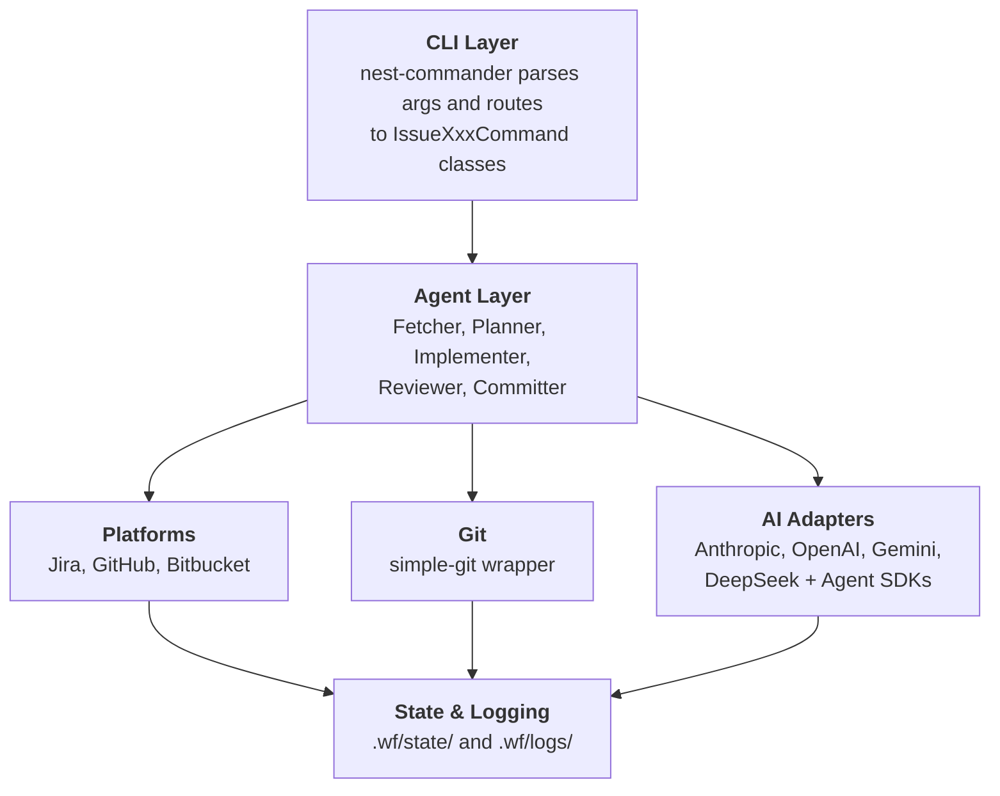

# wf — Issue Workflow CLI

A **NestJS-based CLI** that orchestrates the `issue:*` pipeline — fetch, plan, implement, review, commit, and PR — with pluggable AI providers and issue tracker integrations.

## Features

- 🎯 **Jira Integration** - Create, read, update Jira tickets with Markdown ↔ ADF conversion
- 🌳 **Git Automation** - Branch management, conventional commits, and more
- 🤖 **AI-Powered** - Claude integration for intelligent planning and code generation
- 💾 **State Management** - Pause and resume workflows at any point
- ✨ **Beautiful CLI** - Colored output, progress indicators, and interactive prompts

## Table of Contents

- [Installation](#installation)
- [Configuration](#configuration)
- [Usage](#usage)
- [Commands](#commands)
  - [Issue API](#issue-api)
  - [Workflow Commands](#workflow-commands)
- [Workflows](#workflows)
- [Architecture](#architecture)
- [Development](#development)
- [Testing](#testing)

## Prerequisites

- **Node.js >= 22.17** (pinned in `.nvmrc`; run `nvm use` to activate)
- **Yarn** (package manager)

## Installation

```bash
# Clone the repository
cd /Users/tafadzwagonera/Projects/wf

# Activate the pinned Node version
nvm use

# Install dependencies
yarn install

# Build the project
yarn build

# Link globally (optional)
npm link
```

## Configuration

Create one of these files in the consumer project root:

- `wf.config.js`
- `wf.config.mjs`
- `wf.config.ts`
- `wf.config.mts`
- `wf.config.yaml`
- `wf.config.yml`

When multiple files exist, `wf` uses this precedence order from top to bottom. When `--repos` points to a local checkout, `wf` bootstraps config from that repository instead of the caller's current working directory.

### JavaScript / TypeScript Example

```ts
import { defineConfig } from 'wf/config';

export default defineConfig({
  tracker: 'jira',
  ai: [
    {
      provider: 'anthropic',
      apiKey: process.env.ANTHROPIC_API_KEY,
      model: 'claude-sonnet-4-20250514',
      default: true,
    },
    {
      provider: 'google',
      apiKey: process.env.GEMINI_API_KEY,
      model: 'gemini-2.5-pro',
    },
  ],
  atlassian: {
    baseUrl: 'https://yourcompany.atlassian.net',
    email: 'your-email@company.com',
    jira: {
      apiToken: process.env.ATLASSIAN_JIRA_API_TOKEN,
      defaultProject: 'WBP',
    },
    bitbucket: {
      apiToken: process.env.ATLASSIAN_BITBUCKET_API_TOKEN,
      workspace: 'your-workspace',
    },
  },
  github: {
    token: process.env.GITHUB_TOKEN,
    defaultRepo: 'owner/repo',
  },
  git: {
    defaultBranch: 'develop',
    commitFormat: 'auto',
  },
  log: {
    level: 'info',
  },
  stages: {
    plan: {
      provider: 'anthropic',
      model: 'claude-sonnet-4-20250514',
    },
    implement: {
      provider: 'anthropic',
      model: 'claude-sonnet-4-20250514',
      agent: true,
      verificationConditions: {
        policyFile: 'verification.policy.json',
      },
    },
    review: {
      provider: 'google',
      model: 'gemini-2.5-pro',
      agent: false,
    },
  },
});
```

### YAML Example

```yaml
tracker: jira
ai:
  - provider: anthropic
    apiKey: ${ANTHROPIC_API_KEY}
    model: claude-sonnet-4-20250514
    default: true
atlassian:
  baseUrl: https://yourcompany.atlassian.net
  email: your-email@company.com
  jira:
    apiToken: ${ATLASSIAN_JIRA_API_TOKEN}
    defaultProject: WBP
log:
  level: info
stages:
  plan:
    provider: anthropic
    model: claude-sonnet-4-20250514
  implement:
    provider: anthropic
    model: claude-sonnet-4-20250514
    agent: true
    verificationConditions:
      policyFile: verification.policy.json
  review:
    provider: google
    model: gemini-2.5-pro
    agent: false
```

Example verification manifest:

```json
{
  "version": 1,
  "baseline": [
    { "id": "format", "run": "npm run format", "policy": "enforced" },
    { "id": "lint", "run": "npm run lint", "policy": "enforced" },
    { "id": "build", "run": "npm run build", "policy": "enforced" }
  ]
}
```

### TypeScript Config Support

- Bun and Deno support TypeScript config files natively.
- Node.js supports TypeScript configs natively on `>= 22.13.0` when started with `--experimental-strip-types`.
- Otherwise install `jiti@>=2.2.0` in the consumer project. `wf` does not install it for you.

```bash
npm install --save-dev jiti
```

```bash
node --experimental-strip-types ./node_modules/.bin/wf issue:fetch WBP-2971
```

### JavaScript Config Module Formats

- `wf.config.js` supports both `module.exports = { ... }` and `export default { ... }`.
- In repositories whose nearest `package.json` sets `"type": "module"`, `wf.config.js` may still use CommonJS exports. This is useful when `issue:generate --repos <local-checkout>` or another repo-scoped command bootstraps config from a sibling checkout that has not renamed the file to `.cjs`.

### Defaults and Notes

- Built-in defaults cover provider/model selection, branch prefixes, workflow directory, and log level. State and log directories are fixed at `~/.wf/state` and `~/.wf/logs` respectively and are not configurable.
- `ai[].provider` selects the backing AI provider for each entry.
- `ai[].default` is optional when only one provider is configured, and required when two or more providers are configured.
- `ai[].maxTokens` is only applied to Gemini provider entries using Gemini models; other providers ignore it.
- `stages.generate`, `stages.plan`, `stages.review`, and `stages.implement` accept `{ provider, model, agent? }`.
- `stages.commit` accepts `{ provider, model }`.
- Stage targets explicitly override the default `ai.provider` and `ai.model`.
- Prefer `verificationConditions.policyFile` to point at a repository-owned verification manifest. This keeps baseline verification policy tool-agnostic and reusable from CI or other executors.
- `verificationConditions.scripts` remains supported as a fallback when a manifest is not present.
- Manifest baseline checks run in declaration order. Recommended sequence: `format` → `lint --fix` → `lint` → `build`. This removes formatting noise before the final lint/build gate and makes retries focus on real code issues.
- Prefer portable wrappers such as `npm run lint`, `bash ./scripts/verify.sh`, or `node ./scripts/verify.mjs` instead of relying on executable bits or shell-specific features.
- `fetch` cannot be overridden.
- `wf config get` and `wf config list` read the normalized runtime config.
- `wf config set` is advisory only and points you at the config file to edit.

### Generate API Tokens

**Anthropic API Key:**

- Go to: https://console.anthropic.com/settings/keys
- Create a new API key

**Jira API Token:**

- Go to: https://id.atlassian.com/manage-profile/security/api-tokens
- Create a new API token
- Ensure your Jira user has necessary project permissions

**BitBucket API Token** (for BitBucket tracker support):

- Go to: BitBucket Settings → Personal Settings → App passwords → API tokens
- Create a new token with required scopes:
  - `repository:read` - Read repository data
  - `issue:read` - Read issues
  - `issue:write` - Create and update issues
  - `pullrequest:read` - Read pull requests
- Copy the generated token
- Set `atlassian.bitbucket.apiToken` and `atlassian.bitbucket.workspace` in `wf.config.*`

**⚠️ Note:** BitBucket app passwords were deprecated on September 9, 2025. Only API tokens are supported.

## Usage

### Quick Start

```bash
# List available workflows
yarn start list

# Run a workflow
yarn start run test-workflow

# Fetch a ticket and generate a plan
wf issue:fetch WBP-2971 --tracker jira
wf issue:plan WBP-2971 --action fix

# Run the complete issue workflow in one command
wf issue WBP-2971 --from fetch --to commit --action fix
```

## Commands

### Issue API

The issue API is a suite of commands for the full ticket lifecycle: fetch → plan → implement → review → commit. Commands prefixed with `issue:` are focused steps; `issue` orchestrates them together.

---

#### `wf issue:fetch <ticket-key>`

<!-- BEGIN GENERATED COMMAND DOCS: issue:fetch -->
Fetch ticket description from a tracker. NB: This command will override the locally generated artifact with the ticket description fetched from the specified tracker

```bash
# Fetch ticket from primary tracker
wf issue:fetch WBP-2971

# Specify tracker and format
wf issue:fetch WBP-2971 --tracker jira --format md
```

**Options:**

| Flag | Description |
| ---- | ----------- |
| `--dry-run` | Preview the fetch operation without making changes |
| `-f, --format <format>` | Output format (json\|md\|yaml\|yml) |
| `-t, --tracker <tracker>` | Target tracker (jira\|github\|bitbucket) |
| `-r, --repos <repos...>` | Space-separated repositories; only the first repo is used and additional repos are ignored with a warning |
| `-s, --silent` | Suppress decorative output and interactive prompts. Emits only the file path for piping |
<!-- END GENERATED COMMAND DOCS: issue:fetch -->

**Output:** saves to `./<tracker>/<ticket-key>.<format>` (e.g., `./jira/WBP-2971.md`).

---

#### `wf issue:plan <ticket-key>`

<!-- BEGIN GENERATED COMMAND DOCS: issue:plan -->
Plan ticket implementation from a local artifact or repo-scoped custom artifact. If a local artifact is not found, the command will attempt to fetch it from the primary tracker. Use --force to fetch and recreate artifacts. Targeted verification commands are interpreted as repo-root-relative: redundant `cd <repo>` prefixes are normalized away, while commands that change directories outside the selected repository are rejected.

```bash
# Create a custom feature plan from a markdown artifact
wf issue:plan --action feature --custom bar.md

# Prefer the repo-scoped custom artifact when a repo is supplied
wf issue:plan --action feature --custom bar.md --repos repo-a

# Plan a fix for a ticket
wf issue:plan WBP-2971 --action fix

# Force re-fetch before planning
wf issue:plan WBP-2971 --action fix --force --tracker jira
```

**Options:**

| Flag | Description |
| ---- | ----------- |
| `-a, --action <action>` | Resolution action (feature\|fix\|investigate) |
| `-c, --custom <source.md>` | Custom markdown source artifact to synthesize into a canonical plan (mutually exclusive with <ticket-key>) |
| `--dry-run` | Preview the plan operation without making changes |
| `--force` | Force fetch and recreate ticket artifact before planning |
| `-f, --format <format>` | Output format for plan (json\|md\|yaml\|yml) |
| `-t, --tracker <tracker>` | Tracker to fetch from if local artifact not found |
| `-r, --repos <repos...>` | Space-separated list of repositories affected by this ticket (workspace/repo or repo-name) |
| `-s, --silent` | Suppress decorative output and interactive prompts. Emits only the plan path for piping |
<!-- END GENERATED COMMAND DOCS: issue:plan -->

Targeted verification commands are stored as **repo-root-relative** commands. If the plan generator emits a redundant `cd <selected-repo> && ...`, `issue:plan` normalizes it before writing the artifact. If a targeted check tries to `cd` outside the selected repo, the plan is rejected.

When `--repos` is present, filename-only custom sources are resolved against the repo-scoped `~/.wf/<repo>/` artifact directory before cwd-relative paths.

**Output:** saves to `./<tracker>/YYYY-MM-DD-<hash>-<action>-plan.<format>` for both ticket-backed and custom plans. A sidecar `.<format>.sources.json` manifest records the original ticket key or custom source name so `issue:implement` can resolve the artifact later.

---

#### `wf issue:review [source]`

<!-- BEGIN GENERATED COMMAND DOCS: issue:review -->
AI-powered code review of local repository changes, ticket-associated pull requests, or pull request diffs with nested trace provenance, issue-local suggestions, and diff-aligned inline comment anchors

```bash
# Review current repo changes
wf issue:review

# Review a ticket and associated pull requests from credentialed adapters using a remote repo hint
yarn start issue:review WBP-3057 -r service-bookingv3

# Review a ticket and its associated pull requests across credentialed repos
wf issue:review WBP-2971 --tracker jira --repos service-tourv3

# Review a ticket PR remotely without a local checkout; fails fast if local fallback would target cwd
yarn start issue:review CTRL-280 -r api-gateway-v1

# Review a pull request and post review comments with diff-aligned inline anchors
wf issue:review https://bitbucket.org/workspace/repo/pull-requests/160 --comment
```

**Options:**

| Flag | Description |
| ---- | ----------- |
| `--comment` | Post review as a comment on supported pull requests |
| `--criteria <path>` | Path to a markdown file with additional review criteria to append to the defaults |
| `--dry-run` | Preview the review operation without making changes |
| `-f, --format <format>` | Output format (json\|md\|yaml\|yml) - default: md |
| `-o, --output <path>` | Save review to file |
| `-t, --tracker <tracker>` | Tracker (jira\|github\|bitbucket) used to resolve a ticket source; defaults to the configured primary tracker |
| `--replace-criteria <path>` | Path to a markdown file whose criteria replace the default review guidelines entirely |
| `-r, --repos <repos...>` | Space-separated repositories; used as remote PR-discovery hints for ticket review, and as local review roots when the repositories exist on disk |
| `-s, --silent` | Suppress decorative output and interactive prompts. Emits only the review artifact path for piping |
<!-- END GENERATED COMMAND DOCS: issue:review -->

Accepts three source modes:

| Source                 | Description                                                                                                                     |
| ---------------------- | ------------------------------------------------------------------------------------------------------------------------------- |
| _(none)_               | Review staged/unstaged changes in the current repo, or all repos listed in `--repos`                                            |
| `ABC-123`              | Fetch ticket context and review associated pull requests; `--repos` provides remote PR-discovery hints and local fallback roots |
| `https://github.com/…` | Fetch and review a GitHub or Bitbucket pull request                                                                             |

When a ticket key is supplied, `issue:review` fetches ticket context from the configured tracker, then fans out PR discovery across registered adapters that have explicit credentials in `wf.config.*`. It reviews matching PR diffs first, in deterministic order, and the trace output uses nested call stacks plus frame-aligned state transitions so downstream dependencies and variable changes stay visible together.

**Staged file exclusions:** before computing the diff for review, `issue:review` stages all local changes while automatically excluding wf tooling artifacts: `.wf/**` runtime directories, `wf.config.{js,mjs,ts,mts,yaml,yml}` files, and `dist/` build output. These files are created by wf itself inside target repos and are not part of the ticket's code changes.

`--repos` serves two roles in ticket mode:

- it provides the remote repository hints used for PR discovery
- when the same repositories exist locally, it also defines the local roots for fallback review

If no `--repos` value is supplied and adapters cannot determine a remote repository on their own, the command now exits with an actionable error instead of guessing from the current directory.

If `--repos` is supplied for ticket review but a listed repository is not available as a local path or sibling directory, remote PR review can still succeed. However, if no PR is found, the command now exits with an actionable error instead of falling back to reviewing the current directory.

The current review output keeps `Call Stack` and `State Transition` in the same order before any trailing unmatched `Suggestions`, with `Approval Status` after `Suggestions`. Paired model suggestions now render directly under their corresponding issues in terminal output, exported text, workflow artifacts, and PR summary comments. Each trace section includes explicit provenance text so the output says whether the trace is evidence-based from an agent backend, best-effort from the standard SDK path, or unavailable. The `Call Stack` section renders as a nested tree of concrete frames, and `State Transition` shows the variable changes observed at each frame.

After displaying the review, an interactive TTY session prompts "Would you like to discuss the review?" When accepted, the user can ask follow-up questions about the review findings. The conversation is persisted to `~/.wf/<repo>/review-conversation.json`. The prompt is suppressed in `--silent` mode and non-interactive (no TTY) sessions. Follow-up chat honours the same stage config as the review or plan that preceded it: when `stages.review.agent` (or `stages.plan.agent`) is `true`, each chat turn routes through the agent SDK's native multi-turn session; otherwise it routes through standard completions with the correct stage-level provider and model.

When `--comment` is used on a pull request, inline review comments use destination-side changed diff lines. If the model returns the wrong changed line but the issue text clearly references a different changed line in the same file, wf prefers the stronger semantic match first. Otherwise, if the model returns an invalid changed line for a file, wf remaps it to the nearest changed destination-side line in that file before posting. If the file has no usable destination-side changed line, wf omits the inline line anchor instead of posting an invalid one.

---

#### `wf issue:create <input>`

<!-- BEGIN GENERATED COMMAND DOCS: issue:create -->
Create tickets on various trackers from standardized input (file or stdin). When stages.create.verificationConditions.scripts is configured, validates the ADF payload before sending and uses AI self-correction to fix wiki markup leaks

```bash
# Create ticket from JSON on primary tracker
wf issue:create ticket.json

# Create on a specific tracker and override the Jira project
wf issue:create ticket.md --tracker jira --ticket-project WBP --type story

# Create Jira ticket with project-specific priority resolution
wf issue:create ticket.md --tracker jira --ticket-project WBP --priority medium

# Dry-run a repo-scoped generated Jira artifact before creation
wf issue:create 2026-05-12-d38b5be9-ticket-description.md --ticket-project WBP -r terraform-aws --dry-run

# Live smoke-test a Jira description update using a generated artifact; --live requires --confirm-live-update and shows a y/N prompt before the PUT
nr test:manual -- test-issue-update-jira-adf-smoke WBP-3092 --description-file /Users/tafadzwagonera/.wf/terraform-aws/jira/2026-05-13-3d6f5adb-ticket-description.md --live --confirm-live-update
```

**Options:**

| Flag | Description |
| ---- | ----------- |
| `--dry-run` | Validate without creating - preview only |
| `-f, --format <format>` | Input format (json\|md\|yaml\|yml) - overrides file extension detection; required when reading from stdin |
| `-t, --tracker <tracker>` | Target tracker (jira\|github\|bitbucket) - default from config |
| `-r, --repos <repos...>` | Space-separated repositories; only the first repo is used for artifact lookup and others are ignored with a warning |
| `--ticket-project <project>` | Project key (Jira) or repository (Bitbucket: workspace/repo) - overrides input file |
| `-t, --type <type>` | Issue type (task\|bug\|story\|todo) - overrides input file |
| `--priority <priority>` | Override normalized ticket priority (highest\|high\|medium\|low\|lowest); Jira resolves it to an allowed project value |
| `-s, --silent` | Suppress decorative output and interactive prompts. Emits only the ticket key for piping |
<!-- END GENERATED COMMAND DOCS: issue:create -->

When creating Jira tickets, `wf` resolves the requested priority against Jira create metadata for the target project and issue type. Exact allowed names win first; otherwise normalized values such as `medium` can resolve to project values such as `Minor`. If priority is hidden from the create screen or Jira still rejects it, `wf` creates the ticket without a priority field.

For Jira, `issue:create` converts generated Markdown descriptions into Jira ADF before sending the create request. Inline Markdown delimiters in plain-text fields such as summaries are stripped, and inline-code spans in descriptions are preserved as Jira ADF inline code marks without leaking Jira wiki markers like `{{value}}`. Use `--dry-run` to inspect the formatting summary before creating a ticket.

When `stages.create.verificationConditions.scripts` is configured in `wf.config.*`, `issue:create` runs each script against the built ADF payload before sending it to Jira. If validation fails and a `stages.create.provider` is set, the command feeds the structured errors back to the AI to regenerate the description markdown, re-converts to ADF, and re-validates — repeating until clean or stalled (2 consecutive non-improving passes). This catches wiki markup leaks such as orphan `{noformat}` tokens and `{{monospace}}` markers that the deterministic normalizer cannot handle. The `--dry-run` flag also runs the validation scripts and reports pass/fail without sending to Jira.

```js
// wf.config.js — example create stage with ADF verification
stages: {
  create: {
    provider: 'openai',             // optional: enables AI self-correction
    verificationConditions: {
      scripts: {
        format: 'npm run test:manual -- test-verify-request-format',
      },
    },
  },
}
```

---

#### `wf issue:generate <sources...>`

<!-- BEGIN GENERATED COMMAND DOCS: issue:generate -->
Generate ticket descriptions from local files, repo-scoped artifacts via --repos, URLs, or Jira keys. Local .md, .json, .yaml, and .yml files that parse as tickets are imported as tickets; files that are not recognized as ticket-formatted content remain plain file sources. When --repos points to a local checkout, wf bootstraps config from that repo and accepts either module.exports or export default in wf.config.js, including ESM repos. Generated output enforces formal writing conventions (no contractions, active voice, British English) before display or save. Can use an agent backend when stages.generate.agent: true is configured

```bash
# Generate ticket from a URL
wf issue:generate https://example.com/spec

# Generate from a Slack thread permalink with query params
wf issue:generate "https://workspace.slack.com/archives/C0AP5MMCP53/p1775650646860809?thread_ts=1775650646.860809&cid=C0AP5MMCP53"

# Generate from a repo-scoped artifact (requires -r, --repos)
wf issue:generate itinerary-pdf-generation.md -r service-tourv3

# Save with overridden title
wf issue:generate ./requirements.md --title "Add OAuth2" --save

# Silent mode: pipe generated ticket directly into issue:create
wf issue:generate ./spec.md -s | wf issue:create

# Silent mode: pipe saved artifact path to issue:create
wf issue:generate ./spec.md --save --silent | xargs wf issue:create
```

**Options:**

| Flag | Description |
| ---- | ----------- |
| `--dry-run` | Preview the generate operation without making changes |
| `-f, --format <format>` | Output format (json\|md\|yaml\|yml) - default from config |
| `-o, --output <path>` | Output file path - default: stdout |
| `-t, --tracker <tracker>` | Tracker for ticket sources (jira\|github\|bitbucket) |
| `--priority <priority>` | Override ticket priority (highest\|high\|medium\|low\|lowest) |
| `-r, --repos <repos...>` | Space-separated list of repositories affected by this ticket (workspace/repo or repo-name) |
| `--save` | Save generated ticket to tracker directory |
| `-s, --silent` | Suppress decorative output and interactive prompts (clarification, disambiguation). Emits only file paths (with --save/--output) or raw ticket content for piping |
| `-t, --title <title>` | Override generated title with custom title |
| `--type <type>` | Override ticket type (task\|bug\|story\|epic) |
<!-- END GENERATED COMMAND DOCS: issue:generate -->

Generated artifacts are saved with a sidecar manifest file named `YYYY-MM-DD-<hash>-ticket-description.sources.json` in the same directory. Use `wf issue:generate:lookup <hash>` to print the original source list. Generated `issue:generate` output enforces formal writing conventions before serialisation: contractions are expanded to their formal equivalents, and the prompt instructs the model to use active voice, third-person perspective, formal British English spelling, and no informal language.

When `--repos` is provided, filename-only local sources are resolved against the repo-scoped artifact directory first, then the live checkout path. Without `--repos`, unresolved bare filenames stay cwd-relative and the command now tells you to retry with `--repos <repo>` when the source looks like a repo-scoped artifact. When the first `--repos` entry resolves to a local checkout, `issue:generate` also bootstraps AI provider and stage config from that repository before command execution.
Slack permalinks that include query parameters should be quoted when invoked from shells such as `zsh` or `bash`.

In interactive mode (TTY, no `--silent`), the command performs a pre-synthesis clarification pass: the AI identifies unaddressed ambiguities, assumptions, or risks in the sources, and prompts the user to answer them before generating the ticket. Sources that already acknowledge their own risks and assumptions are not re-surfaced. The `--silent` flag suppresses all decorative output and interactive prompts, emitting only file paths (with `--save`/`--output`) or raw ticket content suitable for piping.

---

#### `wf issue:commit [ticket-key]`

<!-- BEGIN GENERATED COMMAND DOCS: issue:commit -->
Create git commit with AI-generated message (auto-detects ticket from branch; fails hard if .gitignore is staged)

```bash
# AI-generated commit message
wf issue:commit WBP-2971

# Run the commit stage from source with conventional commits enabled
yarn start issue:commit -c

# Force conventional format
wf issue:commit WBP-2971 --conventional --tracker jira
```

**Options:**

| Flag | Description |
| ---- | ----------- |
| `-c, --conventional` | Force conventional commits format |
| `--dry-run` | Preview the commit operation without making changes |
| `-m, --message <message>` | Manual commit message (bypasses AI generation) |
| `--no-ai` | Disable AI generation and require manual message |
| `-t, --tracker <tracker>` | Tracker (jira\|github\|bitbucket) |
| `-r, --repos <repos...>` | Space-separated repositories; only the first repo is used and additional repos are ignored with a warning |
<!-- END GENERATED COMMAND DOCS: issue:commit -->

**Branch detection:** ticket keys are extracted from the branch name using the pattern `[A-Z]+-\d+` (e.g., `feature/WBP-2971__add-oauth` → `WBP-2971`).

**Staged file exclusions:** when no files are pre-staged, `issue:commit` stages all local changes while automatically excluding wf tooling artifacts: `.wf/**` runtime directories, `wf.config.{js,mjs,ts,mts,yaml,yml}` files, and `dist/` build output. If `.gitignore` is already staged or explicitly included, `issue:commit` fails hard instead of creating a commit. These are tooling inputs created by wf inside target repos and should never appear in ticket commits.

---

#### `wf issue:pr [ticket-key]`

<!-- BEGIN GENERATED COMMAND DOCS: issue:pr -->
Create a pull request from a plan artifact (auto-detects ticket from branch)

```bash
# Create a PR from a fix plan
wf issue:pr WBP-2971 --action fix

# Dry-run to preview PR title and body
wf issue:pr WBP-2971 --dry-run
```

**Options:**

| Flag | Description |
| ---- | ----------- |
| `-a, --action <action>` | Resolution action type (feature\|fix\|investigate) |
| `-b, --base <base>` | Target branch for the PR (default: main) |
| `--dry-run` | Preview the PR creation without making changes |
| `-t, --tracker <tracker>` | Tracker (jira\|github\|bitbucket) |
| `-r, --repos <repos...>` | Space-separated repositories; only the first repo is used and additional repos are ignored with a warning |
| `-t, --title <title>` | Override the PR title |
| `-s, --silent` | Suppress decorative output and interactive prompts. Emits only the PR URL for piping |
<!-- END GENERATED COMMAND DOCS: issue:pr -->

---

#### `wf issue <ticket-key-or-plan-token>`

Orchestrate the full issue workflow in a single command. Runs any contiguous range of stages: `fetch → plan → implement → review → commit`.

```bash
# Full workflow from scratch
wf issue WBP-2971 --from fetch --action fix

# Resume from plan and run through review
wf issue WBP-2971 --from plan --to review --action fix

# Resume from implement (auto-discovers existing plan)
wf issue WBP-2971 --from implement

# Resume from a canonical hashed plan artifact without --action
wf issue 2026-05-04-1a2b3c4d-fix-plan.json --from implement

# Force refresh even when local artifacts already exist
wf issue WBP-2971 --from fetch --action fix --force

# Interactive chat mode after plan and review stages
wf issue WBP-2971 --from fetch --action investigate --chat-mode

# Bitbucket with repos override
wf issue 123 --from fetch --to review --action fix \
  --tracker bitbucket --repos myworkspace/myrepo

# Multi-repo: implement stage runs once per repo in sequence
wf issue WBP-3070 --from implement --action feature -r terraform-aws service-document-v1

# Preview the full workflow without making changes
wf issue WBP-2971 --from fetch --action fix --dry-run
```

**Options:**

| Flag                        | Description                                                                                                                                        | Default            |
| --------------------------- | -------------------------------------------------------------------------------------------------------------------------------------------------- | ------------------ |
| `--from <stage>`            | **(Required)** Start stage: `fetch \| plan \| implement \| review \| commit`                                                                       | —                  |
| `--to <stage>`              | Stop stage (inclusive)                                                                                                                             | `commit`           |
| `--action <action>`         | Resolution action: `feature \| fix \| investigate` — required when `plan` stage runs, optional when resuming from a canonical hashed plan artifact | —                  |
| `-t, --tracker <tracker>` | Tracker: `jira \| github \| bitbucket`                                                                                                            | `TRACKER` |
| `--pr`                      | Create PR after commit stage                                                                                                                       | false              |
| `--chat-mode`               | Open AI chat after `plan` and `review` stages                                                                                                      | —                  |
| `--force`                   | Recreate artifacts instead of using the default skip-existing behavior                                                                             | false              |
| `--dry-run`                 | Preview every stage without making changes, including branch and file work                                                                         | —                  |
| `-r, --repos <repos...>`    | First repo anchors artifact storage; when multiple repos are given, the implement stage runs once per repo in sequence                             | current repo       |

**Stage order and artifacts:**

| Stage       | Artifact                                                                                    |
| ----------- | ------------------------------------------------------------------------------------------- |
| `fetch`     | `./<tracker>/<ticket-key>.md`                                                              |
| `plan`      | `./<tracker>/YYYY-MM-DD-<hash>-<action>-plan.json` with a `.sources.json` sidecar manifest |
| `implement` | working tree updates in the selected repo plus branch setup                                 |
| `review`    | `./<tracker>/<ticket-key>-review.md`                                                       |
| `commit`    | _(display only — commit commands printed for confirmation)_                                 |

**Branch naming:** `issue` generates a branch name in the format `<prefix>/<TICKET-KEY>__<slug>`, where prefix is controlled by `BRANCH_PREFIX_*` env vars (`feature`, `bugfix`, `chore`).

---

#### `wf issue:implement <ticket-key-or-plan-token>`

<!-- BEGIN GENERATED COMMAND DOCS: issue:implement -->
Carry out an implementation plan from a ticket-backed, hashed, or custom plan artifact. Delegates the generate-and-verify loop to the Anthropic or OpenAI agent backend based on stages.implement.provider. Progress events are streamed to the terminal so you can follow task and tool activity while edits are being generated. Both backends emit stable SDK task and tool progress lines plus explicit file mutation logs and verification logs so terminal output stays human-readable while the agent works. Verification commands are expected to be repo-root-relative; stale plan artifacts that still embed redundant repo-selection `cd` prefixes are normalized, while cross-repo directory jumps are treated as setup errors. Set stages.implement.provider to anthropic or openai in wf.config to select the backend. The Anthropic backend explicitly loads ~/.claude/CLAUDE.md and the repository-root CLAUDE.md, warning when either file is missing. The OpenAI backend loads ~/.openai/OPENAI.md and the repository-root .openai/OPENAI.md with the same warning behavior and only exposes an exact-match verify_command tool for whitelisted verification commands. When running from source, use `yarn start issue:implement ...` for the implementation stage and `yarn start issue:commit -c` to stage the final conventional commit once the work is accepted. Unsupported providers (google, deepseek) fail fast with a clear error listing supported providers. Run issue:fetch then issue:plan before calling this command for ticket-backed workflows. When a hashed plan artifact is provided, the action is inferred from the filename/manifest and `--action` becomes optional, but any supplied action is still validated against the resolved artifact. Examples: wf issue:implement PROJ-123 | wf issue:implement 2026-05-04-1a2b3c4d-fix-plan.json | wf issue:implement PROJ-123 --repos my-repo | wf issue:implement PROJ-123 --repos repo-a repo-b | wf issue:implement PROJ-123 --dry-run

**Options:**

| Flag | Description |
| ---- | ----------- |
| `-t, --tracker <tracker>` | Tracker to fetch from if local artifact not found |
| `--dry-run` | Preview branch, file, and investigation work without making changes |
| `--model-routing <mode>` | Model selection strategy: auto (detect mechanical vs creative), default (force default model), mechanical (force cheaper model). Defaults to auto. |
| `-r, --repos <repos...>` | Space-separated repositories; first repo anchors artifact lookup, all repos remain available as implementation context |
<!-- END GENERATED COMMAND DOCS: issue:implement -->

`issue:implement` only supports plans that affect a single repository. If the plan's `repositoriesAffected` lists more than one repo, the command exits with an error. Use `wf issue -r <repos...>` to run implementation per repo when the plan spans multiple repositories.

When a canonical hashed plan artifact is detected, the CLI prints a yellow warning with the decoded artifact and action so you can confirm the resolved plan before implementation starts. Supplying `--action` alongside that artifact still performs a strict validation check against the filename and manifest contents.

Short hashed filenames (`<hash>-<action>-plan.<ext>`) are no longer accepted by workflow commands. To normalize existing local artifacts under `~/.wf`, run:

```bash
ts-node -r tsconfig-paths/register scripts/migrate-short-hash-plan-artifacts.ts
```

Runtime backend selection is separate from plan metadata:

- `plan.provider` tags the plan/model for analysis and reporting.
- `stages.implement.provider: anthropic` selects the Anthropic agent backend.
- `stages.implement.provider: openai` selects the OpenAI agent backend.
- Unsupported providers (`google`, `deepseek`) fail fast with a clear error.
- The CLI streams progress while the agent is working. Anthropic emits stable Claude Agent SDK task and tool lines; OpenAI emits structured progress events covering tool calls, reasoning, token usage, context compaction, and agent handoffs.
- The OpenAI backend exposes seven tools: `read_file` (with line-range support), `write_file`, `edit_file` (surgical string replacement), `delete_file`, `search_files` (regex grep), `find_files` (glob), and `verify_command` (exact-match whitelist). The turn budget scales with plan step count and target file count (capped at 200).
- The OpenAI backend classifies errors from the SDK (`MaxTurnsExceededError`, `ToolTimeoutError`, `ToolCallError`, rate limits, auth errors) and fails immediately on rate limits (TPM exhaustion is not recoverable via retry because the context size that caused the limit persists across attempts).
- On completion the OpenAI agent emits turn count, token usage, and a structured summary with four sections: **What I changed**, **Verification run**, **Files** (updated / new / deleted), and **Assumptions / risk note**. If no file writes occurred, the CLI prints `File summary: no file changes were made.`

Example:

```yaml
ai:
  - provider: anthropic
    apiKey: ${ANTHROPIC_API_KEY}
    model: claude-sonnet-4-6
    default: true
  - provider: openai
    apiKey: ${OPENAI_API_KEY}
    model: gpt-5.4-mini
stages:
  implement:
    provider: openai
    model: gpt-5.4-mini
```

The `stages.implement.provider` and `stages.implement.model` values above are runtime implementation settings. The same shape may also appear in generated plan artifacts, but the plan artifact provider is informational and does not change backend selection by itself.

#### Model routing

The `--model-routing` flag controls which model the implement stage uses:

| Value | Behavior | OpenAI default | Anthropic default |
|---|---|---|---|
| `auto` (default) | Detect mechanical vs creative from the plan | gpt-4.1 or gpt-5.1-codex-mini | claude-sonnet-4-6 or claude-haiku-4-5-20251001 |
| `default` | Force the default model for the entire run | gpt-4.1 | claude-sonnet-4-6 |
| `mechanical` | Force the cheaper mechanical model | gpt-5.1-codex-mini | claude-haiku-4-5-20251001 |

In `auto` mode, the adapter detects mechanical tasks by examining plan steps for patterns like "migrate all", "replace every", "update each", or by checking for a high file-to-step ratio (>3) or low complexity with 20+ files.

Override both models in config:

```yaml
stages:
  implement:
    provider: openai
    models:
      default: gpt-4.1
      mechanical: gpt-5.1-codex-mini
```

The primary model resolves from `stages.implement.models.default` → `stages.implement.model` → `ai.$.model` → provider default. The mechanical model resolves from `stages.implement.models.mechanical` → provider default mechanical. When both `model` and `models` are set, `models` takes precedence (it is more specific) and a warning displays the effective configuration.

#### Context compaction

Long-running implement sessions (50+ turns, 30+ file edits) can exhaust per-minute token limits when the full conversation history is re-sent on every API turn.

| Backend | Mechanism | Config |
|---|---|---|
| OpenAI | **Session compaction:** `OpenAIResponsesCompactionSession` with `compactionMode: 'auto'` and a custom `shouldTriggerCompaction` hook that triggers on either candidate-item count thresholds (scaled by plan step count) or when the last observed input token count exceeds 80K tokens. **State pruning:** when input tokens exceed 120K, the adapter directly trims the Runner's in-memory `_generatedItems` — replacing older items with a compact summary while retaining the 20 most recent items. This addresses the SDK architectural gap where session compaction only targets the persistence layer, not the live conversation buffer. | Automatic — no user config needed |
| Anthropic | `autoCompactWindow: 20000` in SDK settings | Compacts when context exceeds ~20K tokens |

When compaction occurs, the Anthropic backend emits a `Status: compacting` progress message. The OpenAI backend logs `[openai-agent] State pruned: removed N items` when adapter-level pruning fires, showing the item count and input token count that triggered it. Cached input tokens are also surfaced in the usage log (e.g. `Usage: 31376 input (12000 cached) / 1063 output tokens`).

#### Incomplete-work loop

When the first implementation pass (which may use a mechanical model in `auto` routing mode) leaves planned files unvisited or produces structural edit validation failures, the adapter runs additional passes with the primary (default) model to complete the remaining work.

**Termination:** the loop stops when either (a) all planned files are touched and no validation failures remain, or (b) the total workload (unvisited files + unique validation failures) does not decrease for 2 consecutive passes. On termination, the adapter logs a summary of remaining work so upstream tooling can take over.

**Context efficiency:** each iteration receives the previous pass's structured summary (`finalOutput` / `result`) so it can focus on remaining work without re-reading already-edited files. The OpenAI adapter returns compact tool results (`{path, status}` for file mutations; omits stdout/stderr for passing verification commands), truncates failing verification output to the last 200 lines, limits `read_file` to 200 lines by default, and returns surrounding code context on edit validation failures — all reducing per-turn context growth.

### Retry strategy

`issue:implement` delegates the generate-and-verify loop to the selected agent backend (Anthropic or OpenAI). The agent drives its own inner loop via built-in tools, iterating until verification passes.

Verification commands are expected to run from the selected repository root. Recent `issue:plan` builds normalize redundant `cd <repo> && ...` wrappers before persisting the plan artifact. `issue:implement` keeps a defense-in-depth fallback for older artifacts and fails fast when a targeted verification command tries to jump outside the selected repository, because retrying code generation cannot fix a mis-scoped verification command.

```bash
# Implement a ticket-backed plan
wf issue:implement WBP-2971 --repos repo-a

# Implement with read-only sibling repo context while still writing only repo-a
wf issue:implement WBP-2971 --repos repo-a repo-b

# Execute a custom plan artifact
wf issue:implement dark-building-creek-fix.json --repos service-tourv3
```

#### Agent backends

Set `stages.implement.provider: anthropic` or `stages.implement.provider: openai` in `wf.config.*` to select the backend. The Anthropic backend loads `~/.claude/CLAUDE.md` and the repository-root `CLAUDE.md`; the OpenAI backend loads `~/.openai/OPENAI.md` and the repository-root `.openai/OPENAI.md`. If a backend-specific file is missing, it logs a yellow warning and continues. The OpenAI backend only exposes an exact-match `verify_command` tool for verification, so non-whitelisted commands are rejected before execution.

```yaml
stages:
  implement:
    provider: openai
    model: gpt-5.4-mini
    narrate: true  # opt-in: narrate the plan before implementation (adds ~500-1K tokens per turn)
```

---

### Bitbucket Repository

All `issue:*` commands that interact with Bitbucket require a `--repos` (`-r`) option.

```bash
# Single repository in full workspace/repo format
wf issue:fetch 123 --tracker bitbucket --repos myworkspace/myrepo

# Single repository using repo name only (uses atlassian.bitbucket.workspace from config)
wf issue:fetch 123 --tracker bitbucket --repos myrepo

# Multiple repositories (space-separated)
wf issue:fetch 123 --tracker bitbucket --repos myworkspace/repo-a myworkspace/repo-b
```

**Repository format:**

- **Full format**: `workspace/repo` — explicit workspace and repository
- **Short format**: `repo` — uses `atlassian.bitbucket.workspace` from config

---

#### `wf config`

Inspect the resolved runtime configuration.

```bash
yarn start config get atlassian.baseUrl
yarn start config set atlassian.email user@example.com
yarn start config list
```

## Architecture

### High-Level Overview

`wf` follows a layered architecture where CLI commands delegate to domain agents, which call AI providers through adapter classes. The system is built on NestJS with dependency injection, using `nest-commander` for CLI argument parsing and command routing.



### Data Flow

Each `issue:*` command follows a consistent pattern:

1. **Command** receives CLI args and resolves config (including repo-scoped config via `--repos`)
2. **Agent** orchestrates the domain logic — fetching tickets, calling AI, writing artifacts
3. **Adapters** translate between wf's internal types and external APIs (Jira REST, GitHub GraphQL, AI chat/agent SDKs)
4. **Artifacts** are written to the file system under `./<tracker>/` or `~/.wf/<repo>/`

The orchestrator command (`wf issue`) chains stages together, passing artifacts forward: `fetch` output feeds `plan`, `plan` output feeds `implement`, and so on.

### Project Structure

```
wf/
├── src/
│   ├── commands/                  # CLI command handlers (one per issue:* stage)
│   │   ├── issue.command.ts       #   orchestrator: chains fetch → plan → implement → review → commit
│   │   ├── issue-fetch.command.ts
│   │   ├── issue-plan.command.ts
│   │   ├── issue-implement.command.ts
│   │   ├── issue-review.command.ts
│   │   ├── issue-commit.command.ts
│   │   ├── issue-create.command.ts
│   │   ├── issue-generate.command.ts
│   │   ├── issue-pr.command.ts
│   │   └── config.command.ts
│   │
│   ├── agents/                    # Domain agents (business logic per stage)
│   │   ├── fetcher.agent.ts       #   fetches ticket data from tracker adapters
│   │   ├── planner.agent.ts       #   generates implementation plans via AI
│   │   ├── implementer.agent.ts   #   drives AI agent backends to write code
│   │   ├── reviewer.agent.ts      #   AI-powered code review with trace provenance
│   │   ├── committer.agent.ts     #   generates commit messages from staged diffs
│   │   └── agent-orchestrator.service.ts
│   │
│   ├── integrations/
│   │   ├── ai/                    # AI provider integration
│   │   │   └── adapters/
│   │   │       ├── anthropic.adapter.ts        # Anthropic completion API
│   │   │       ├── anthropic-agent.adapter.ts  # Claude Agent SDK (agentic mode)
│   │   │       ├── openai.adapter.ts           # OpenAI completion API
│   │   │       ├── openai-agent.adapter.ts     # OpenAI Agents SDK (agentic mode)
│   │   │       ├── gemini.adapter.ts           # Google Gemini API
│   │   │       ├── deepseek.adapter.ts         # DeepSeek API
│   │   │       ├── llm-adapter.factory.ts      # Factory for provider resolution
│   │   │       └── shared-routing.ts           # Model routing (auto/default/mechanical)
│   │   │
│   │   ├── issue-trackers/         # Issue tracker adapters (ticket systems)
│   │   │   ├── jira/              #   Jira REST API (Basic Auth, ADF conversion)
│   │   │   ├── github/            #   GitHub via @octokit/rest
│   │   │   ├── bitbucket/         #   Bitbucket Cloud API
│   │   │   ├── issue-tracker.service.ts      # Tracker resolution and dispatch
│   │   │   └── issue-tracker-adapter.interface.ts # Shared adapter contract
│   │   │
│   │   ├── git/                   # Git operations via simple-git
│   │   ├── jira/                  # Jira-specific services (ADF, metadata)
│   │   └── slack/                 # Slack thread/permalink fetching
│   │
│   ├── config/                    # Configuration loading (wf.config.* resolution, Zod validation)
│   ├── common/                    # Shared types, DTOs, and format converters
│   ├── shared/                    # Logger, preview, and error utilities
│   ├── bootstrap/                 # NestJS app bootstrap and module wiring
│   ├── review/                    # Review output formatting and trace rendering
│   ├── workflows/                 # Workflow definitions and runner
│   └── test/                      # Test utilities and fixtures
│
├── test/manual/                   # Manual smoke tests (run via yarn test:manual)
├── scripts/                       # Build and migration scripts
├── dist/                          # Compiled output (wf binary entry point)
└── wf.config.ts                   # Project's own config (dogfooding)
```

### Key Design Decisions

- **File-system-only state.** No database — all artifacts, state, and logs live under `.wf/` in the target repository or `~/.wf/<repo>/` for repo-scoped artifacts. This keeps wf portable and easy to debug.
- **Per-stage provider overrides.** Each pipeline stage can use a different AI provider and model via `stages.<command>` config, so you can use a cheaper model for planning and a more capable one for implementation.
- **Agent vs completion mode.** Stages that need tool use (implement) run in agent mode via the Claude Agent SDK or OpenAI Agents SDK. Stages that need structured output (plan, review) use the completion API. Controlled by `stages.<command>.agent: true|false`.
- **Adapter pattern.** Platform adapters (Jira, GitHub, Bitbucket) and AI adapters (Anthropic, OpenAI, Gemini, DeepSeek) share a common interface so new providers can be added without changing command or agent code.
- **Config resolution.** `wf` resolves config from the target repository when `--repos` is supplied, not from the caller's cwd. This lets a single wf installation manage many repositories with different settings.

## Development

### Project Setup

```bash
# Clone and enter the project
git clone <repository-url>
cd wf

# Activate the correct Node.js version
nvm use

# Install dependencies
yarn install

# Build the project (compiles TypeScript to dist/)
yarn build

# Link globally so the `wf` command is available system-wide
npm link
```

### Development Workflow

```bash
# Start development mode (watches for changes)
yarn start:dev

# Build for production
yarn build

# Run from source without building (useful for quick iteration)
yarn start <command> [args...]

# Run TypeScript type checks
yarn typecheck

# Run linting
yarn lint

# Run formatting
yarn format
```

### Important: Stale Dist

TypeScript changes have **no effect on the `wf` binary** until `yarn build` (which runs `nest build`) completes. Manual tests bypass this because they use `ts-node` directly, but any invocation via the global `wf` command reads from `dist/`. Always rebuild after code changes.

## Testing

### Unit Tests

Specs are co-located next to their source files as `*.spec.ts`. The project uses Jest 30.

```bash
# Run all unit tests
yarn test

# Run specific test file
yarn test jira.service.spec.ts

# Run with coverage
yarn test:cov
```

### Manual Testing

Manual smoke tests live in `test/manual/` and are run via the `test:manual` script. These use `ts-node` so they always reflect the latest source.

```bash
# Run a named manual smoke test
yarn test:manual test-issue-create-jira-adf-smoke

# Smoke-test shared Anthropic/OpenAI agent progress output
nr test:manual -- test-agent-progress-output

# Live smoke-test a Jira description update from a generated artifact
nr test:manual -- test-issue-update-jira-adf-smoke WBP-3092 --description-file /Users/tafadzwagonera/.wf/terraform-aws/jira/2026-05-13-3d6f5adb-ticket-description.md --live --confirm-live-update

# Test Jira integration
yarn test:manual test-jira

# Diagnose Jira permissions
yarn test:manual diagnose-jira-permissions

# Verify CI scripts use yarn consistently
nr test:manual -- test-ci-yarn-scripts
```

`test-issue-update-jira-adf-smoke` defaults to preview-only mode. `--live` enables the real Jira update path, and `--confirm-live-update` is the explicit mutation safety gate. If `--live` is supplied without `--confirm-live-update`, the harness fails early instead of sending the Jira `PUT`. When both flags are present, the harness prints the full payload preview and then prompts `Update <ticket>? (y/N)` — the update only proceeds if you answer `y` or `Y`.

### Integration Tests

```bash
# Run integration tests
yarn test:e2e
```

## Troubleshooting

### Common Issues

**1. "Jira authentication failed"**

- Verify `atlassian.jira.apiToken` is correct and not expired
- Check user has necessary permissions
- Run diagnostic: `yarn ts-node -r tsconfig-paths/register test/manual/diagnose-jira-permissions.ts`

**2. "Claude API error"**

- Verify the active Anthropic provider entry in `wf.config.*` has a valid `apiKey`
- Check API quota and billing

**3. "Git error"**

- Ensure you're in a git repository
- Check git status and permissions

**4. "Plan file not found"**

- Run `issue:plan` (or `issue --from plan`) before running `implement` or later stages
- If you resume from a ticket key, keep `--action` aligned with the existing plan; if you resume from a canonical hashed plan artifact, the action is decoded automatically and `--action` becomes optional

**5. "Workspace required"**

- Set `atlassian.bitbucket.workspace` in `wf.config.*`, or pass `--repo workspace/repo` (full format)

### Debug Mode

Enable debug logging:

```bash
LOG_LEVEL=debug yarn start issue:fetch PROJ-123
```

## Contributing

1. Fork the repository
2. Create a feature branch
3. Make your changes
4. Add tests
5. Submit a pull request

## License

UNLICENSED

## Support

For issues and questions:

- GitHub Issues: https://github.com/anthropics/claude-code/issues
- Documentation: This README

---

**Built with NestJS, TypeScript, and Claude AI** 🚀
