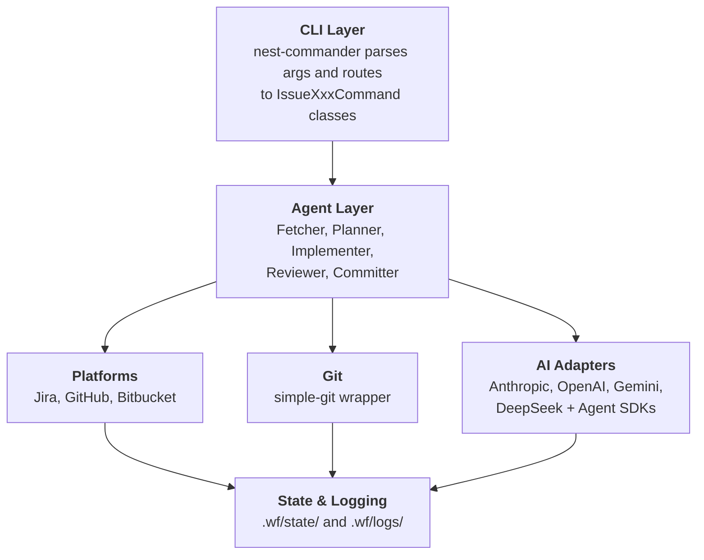

# wf — Issue Workflow CLI

A **NestJS-based CLI** that orchestrates the `issue:*` pipeline — fetch, plan, implement, review, commit, and PR — with pluggable AI providers and issue tracker integrations.

## Features

- 🎯 **Jira Integration** - Create, read, update Jira tickets with Markdown ↔ ADF conversion
- 🌳 **Git Automation** - Branch management, conventional commits, and more
- 🤖 **AI-Powered** - Claude integration for intelligent planning and code generation
- 🩺 **Provider-Aware Diagnostics** - Blank or blocked AI stage responses fail fast with provider/model context instead of generic parse errors
- 💾 **State Management** - Pause and resume workflows at any point
- ✨ **Beautiful CLI** - Colored output, progress indicators, and interactive prompts

## Table of Contents

- [Installation](#installation)
- [Configuration](#configuration)
- [Usage](#usage)
- [Commands](#commands)
  - [Issue API](#issue-api)
  - [Workflow Commands](#workflow-commands)
- [Workflows](#workflows)
- [Key Design Decisions](#key-design-decisions)
- [Development](#development)
- [Testing](#testing)
- [Known Issues](#known-issues)

## Prerequisites

- **Node.js >= 22.17** (pinned in `.nvmrc`; run `nvm use` to activate)
- **Yarn** (package manager)

## Installation

```bash
# Clone the repository
cd /Users/tafadzwagonera/Projects/wf

# Activate the pinned Node version
nvm use

# Install dependencies
yarn install

# Build the project
yarn build

# Link globally (optional)
npm link
```

## Configuration

Create one of these files in the consumer project root:

- `wf.config.js`
- `wf.config.mjs`
- `wf.config.ts`
- `wf.config.mts`
- `wf.config.yaml`
- `wf.config.yml`

When multiple files exist, `wf` uses this precedence order from top to bottom. When `--repos` points to a local checkout, `wf` bootstraps config from that repository instead of the caller's current working directory.

### JavaScript / TypeScript Example

```ts
import { defineConfig } from 'wf/config';

export default defineConfig({
  tracker: 'jira',
  ai: [
    {
      provider: 'anthropic',
      apiKey: process.env.ANTHROPIC_API_KEY,
      model: 'claude-sonnet-4-6',
    },
    {
      provider: 'openai',
      apiKey: process.env.OPENAI_API_KEY,
      model: 'gpt-5.5',
      default: true,
    },
    {
      provider: 'google',
      apiKey: process.env.GEMINI_API_KEY,
      model: 'gemini-2.5-flash',
      maxTokens: 8192,
    },
  ],
  atlassian: {
    baseUrl: 'https://yourcompany.atlassian.net',
    email: 'your-email@company.com',
    jira: {
      apiToken: process.env.ATLASSIAN_JIRA_API_TOKEN,
      defaultProject: 'WBP',
    },
    bitbucket: {
      apiToken: process.env.ATLASSIAN_BITBUCKET_API_TOKEN,
      workspace: 'your-workspace',
    },
  },
  github: {
    token: process.env.GITHUB_TOKEN,
    defaultRepo: 'owner/repo',
  },
  git: {
    commitFormat: 'auto',
    branchNamePattern:
      '^(bugfix|build|chore|ci|docs|feat|feature|fix|perf|performance|refactor|revert|style|test)\\/[A-Z]+-[0-9]+__|-.+$',
  },
  log: {
    level: 'info',
  },
  slack: {
    botToken: process.env.SLACK_BOT_TOKEN,
    userToken: process.env.SLACK_USER_TOKEN,
  },
  stages: {
    generate: {
      provider: 'anthropic',
      backend: 'cli',
    },
    plan: {
      provider: 'anthropic',
      model: 'claude-sonnet-4-6',
    },
    implement: {
      provider: 'anthropic',
      model: 'claude-haiku-4-5-20251001',
      backend: 'cli',
      verificationConditions: {
        policyFile: 'verification.policy.json',
      },
    },
    create: {
      provider: 'anthropic',
      backend: 'cli',
    },
    review: {
      provider: 'anthropic',
      backend: 'cli',
    },
    commit: {
      provider: 'google',
      backend: 'standard',
    },
  },
});
```

### YAML Example

```yaml
tracker: jira
ai:
  - provider: anthropic
    apiKey: ${ANTHROPIC_API_KEY}
    model: claude-sonnet-4-6
  - provider: openai
    apiKey: ${OPENAI_API_KEY}
    model: gpt-5.5
    default: true
  - provider: google
    apiKey: ${GEMINI_API_KEY}
    model: gemini-2.5-flash
    maxTokens: 8192
atlassian:
  baseUrl: https://yourcompany.atlassian.net
  email: your-email@company.com
  jira:
    apiToken: ${ATLASSIAN_JIRA_API_TOKEN}
    defaultProject: WBP
  bitbucket:
    apiToken: ${ATLASSIAN_BITBUCKET_API_TOKEN}
    workspace: your-workspace
git:
  commitFormat: auto
  branchNamePattern: "^(bugfix|build|chore|ci|docs|feat|feature|fix|perf|performance|refactor|revert|style|test)\\/[A-Z]+-[0-9]+__|-.+$"
log:
  level: info
slack:
  botToken: ${SLACK_BOT_TOKEN}
  userToken: ${SLACK_USER_TOKEN}
stages:
  generate:
    provider: anthropic
    backend: cli
  plan:
    provider: anthropic
    model: claude-sonnet-4-6
  implement:
    provider: anthropic
    model: claude-haiku-4-5-20251001
    backend: cli
    verificationConditions:
      policyFile: verification.policy.json
  create:
    provider: anthropic
    backend: cli
  review:
    provider: anthropic
    backend: cli
  commit:
    provider: google
    backend: standard
```

Example verification manifest:

```json
{
  "version": 1,
  "baseline": [
    { "id": "format", "run": "yarn format", "policy": "enforced" },
    { "id": "lint", "run": "yarn lint", "policy": "enforced" },
    { "id": "build", "run": "yarn build", "policy": "enforced" }
  ]
}
```

### TypeScript Config Support

- Bun and Deno support TypeScript config files natively.
- Node.js supports TypeScript configs natively on `>= 22.13.0` when started with `--experimental-strip-types`.
- Otherwise install `jiti@>=2.2.0` in the consumer project. `wf` does not install it for you.

```bash
yarn add --dev jiti
```

```bash
node --experimental-strip-types ./node_modules/.bin/wf issue:fetch WBP-2971
```

### JavaScript Config Module Formats

- `wf.config.js` supports both `module.exports = { ... }` and `export default { ... }`.
- In repositories whose nearest `package.json` sets `"type": "module"`, `wf.config.js` may still use CommonJS exports. This is useful when `issue:generate --repos <local-checkout>` or another repo-scoped command bootstraps config from a sibling checkout that has not renamed the file to `.cjs`.

### Defaults and Notes

- Built-in defaults cover provider/model selection, branch prefixes, workflow directory, and log level. State and log directories are fixed at `~/.wf/state` and `~/.wf/logs` respectively and are not configurable.
- `ai[].provider` selects the backing AI provider for each entry.
- `ai[].default` is optional when only one provider is configured, and required when two or more providers are configured.
- `ai[].maxTokens` is only applied to Gemini provider entries using Gemini models; other providers ignore it.
- `stages.generate`, `stages.plan`, `stages.review`, and `stages.implement` accept `{ provider, model, backend? }`.
- `stages.plan`, `stages.implement`, and `stages.review` accept `maxTokens?: number` to set the output token ceiling for the stage (default: 16384). Increase this if the model truncates verbose JSON responses. This setting applies to the standard (non-CLI) backend only; the CLI backend manages token limits internally but detects truncation (`stop_reason: 'max_tokens'`) automatically.
- `stages.plan`, `stages.review`, and `stages.generate` accept `timeoutMs?: number` to set the wall-clock timeout for CLI backend invocations (default: 30 minutes). The CLI backend also uses a 2-minute inactivity timer that resets on each message, so an actively-working model is never killed prematurely.
- `stages.generate`, `stages.plan`, and `stages.review` also accept `outputFormat?: 'json' | 'md' | 'yaml' | 'yml'` to override the per-stage default format (generate=md, plan=json, review=md).
- `stages.commit` accepts `{ provider, model, backend? }`.
- `stages.create` accepts `{ provider, model, backend?, verificationConditions? }`.
- Stage targets explicitly override the default `ai.provider` and `ai.model`.
- Prefer `verificationConditions.policyFile` to point at a repository-owned verification manifest. This keeps baseline verification policy tool-agnostic and reusable from CI or other executors.
- `verificationConditions.scripts` remains supported as a fallback when a manifest is not present.
- Manifest baseline checks run in declaration order. Recommended sequence: `format` → `lint --fix` → `lint` → `build`. This removes formatting noise before the final lint/build gate and makes retries focus on real code issues.
- Prefer portable wrappers such as `yarn lint`, `bash ./scripts/verify.sh`, or `node ./scripts/verify.mjs` instead of relying on executable bits or shell-specific features.
- `git.branchNamePattern` sets a regex used to validate branch names during `issue:implement`. `git.branchPrefixMapping` overrides the prefix per action type (`feature`, `fix`, `investigate`).
- `slack.botToken` and `slack.userToken` are used by `issue:generate` to fetch Slack thread content from permalinks.
- `fetch` cannot be overridden.
- `wf config get` and `wf config list` read the normalized runtime config.
- `wf config set` is advisory only and points you at the config file to edit.

### Generate API Tokens

**Anthropic API Key:**

- Go to: https://console.anthropic.com/settings/keys
- Create a new API key

**Jira API Token:**

- Go to: https://id.atlassian.com/manage-profile/security/api-tokens
- Create a new API token
- Ensure your Jira user has necessary project permissions

**BitBucket API Token** (for BitBucket tracker support):

- Go to: BitBucket Settings → Personal Settings → App passwords → API tokens
- Create a new token with required scopes:
  - `repository:read` - Read repository data
  - `issue:read` - Read issues
  - `issue:write` - Create and update issues
  - `pullrequest:read` - Read pull requests
- Copy the generated token
- Set `atlassian.bitbucket.apiToken` and `atlassian.bitbucket.workspace` in `wf.config.*`

**⚠️ Note:** BitBucket app passwords were deprecated on September 9, 2025. Only API tokens are supported.

## Usage

### Quick Start

```bash
# List available workflows
yarn start list

# Run a workflow
yarn start run test-workflow

# Fetch a ticket and generate a plan
wf issue:fetch WBP-2971 --tracker jira
wf issue:plan -k WBP-2971 --action fix

# Run the complete issue workflow in one command
wf issue -k WBP-2971 --from fetch --to commit --action fix
```

## Commands

### Issue API

The issue API is a suite of commands for the full ticket lifecycle: fetch → plan → implement → review → commit. Commands prefixed with `issue:` are focused steps; `issue` orchestrates them together.

---

#### `wf issue:fetch <ticket-key>`

<!-- BEGIN GENERATED COMMAND DOCS: issue:fetch -->
Fetch ticket description from a tracker. NB: This command will override the locally generated artifact with the ticket description fetched from the specified tracker

```bash
# Fetch ticket from primary tracker
wf issue:fetch WBP-2971

# Specify tracker and format
wf issue:fetch WBP-2971 --tracker jira --format md
```

**Options:**

| Flag | Description |
| ---- | ----------- |
| `--dry-run` | Preview the fetch operation without making changes |
| `-f, --format <format>` | Output format (json\|md\|yaml\|yml) - default: md |
| `-r, --repos <repos...>` | Space-separated repositories; only the first repo is used and additional repos are ignored with a warning |
| `-s, --silent` | Suppress decorative output and interactive prompts. Emits only the file path for piping |
| `-t, --tracker <tracker>` | Target tracker (jira\|github\|bitbucket) |
<!-- END GENERATED COMMAND DOCS: issue:fetch -->

**Output:** saves to `./<tracker>/<ticket-key>.<format>` (e.g., `./jira/WBP-2971.md`).

---

#### `wf issue:plan`

<!-- BEGIN GENERATED COMMAND DOCS: issue:plan -->
Plan ticket implementation from a local artifact or repo-scoped custom artifact. If a local artifact is not found, the command will attempt to fetch it from the primary tracker. Use --force to fetch and recreate artifacts. Repo-scoped planning inspects prior plan artifacts anywhere under ~/.wf/<repo>/**/* and correlates them by keyword similarity so planning prompts can reuse earlier implementation context. Planning prompts include detected repository test conventions and ecosystem-specific verification guidance so generated steps match local test patterns and only reference allowed command forms. Generated plans are semantically validated before they are saved: wf retries once with explicit repair feedback when a draft omits rename targets, uses a non-allowlisted verification command, or contradicts detected test conventions. Targeted verification commands are interpreted as repo-root-relative: redundant `cd <repo>` prefixes are normalized away, while commands that change directories outside the selected repository are rejected.

```bash
# Create a custom feature plan from a markdown artifact
wf issue:plan --action feature --custom-plan bar.md

# Prefer the repo-scoped custom artifact when a repo is supplied
wf issue:plan --action feature --custom-plan bar.md --repos repo-a

# Plan a fix for a ticket
wf issue:plan -k WBP-2971 --action fix

# Plan against a repo so prior plan artifacts feed plan correlation
wf issue:plan -k WBP-2971 --action fix --repos repo-a

# Force re-fetch before planning
wf issue:plan -k WBP-2971 --action fix --force --tracker jira
```

**Options:**

| Flag | Description |
| ---- | ----------- |
| `-a, --action <action>` | Resolution action (feature\|fix\|investigate) |
| `-c, --custom-plan <source.md>` | Custom markdown source artifact to synthesize into a canonical plan (mutually exclusive with --ticket-key) |
| `--dry-run` | Preview the plan operation without making changes |
| `--force` | Force fetch and recreate ticket artifact before planning |
| `-f, --format <format>` | Output format for plan (json\|md\|yaml\|yml) - default: json |
| `-r, --repos <repos...>` | Space-separated list of repositories affected by this ticket (workspace/repo or repo-name) |
| `--session-id <id>` | Resume an AI provider session (e.g. Anthropic sess_*, Claude CLI, or Codex CLI session ID) |
| `-s, --silent` | Suppress decorative output and interactive prompts. Emits only the plan path for piping |
| `-k, --ticket-key <key>` | Ticket key to fetch and plan (e.g. WBP-2971) |
| `-t, --tracker <tracker>` | Tracker to fetch from if local artifact not found |
<!-- END GENERATED COMMAND DOCS: issue:plan -->

Targeted verification commands are stored as **repo-root-relative** commands. If the plan generator emits a redundant `cd <selected-repo> && ...`, `issue:plan` normalizes it before writing the artifact. If a targeted check tries to `cd` outside the selected repo, the plan is rejected.

Before a plan artifact is written, `issue:plan` now runs a semantic quality gate over the generated JSON. If the first draft omits a rename target, uses a verification command outside the detected allowlist, or prescribes test guidance that contradicts the repo's detected conventions, wf sends one corrective retry with explicit repair feedback. Plans that still fail those checks are rejected instead of being persisted.

When the selected backend returns structured JSON for planning, wf now explicitly asks for minified single-line JSON in both the primary prompt and any CLI retry turn. This reduces token overhead and avoids downstream parsing drift caused by prettified responses.

Custom sources (both filename-only and subdirectory-prefixed) are always resolved from the artifact repository (`~/.wf/<app>/`). When `--repos` is present, filename-only sources prefer the repo-scoped `~/.wf/<repo>/` namespace. The command never falls back to the caller's working directory — if the artifact is absent, it fails with a clear error.

When `--repos` points at a local checkout, `issue:plan` inspects `~/.wf/<repo>/**/*` for prior plan artifacts and correlates them by Jaccard keyword similarity. Matched plans — along with their affected files and source snippets — are forwarded to the planning prompt so it can build on earlier implementation context.

**Output:** saves to `./<tracker>/YYYY-MM-DD-<hash>-<action>-plan.<format>` for both ticket-backed and custom plans. A sidecar `.<format>.sources.json` manifest records the original ticket key or custom source name so `issue:implement` can resolve the artifact later.

---

#### `wf issue:review [pr-url]`

<!-- BEGIN GENERATED COMMAND DOCS: issue:review -->
AI-powered code review of local repository changes, ticket-associated pull requests, or pull request diffs with nested trace provenance, issue-local suggestions, and diff-aligned inline comment anchors. Blank or blocked AI review responses fail fast with provider-aware diagnostics instead of generic parse errors. CLI-backed review sessions also send a final human-readable summary so manual provider resume replays readable text instead of raw JSON.

```bash
# Review current repo changes
wf issue:review

# Review a ticket and associated pull requests from credentialed adapters using a remote repo hint
wf issue:review --ticket-key WBP-3057 -r service-bookingv3

# Review a ticket and its associated pull requests across credentialed repos
wf issue:review --ticket-key WBP-2971 --tracker jira --repos service-tourv3

# Force re-review a ticket, ignoring cached artifacts
wf issue:review --ticket-key WBP-2971 --force --tracker jira -r service-bookingv3

# Review a pull request and post review comments with diff-aligned inline anchors
wf issue:review https://bitbucket.org/workspace/repo/pull-requests/160 --comment

# Resume a provider-backed review session; CLI review sessions leave a human-readable summary as the resume tail
wf issue:review --ticket-key WBP-2971 --session-id review-session-42 -r service-bookingv3
```

**Options:**

| Flag | Description |
| ---- | ----------- |
| `--comment` | Post review as a comment on supported pull requests |
| `--criteria <path>` | Path to a markdown file with additional review criteria to append to the defaults |
| `--dry-run` | Preview the review operation without making changes |
| `--force` | Force recreate review artifacts, ignoring any cached files |
| `-f, --format <format>` | Output format (json\|md\|yaml\|yml) - default: md |
| `-o, --output <path>` | Save review to file |
| `--replace-criteria <path>` | Path to a markdown file whose criteria replace the default review guidelines entirely |
| `-r, --repos <repos...>` | Space-separated repositories; used as remote PR-discovery hints for ticket review, and as local review roots when the repositories exist on disk |
| `--session-id <id>` | Resume an AI provider session (e.g. Anthropic sess_*, Claude CLI, or Codex CLI session ID) |
| `-s, --silent` | Suppress decorative output and interactive prompts. Emits only the review artifact path for piping |
| `-k, --ticket-key <key>` | Ticket key to review (e.g. WBP-2971) |
| `-t, --tracker <tracker>` | Tracker (jira\|github\|bitbucket) used to resolve a ticket source; defaults to the configured primary tracker |
<!-- END GENERATED COMMAND DOCS: issue:review -->

Accepts three source modes:

| Source                 | Description                                                                                                                     |
| ---------------------- | ------------------------------------------------------------------------------------------------------------------------------- |
| _(none)_               | Review staged/unstaged changes in the current repo, or all repos listed in `--repos`                                            |
| `--ticket-key ABC-123` | Fetch ticket context and review associated pull requests; `--repos` provides remote PR-discovery hints and local fallback roots |
| `https://github.com/…` | Fetch and review a GitHub or Bitbucket pull request                                                                             |

When `--ticket-key` is supplied, `issue:review` fetches ticket context from the configured tracker, then fans out PR discovery across registered adapters that have explicit credentials in `wf.config.*`. It reviews matching PR diffs first, in deterministic order, and the trace output uses nested call stacks plus frame-aligned state transitions so downstream dependencies and variable changes stay visible together.

**Staged file exclusions:** before computing the diff for review, `issue:review` stages all local changes while automatically excluding wf tooling artifacts: `.wf/**` runtime directories, `wf.config.{js,mjs,ts,mts,yaml,yml}` files, and `dist/` build output. These files are created by wf itself inside target repos and are not part of the ticket's code changes.

`--repos` serves two roles in ticket mode:

- it provides the remote repository hints used for PR discovery
- when the same repositories exist locally, it also defines the local roots for fallback review

If no `--repos` value is supplied and adapters cannot determine a remote repository on their own, the command now exits with an actionable error instead of guessing from the current directory.

If `--repos` is supplied for ticket review but a listed repository is not available as a local path or sibling directory, remote PR review can still succeed. However, if no PR is found, the command now exits with an actionable error instead of falling back to reviewing the current directory.

The current review output keeps `Call Stack` and `State Transition` in the same order before any trailing unmatched `Suggestions`, with `Approval Status` after `Suggestions`. Paired model suggestions now render directly under their corresponding issues in terminal output, exported text, workflow artifacts, and PR summary comments. Each trace section includes explicit provenance text so the output says whether the trace is evidence-based from an agent or CLI backend, best-effort from the standard completion path, or unavailable. The `Call Stack` section renders as a nested tree of concrete frames, and `State Transition` shows the variable changes observed at each frame.

After displaying the review, an interactive TTY session prompts "Would you like to discuss the review?" When accepted, the user can ask follow-up questions about the review findings. The conversation is persisted to `~/.wf/<repo>/review-conversation.json`. The prompt is suppressed in `--silent` mode and non-interactive (no TTY) sessions. Follow-up chat honours the same stage config as the review or plan that preceded it: when `stages.review.backend` (or `stages.plan.backend`) is `'agent'` or `'cli'`, each chat turn routes through the agent SDK's native multi-turn session or the Claude CLI headless mode respectively; otherwise it routes through standard completions with the correct stage-level provider and model.

When `--comment` is used on a pull request, inline review comments use destination-side changed diff lines. If the model returns the wrong changed line but the issue text clearly references a different changed line in the same file, wf prefers the stronger semantic match first. Otherwise, if the model returns an invalid changed line for a file, wf remaps it to the nearest changed destination-side line in that file before posting. If the file has no usable destination-side changed line, wf omits the inline line anchor instead of posting an invalid one.

---

#### `wf issue:create <input>`

<!-- BEGIN GENERATED COMMAND DOCS: issue:create -->
Create tickets on various trackers from standardized input (file or stdin)

```bash
# Create ticket from JSON on primary tracker
wf issue:create ticket.json

# Create on a specific tracker and override the Jira project
wf issue:create ticket.md --tracker jira --ticket-project WBP --type story

# Create Jira ticket with project-specific priority resolution
wf issue:create ticket.md --tracker jira --ticket-project WBP --priority medium

# Dry-run a repo-scoped generated Jira artifact before creation
wf issue:create 2026-05-12-d38b5be9-ticket-description.md --ticket-project WBP -r terraform-aws --dry-run

# Live smoke-test a Jira description update using a generated artifact; --live requires --confirm-live-update and shows a y/N prompt before the PUT
nr test:manual -- test-issue-update-jira-adf-smoke WBP-3092 --description-file /Users/tafadzwagonera/.wf/terraform-aws/jira/2026-05-13-3d6f5adb-ticket-description.md --live --confirm-live-update
```

**Options:**

| Flag | Description |
| ---- | ----------- |
| `--dry-run` | Validate without creating - preview only |
| `-f, --format <format>` | Input format (json\|md\|yaml\|yml) - overrides file extension detection; required when reading from stdin |
| `--priority <priority>` | Override normalized ticket priority (highest\|high\|medium\|low\|lowest); Jira resolves it to an allowed project value |
| `-r, --repos <repos...>` | Space-separated repositories; only the first repo is used for artifact lookup and others are ignored with a warning |
| `-s, --silent` | Suppress decorative output and interactive prompts. Emits only the ticket key for piping |
| `--ticket-project <project>` | Project key (Jira) or repository (Bitbucket: workspace/repo) - overrides input file |
| `-t, --tracker <tracker>` | Target tracker (jira\|github\|bitbucket) - default from config |
| `-t, --type <type>` | Issue type (task\|bug\|story\|todo) - overrides input file |
<!-- END GENERATED COMMAND DOCS: issue:create -->

When creating Jira tickets, `wf` resolves the requested priority against Jira create metadata for the target project and issue type. Exact allowed names win first; otherwise normalized values such as `medium` can resolve to project values such as `Minor`. If priority is hidden from the create screen or Jira still rejects it, `wf` creates the ticket without a priority field.

For Jira, `issue:create` converts generated Markdown descriptions into Jira ADF before sending the create request. Inline Markdown delimiters in plain-text fields such as summaries are stripped, and inline-code spans in descriptions are preserved as Jira ADF inline code marks without leaking Jira wiki markers like `{{value}}`. Use `--dry-run` to inspect the formatting summary before creating a ticket.

---

#### `wf issue:generate <sources...>`

<!-- BEGIN GENERATED COMMAND DOCS: issue:generate -->
Generate ticket descriptions from local files, repo-scoped artifacts via --repos, URLs, ticket keys, or tracker browse URLs. Tracker browse URLs (e.g., https://<org>.atlassian.net/browse/<KEY>) are automatically detected and fetched via the tracker REST API instead of scraping HTML; self-hosted instances are supported when atlassian.baseUrl is configured. Local .md, .json, .yaml, and .yml files that parse as tickets are imported as tickets; files that are not recognized as ticket-formatted content remain plain file sources. Repo-scoped generation inspects prior plan artifacts anywhere under ~/.wf/<repo>/**/* and correlates them by keyword similarity so synthesis prompts can reuse earlier implementation context. AI synthesis always runs on every source to enrich and standardize the output. Generated output enforces formal writing conventions (concise prose, no contractions, active voice, British English) before display or save. Blank AI generate-stage responses fail fast with provider-aware diagnostics. Can use an agent backend when stages.generate.backend is set to agent

```bash
# Generate ticket from a URL
wf issue:generate https://example.com/spec

# Generate from a tracker browse URL (fetches via REST API, not HTML)
wf issue:generate https://touraxis.atlassian.net/browse/WBP-3371 --type bug -r service-document-v1

# Generate from a Slack thread permalink with query params
wf issue:generate "https://workspace.slack.com/archives/C0AP5MMCP53/p1775650646860809?thread_ts=1775650646.860809&cid=C0AP5MMCP53"

# Generate from a repo-scoped artifact (requires -r, --repos)
wf issue:generate itinerary-pdf-generation.md -r service-tourv3

# Generate with repo context so prior plan artifacts inform plan correlation
wf issue:generate ./requirements.md -r service-tourv3 --save

# Save with overridden title
wf issue:generate ./requirements.md --title "Add OAuth2" --save

# Silent mode: pipe generated ticket directly into issue:create
wf issue:generate ./spec.md -s | wf issue:create

# Silent mode: pipe saved artifact path to issue:create
wf issue:generate ./spec.md --save --silent | xargs wf issue:create
```

**Options:**

| Flag | Description |
| ---- | ----------- |
| `--dry-run` | Preview the generate operation without making changes |
| `-f, --format <format>` | Output format (json\|md\|yaml\|yml) - default: md |
| `-o, --output <path>` | Output file path - default: stdout |
| `--priority <priority>` | Override ticket priority (highest\|high\|medium\|low\|lowest) |
| `-r, --repos <repos...>` | Space-separated repositories; the first repo anchors artifact storage and read context, remaining repos provide additional read context for the AI |
| `--save` | Save generated ticket to tracker directory |
| `-s, --silent` | Suppress decorative output and interactive prompts (clarification, disambiguation). Emits only file paths (with --save/--output) or raw ticket content for piping |
| `-t, --title <title>` | Override generated title with custom title |
| `-t, --tracker <tracker>` | Tracker for ticket sources (jira\|github\|bitbucket) |
| `--type <type>` | Override ticket type (task\|bug\|story\|epic) |
<!-- END GENERATED COMMAND DOCS: issue:generate -->

Generated artifacts are saved with a sidecar manifest file named `YYYY-MM-DD-<hash>-ticket-description.sources.json` in the same directory. Use `wf issue:generate:lookup <hash>` to print the original source list. Generated `issue:generate` output enforces formal writing conventions before serialisation: contractions are expanded to their formal equivalents, and the prompt instructs the model to produce concise prose using active voice, third-person perspective, formal British English spelling, and no informal language.

Tracker browse URLs (e.g. `https://<org>.atlassian.net/browse/<KEY>`) are automatically detected and fetched via the tracker REST API instead of scraping the HTML page. Self-hosted instances are supported when `atlassian.baseUrl` is configured; without it, only `*.atlassian.net` domains are recognised. Non-browse URLs on the same domain (Confluence, board, sprint) fall through to the generic URL handler.

When `--repos` is provided, filename-only local sources are resolved against the repo-scoped artifact directory first, then the live checkout path. Without `--repos`, unresolved bare filenames stay cwd-relative and the command now tells you to retry with `--repos <repo>` when the source looks like a repo-scoped artifact. When the first `--repos` entry resolves to a local checkout, `issue:generate` also bootstraps AI provider and stage config from that repository before command execution.
Repo-scoped generation also inspects `~/.wf/<repo>/**/*` for prior plan artifacts and correlates them by Jaccard keyword similarity. Matched plans — along with their affected files and source snippets — are injected into the synthesis prompt so generated tickets can reflect earlier implementation steps and risks.
Slack permalinks that include query parameters should be quoted when invoked from shells such as `zsh` or `bash`.

In interactive mode (TTY, no `--silent`), the command performs a pre-synthesis clarification pass: the AI identifies unaddressed ambiguities, assumptions, or risks in the sources, and prompts the user to answer them before generating the ticket. Sources that already acknowledge their own risks and assumptions are not re-surfaced. The `--silent` flag suppresses all decorative output and interactive prompts, emitting only file paths (with `--save`/`--output`) or raw ticket content suitable for piping.

---

#### `wf issue:commit [options]`

<!-- BEGIN GENERATED COMMAND DOCS: issue:commit -->
Create git commit with AI-generated message (use -k for ticket key or auto-detects from branch; fails hard if .gitignore is staged; blank AI commit responses fail fast with provider-aware diagnostics)

```bash
# AI-generated commit message
wf issue:commit -k WBP-2971

# Run the commit stage from source with conventional commits enabled
yarn start issue:commit -c

# Force conventional format
wf issue:commit -k WBP-2971 --conventional --tracker jira
```

**Options:**

| Flag | Description |
| ---- | ----------- |
| `-c, --conventional` | Force conventional commits format |
| `--dry-run` | Preview the commit operation without making changes |
| `-m, --message <message>` | Manual commit message (bypasses AI generation) |
| `-r, --repos <repos...>` | Space-separated repositories; only the first repo is used and additional repos are ignored with a warning |
| `--session-id <id>` | Resume a wf session by UUID (persisted to ~/.wf/state/sessions/) |
| `-k, --ticket-key <key>` | Ticket key for the commit (e.g. WBP-2971) |
| `-t, --tracker <tracker>` | Tracker (jira\|github\|bitbucket) |
<!-- END GENERATED COMMAND DOCS: issue:commit -->

**Branch detection:** ticket keys are extracted from the branch name using the pattern `[A-Z]+-\d+` (e.g., `feature/WBP-2971__add-oauth` → `WBP-2971`).

**Staged file exclusions:** when no files are pre-staged, `issue:commit` stages all local changes while automatically excluding wf tooling artifacts: `.wf/**` runtime directories, `wf.config.{js,mjs,ts,mts,yaml,yml}` files, and `dist/` build output. If `.gitignore` is already staged or explicitly included, `issue:commit` fails hard instead of creating a commit. These are tooling inputs created by wf inside target repos and should never appear in ticket commits.

---

#### `wf issue:pr [ticket-key]`

<!-- BEGIN GENERATED COMMAND DOCS: issue:pr -->
Create a pull request from a plan artifact (auto-detects ticket from branch)

```bash
# Create a PR from a fix plan
wf issue:pr WBP-2971 --action fix

# Dry-run to preview PR title and body
wf issue:pr WBP-2971 --dry-run
```

**Options:**

| Flag | Description |
| ---- | ----------- |
| `-a, --action <action>` | Resolution action type (feature\|fix\|investigate) |
| `-b, --base <base>` | Target branch for the PR (default: main) |
| `--dry-run` | Preview the PR creation without making changes |
| `-r, --repos <repos...>` | Space-separated repositories; only the first repo is used and additional repos are ignored with a warning |
| `-s, --silent` | Suppress decorative output and interactive prompts. Emits only the PR URL for piping |
| `-t, --title <title>` | Override the PR title |
| `-t, --tracker <tracker>` | Tracker (jira\|github\|bitbucket) |
<!-- END GENERATED COMMAND DOCS: issue:pr -->

---

#### `wf issue [plan-token]`

Orchestrate the full issue workflow in a single command. Runs any contiguous range of stages: `fetch → plan → implement → review → commit`.

```bash
# Full workflow from scratch
wf issue -k WBP-2971 --from fetch --action fix

# Resume from plan and run through review
wf issue -k WBP-2971 --from plan --to review --action fix

# Resume from implement (auto-discovers existing plan)
wf issue -k WBP-2971 --from implement

# Resume from a canonical hashed plan artifact without --action
wf issue 2026-05-04-1a2b3c4d-fix-plan.json --from implement

# Resume from a custom plan artifact created with --custom-plan
wf issue --custom-plan dark-building-creek-fix.md --from plan

# Force refresh even when local artifacts already exist
wf issue -k WBP-2971 --from fetch --action fix --force

# Interactive chat mode after plan and review stages
wf issue -k WBP-2971 --from fetch --action investigate --chat-mode

# Bitbucket with repos override
wf issue -k 123 --from fetch --to review --action fix \
  --tracker bitbucket --repos myworkspace/myrepo

# Multi-repo: implement stage runs once per repo in sequence
wf issue -k WBP-3070 --from implement --action feature -r terraform-aws service-document-v1

# Preview the full workflow without making changes
wf issue -k WBP-2971 --from fetch --action fix --dry-run
```

**Options:**

| Flag                        | Description                                                                                                                                        | Default            |
| --------------------------- | -------------------------------------------------------------------------------------------------------------------------------------------------- | ------------------ |
| `--from <stage>`            | Start stage: `fetch \| plan \| implement \| review \| commit` — defaults to `implement` when a plan token is provided                              | —                  |
| `--to <stage>`              | Stop stage (inclusive)                                                                                                                             | `commit`           |
| `--action <action>`         | Resolution action: `feature \| fix \| investigate` — required when `plan` stage runs, optional when resuming from a canonical hashed plan artifact | —                  |
| `-t, --tracker <tracker>` | Tracker: `jira \| github \| bitbucket`                                                                                                            | `TRACKER` |
| `--pr`                      | Create PR after commit stage                                                                                                                       | false              |
| `--chat-mode`               | Open AI chat after `plan` and `review` stages                                                                                                      | —                  |
| `--force`                   | Recreate artifacts instead of using the default skip-existing behavior                                                                             | false              |
| `-c, --custom-plan <source.md>` | Path to a custom markdown plan source; skips the fetch stage. When `--from fetch` is set, warns and normalizes to `--from plan` | —                  |
| `--dry-run`                 | Preview every stage without making changes, including branch and file work                                                                         | —                  |
| `-r, --repos <repos...>`    | First repo anchors artifact storage; when multiple repos are given, the implement stage runs once per repo in sequence                             | current repo       |
| `-k, --ticket-key <key>`    | Ticket key to run the full workflow for (e.g. WBP-2971)                                                                                            | —                  |

**Stage order and artifacts:**

| Stage       | Artifact                                                                                    |
| ----------- | ------------------------------------------------------------------------------------------- |
| `fetch`     | `./<tracker>/<ticket-key>.md`                                                              |
| `plan`      | `./<tracker>/YYYY-MM-DD-<hash>-<action>-plan.json` with a `.sources.json` sidecar manifest |
| `implement` | working tree updates in the selected repo plus branch setup                                 |
| `review`    | `./<tracker>/<ticket-key>-review.md`                                                       |
| `commit`    | _(display only — commit commands printed for confirmation)_                                 |

**Plan token resolution:** When a `[plan-token]` positional argument is passed (and neither `--ticket-key` nor `--custom-plan` is set), the command searches for a matching plan artifact in two directories: `~/.wf/<app>/<tracker>/` (ticket-backed plans) then `~/.wf/<app>/` (custom plans created with `issue:plan --custom-plan`). It tries manifest-based resolution first, then falls back to a direct file-path lookup with sidecar manifest reading.

**Branch naming:** `issue` generates a branch name in the format `<prefix>/<TICKET-KEY>__<slug>`, where prefix is controlled by `BRANCH_PREFIX_*` env vars (`feature`, `bugfix`, `chore`).

---

#### `wf issue:implement [plan-token]`

<!-- BEGIN GENERATED COMMAND DOCS: issue:implement -->
Carry out an implementation plan from a ticket-backed, hashed, or custom plan artifact. Delegates the generate-and-verify loop to the configured backend (Anthropic Agent SDK, OpenAI Agents SDK, or Claude CLI headless mode) based on stages.implement.provider and stages.implement.backend. Progress events are streamed to the terminal so you can follow task and tool activity while edits are being generated. All backends emit stable task and tool progress lines plus explicit file mutation logs and verification logs so terminal output stays human-readable while the agent works. Verification commands are expected to be repo-root-relative; stale plan artifacts that still embed redundant repo-selection `cd` prefixes are normalized, while cross-repo directory jumps are treated as setup errors. Set stages.implement.provider and stages.implement.backend in wf.config to select the backend. Use backend: agent with provider anthropic or openai for the Agent SDK path, or backend: cli with provider anthropic or openai for the CLI headless mode (Claude CLI or Codex CLI respectively). The Anthropic backend explicitly loads ~/.claude/CLAUDE.md and the repository-root CLAUDE.md, warning when either file is missing. The OpenAI backend loads ~/.openai/OPENAI.md and the repository-root .openai/OPENAI.md with the same warning behavior and only exposes an exact-match verify_command tool for whitelisted verification commands. When running from source, use `yarn start issue:implement ...` for the implementation stage and `yarn start issue:commit -c` to stage the final conventional commit once the work is accepted. Unsupported providers (google, deepseek) fail fast with a clear error listing supported providers. backend: standard is rejected at runtime because the implement stage requires an agent-capable backend. Blank AI findings responses fail fast with provider-aware diagnostics instead of generic parse errors. Run issue:fetch then issue:plan before calling this command for ticket-backed workflows. When a hashed plan artifact is provided, the action is inferred from the filename/manifest and `--action` becomes optional, but any supplied action is still validated against the resolved artifact. Before implementation, the command runs an interactive branch creation workflow: prompts to create a new branch or stay on the current one, then only checks the working tree for uncommitted changes when a pull is needed. When staying on the current branch, the user is asked whether to pull; stashing is only triggered if a pull is accepted. When creating a new branch, uncommitted changes are stashed before pulling the source branch (dev or main). Generated branch names exceeding 100 characters are automatically truncated at the nearest word boundary. Use --silent to auto-stash without prompting; branch selection and naming still prompt when a TTY is available. Use --no-branch to skip branch creation and work directly on the current branch. Use --branch-name-pattern to override the branch name validation regex from git.branchNamePattern config. Examples: wf issue:implement -k PROJ-123 | wf issue:implement 2026-05-04-1a2b3c4d-fix-plan.json | wf issue:implement -k PROJ-123 --repos my-repo | wf issue:implement -k PROJ-123 --silent | wf issue:implement -k PROJ-123 --no-branch | wf issue:implement -k PROJ-123 --dry-run

**Options:**

| Flag | Description |
| ---- | ----------- |
| `--branch-name-pattern <pattern>` | Override branch name validation pattern from git.branchNamePattern config |
| `--dry-run` | Preview branch, file, and investigation work without making changes |
| `--model-routing <mode>` | Model selection strategy: auto (detect mechanical vs creative), default (force default model), mechanical (force cheaper model). Defaults to auto. |
| `--no-branch` | Suppress branch creation; work directly on the current branch |
| `-r, --repos <repos...>` | Space-separated repositories; the first repository reference anchors artifact lookup and is an execution context. The remaining repository references are execution contexts for a multi-repository issue. Implementation runs per-repo with cross-repo read context from all other repos |
| `--session-id <id>` | Resume an AI provider session (e.g. Anthropic sess_*, Claude CLI, or Codex CLI session ID) |
| `-s, --silent` | Auto-stash without prompting; branch selection and naming still prompt when a TTY is available |
| `-k, --ticket-key <key>` | Ticket key to implement (e.g. WBP-2971) |
| `-t, --tracker <tracker>` | Tracker to fetch from if local artifact not found |
<!-- END GENERATED COMMAND DOCS: issue:implement -->

`issue:implement` only supports plans that affect a single repository. If the plan's `affectedRepositories` lists more than one repo, the command exits with an error. Use `wf issue -r <repos...>` to run implementation per repo when the plan spans multiple repositories.

When a canonical hashed plan artifact is detected, the CLI prints a yellow warning with the decoded artifact and action so you can confirm the resolved plan before implementation starts. Supplying `--action` alongside that artifact still performs a strict validation check against the filename and manifest contents.

Short hashed filenames (`<hash>-<action>-plan.<ext>`) are no longer accepted by workflow commands. To normalize existing local artifacts under `~/.wf`, run:

```bash
ts-node -r tsconfig-paths/register scripts/migrate-short-hash-plan-artifacts.ts
```

Runtime backend selection is separate from plan metadata:

- `plan.provider` tags the plan/model for analysis and reporting.
- `stages.implement.provider: anthropic` selects the Anthropic agent backend.
- `stages.implement.provider: openai` selects the OpenAI agent backend.
- Unsupported providers (`google`, `deepseek`) fail fast with a clear error.
- The CLI streams progress while the agent is working. `issue:implement` shows progress natively; `issue:plan` and `issue:generate` also emit real-time progress lines when their stage backend is set to `agent` or `cli` (suppressed in `--silent` mode). Anthropic emits stable Claude Agent SDK task and tool lines; OpenAI emits structured progress events covering tool calls, reasoning, token usage, context compaction, and agent handoffs.
- The OpenAI backend exposes seven tools: `read_file` (with line-range support), `write_file`, `edit_file` (surgical string replacement), `delete_file`, `search_files` (regex grep), `find_files` (glob), and `verify_command` (exact-match whitelist). The turn budget scales with plan step count and target file count (capped at 200).
- The OpenAI backend classifies errors from the SDK (`MaxTurnsExceededError`, `ToolTimeoutError`, `ToolCallError`, rate limits, auth errors) and fails immediately on rate limits (TPM exhaustion is not recoverable via retry because the context size that caused the limit persists across attempts).
- On completion the OpenAI agent emits turn count, token usage, and a structured summary with four sections: **What I changed**, **Verification run**, **Files** (updated / new / deleted), and **Assumptions / risk note**. If no file writes occurred, the CLI prints `File summary: no file changes were made.`

Example:

```yaml
ai:
  - provider: anthropic
    apiKey: ${ANTHROPIC_API_KEY}
    model: claude-sonnet-4-6
  - provider: openai
    apiKey: ${OPENAI_API_KEY}
    model: gpt-5.5
    default: true
stages:
  implement:
    provider: openai
    model: gpt-5.5
```

The `stages.implement.provider` and `stages.implement.model` values above are runtime implementation settings. The same shape may also appear in generated plan artifacts, but the plan artifact provider is informational and does not change backend selection by itself.

#### Model routing

The `--model-routing` flag controls which model the implement stage uses:

| Value | Behavior | OpenAI default | Anthropic default |
|---|---|---|---|
| `auto` (default) | Detect mechanical vs creative from the plan | gpt-4.1 or gpt-5.4-mini | claude-sonnet-4-6 or claude-haiku-4-5-20251001 |
| `default` | Force the default model for the entire run | gpt-4.1 | claude-sonnet-4-6 |
| `mechanical` | Force the cheaper mechanical model | gpt-5.4-mini | claude-haiku-4-5-20251001 |

In `auto` mode, the adapter classifies tasks through a six-step cascade: (1) low `estimatedComplexity` routes to the mechanical model immediately, (2) high complexity routes to the creative model immediately, (3) a high file-to-step ratio (>3) signals mechanical, (4) keyword patterns in plan steps (e.g. "migrate all", "replace every", "bulk update", "find and replace") signal mechanical, (5) semantic signal analysis compares mechanical indicators (e.g. "standardize", "boilerplate", "same change") against creative indicators (e.g. "design", "algorithm", "refactor") — mechanical wins only when its count exceeds creative, and (6) the fallback is creative.

Override both models in config:

```yaml
stages:
  implement:
    provider: openai
    models:
      default: gpt-4.1
      mechanical: gpt-5.4-mini
```

The primary model resolves from `stages.implement.models.default` → `stages.implement.model` → `ai.$.model` → provider default. The mechanical model resolves from `stages.implement.models.mechanical` → provider default mechanical. When both `model` and `models` are set, `models` takes precedence (it is more specific) and a warning displays the effective configuration.

#### Context compaction

Long-running implement sessions (50+ turns, 30+ file edits) can exhaust per-minute token limits when the full conversation history is re-sent on every API turn.

| Backend | Mechanism | Config |
|---|---|---|
| OpenAI | **Session compaction:** `OpenAIResponsesCompactionSession` with `compactionMode: 'auto'` and a custom `shouldTriggerCompaction` hook that triggers on either candidate-item count thresholds (scaled by plan step count) or when the last observed input token count exceeds 80K tokens. **State pruning:** when input tokens exceed 120K, the adapter directly trims the Runner's in-memory `_generatedItems` — replacing older items with a compact summary while retaining the 20 most recent items. This addresses the SDK architectural gap where session compaction only targets the persistence layer, not the live conversation buffer. | Automatic — no user config needed |
| Anthropic | `autoCompactWindow: 20000` in SDK settings | Compacts when context exceeds ~20K tokens |

When compaction occurs, the Anthropic backend emits a `Status: compacting` progress message. The OpenAI backend logs `[openai-agent] State pruned: removed N items` when adapter-level pruning fires, showing the item count and input token count that triggered it. Cached input tokens are also surfaced in the usage log (e.g. `Usage: 31376 input (12000 cached) / 1063 output tokens`).

#### Incomplete-work loop

When the first implementation pass (which may use a mechanical model in `auto` routing mode) leaves planned files unvisited or produces structural edit validation failures, the adapter runs additional passes with the primary (default) model to complete the remaining work.

**Termination:** the loop stops when either (a) all planned files are touched and no validation failures remain, or (b) the total workload (unvisited files + unique validation failures) does not decrease for 2 consecutive passes. On termination, the adapter logs a summary of remaining work so upstream tooling can take over.

**Context efficiency:** each iteration receives the previous pass's structured summary (`finalOutput` / `result`) so it can focus on remaining work without re-reading already-edited files. The OpenAI adapter returns compact tool results (`{path, status}` for file mutations; omits stdout/stderr for passing verification commands), truncates failing verification output to the last 200 lines, limits `read_file` to 200 lines by default, and returns surrounding code context on edit validation failures — all reducing per-turn context growth.

### Retry strategy

`issue:implement` delegates the generate-and-verify loop to the selected agent backend (Anthropic or OpenAI). The agent drives its own inner loop via built-in tools, iterating until verification passes.

Verification commands are expected to run from the selected repository root. Recent `issue:plan` builds normalize redundant `cd <repo> && ...` wrappers before persisting the plan artifact. `issue:implement` keeps a defense-in-depth fallback for older artifacts and fails fast when a targeted verification command tries to jump outside the selected repository, because retrying code generation cannot fix a mis-scoped verification command.

```bash
# Implement a ticket-backed plan
wf issue:implement -k WBP-2971 --repos repo-a

# Execute a custom plan artifact
wf issue:implement dark-building-creek-fix.json --repos service-tourv3
```

#### Agent backends

Set `stages.implement.provider: anthropic` or `stages.implement.provider: openai` in `wf.config.*` to select the backend. The Anthropic backend loads `~/.claude/CLAUDE.md` and the repository-root `CLAUDE.md`; the OpenAI backend loads `~/.openai/OPENAI.md` and the repository-root `.openai/OPENAI.md`. If a backend-specific file is missing, it logs a yellow warning and continues. The OpenAI backend only exposes an exact-match `verify_command` tool for verification, so non-whitelisted commands are rejected before execution.

```yaml
stages:
  implement:
    provider: openai
    model: gpt-5.4-mini
```

---

### Bitbucket Repository

All `issue:*` commands that interact with Bitbucket require a `--repos` (`-r`) option.

```bash
# Single repository in full workspace/repo format
wf issue:fetch 123 --tracker bitbucket --repos myworkspace/myrepo

# Single repository using repo name only (uses atlassian.bitbucket.workspace from config)
wf issue:fetch 123 --tracker bitbucket --repos myrepo

# Multiple repositories (space-separated)
wf issue:fetch 123 --tracker bitbucket --repos myworkspace/repo-a myworkspace/repo-b
```

**Repository format:**

- **Full format**: `workspace/repo` — explicit workspace and repository
- **Short format**: `repo` — uses `atlassian.bitbucket.workspace` from config

---

#### `wf config`

Inspect the resolved runtime configuration.

```bash
yarn start config get atlassian.baseUrl
yarn start config set atlassian.email user@example.com
yarn start config list
```

#### `wf config clean`

Delete session state files by ID, ticket key, date range, or pattern.

```bash
# Delete a specific session
wf config clean --session-id <id>

# Delete all sessions for a ticket
wf config clean --ticket PROJ-123

# Delete expired sessions (> configured TTL)
wf config clean --expired

# Dry run — list matching sessions without deleting
wf config clean --expired --dry-run
```

#### Session Continuity

When running multi-stage workflows (`wf issue --from plan --to review`), a session state file is persisted at `~/.wf/state/sessions/` to track session IDs and AI-generated summaries across stages. This enables:

- **Automatic handoff**: within a single `wf issue` run, the plan summary is injected into the implement stage prompt
- **Manual resumption**: run `wf issue:plan -k PROJ-123`, note the provider session ID logged to the terminal, then `wf issue:implement -k PROJ-123 --session-id <provider-session-id>` in a separate invocation
- **Provider session ID prompt**: when the plan was not freshly generated in this invocation, an interactive prompt asks for the provider session ID from a prior conversation. This covers three scenarios: (1) custom plan tokens (`wf issue <plan-token> --from implement`), (2) plan served from cache (`planner.execute` returns `fromCache: true`), and (3) plan stage skipped (`--from implement` with plan already on disk). Leave blank to skip. The prompt is suppressed in non-TTY environments (CI/pipes)
- **Provider-switch detection**: when a stage uses a different AI provider or backend than the prior stage, a warning is emitted and conversation resumption is skipped (summaries still flow through)

## Key Design Decisions

### High-Level Overview

`wf` follows a layered architecture where CLI commands delegate to domain agents, which call AI providers through adapter classes. The system is built on NestJS with dependency injection, using `nest-commander` for CLI argument parsing and command routing.



### Data Flow

Each `issue:*` command follows a consistent pattern:

1. **Command** receives CLI args and resolves config (including repo-scoped config via `--repos`)
2. **Agent** orchestrates the domain logic — fetching tickets, calling AI, writing artifacts
3. **Adapters** translate between wf's internal types and external APIs (Jira REST, GitHub GraphQL, AI chat/agent SDKs)
4. **Artifacts** are written to the file system under `./<tracker>/` or `~/.wf/<repo>/`

The orchestrator command (`wf issue`) chains stages together, passing artifacts forward: `fetch` output feeds `plan`, `plan` output feeds `implement`, and so on.

### Project Structure

```
wf/
├── src/
│   ├── commands/                  # CLI command handlers (one per issue:* stage)
│   │   ├── issue.command.ts       #   orchestrator: chains fetch → plan → implement → review → commit
│   │   ├── issue-fetch.command.ts
│   │   ├── issue-plan.command.ts
│   │   ├── issue-implement.command.ts
│   │   ├── issue-review.command.ts
│   │   ├── issue-commit.command.ts
│   │   ├── issue-create.command.ts
│   │   ├── issue-generate.command.ts
│   │   ├── issue-pr.command.ts
│   │   └── config.command.ts
│   │
│   ├── agents/                    # Domain agents (business logic per stage)
│   │   ├── fetcher.agent.ts       #   fetches ticket data from tracker adapters
│   │   ├── planner.agent.ts       #   generates implementation plans via AI
│   │   ├── implementer.agent.ts   #   drives AI agent backends to write code
│   │   ├── reviewer.agent.ts      #   AI-powered code review with trace provenance
│   │   ├── committer.agent.ts     #   generates commit messages from staged diffs
│   │   └── agent-orchestrator.service.ts
│   │
│   ├── integrations/
│   │   ├── ai/                    # AI provider integration
│   │   │   └── adapters/
│   │   │       ├── anthropic.adapter.ts        # Anthropic completion API
│   │   │       ├── anthropic-agent.adapter.ts  # Claude Agent SDK (agentic mode)
│   │   │       ├── openai.adapter.ts           # OpenAI completion API
│   │   │       ├── openai-agent.adapter.ts     # OpenAI Agents SDK (agentic mode)
│   │   │       ├── gemini.adapter.ts           # Google Gemini API
│   │   │       ├── deepseek.adapter.ts         # DeepSeek API
│   │   │       ├── llm-adapter.factory.ts      # Factory for provider resolution
│   │   │       └── shared-routing.ts           # Model routing (auto/default/mechanical)
│   │   │
│   │   ├── issue-trackers/         # Issue tracker adapters (ticket systems)
│   │   │   ├── jira/              #   Jira REST API (Basic Auth, ADF conversion)
│   │   │   ├── github/            #   GitHub via @octokit/rest
│   │   │   ├── bitbucket/         #   Bitbucket Cloud API
│   │   │   ├── issue-tracker.service.ts      # Tracker resolution and dispatch
│   │   │   └── issue-tracker-adapter.interface.ts # Shared adapter contract
│   │   │
│   │   ├── git/                   # Git operations via simple-git
│   │   ├── jira/                  # Jira-specific services (ADF, metadata)
│   │   └── slack/                 # Slack thread/permalink fetching
│   │
│   ├── config/                    # Configuration loading (wf.config.* resolution, Zod validation)
│   ├── common/                    # Shared types, DTOs, and format converters
│   ├── shared/                    # Logger, preview, and error utilities
│   ├── bootstrap/                 # NestJS app bootstrap and module wiring
│   ├── review/                    # Review output formatting and trace rendering
│   ├── workflows/                 # Workflow definitions and runner
│   └── test/                      # Test utilities and fixtures
│
├── test/manual/                   # Manual smoke tests (run via yarn test:manual)
├── scripts/                       # Build and migration scripts
├── dist/                          # Compiled output (wf binary entry point)
└── wf.config.ts                   # Project's own config (dogfooding)
```

- **File-system-only state.** No database — all artifacts, state, and logs live under `.wf/` in the target repository or `~/.wf/<repo>/` for repo-scoped artifacts. This keeps wf portable and easy to debug.
- **Per-stage provider overrides.** Each pipeline stage can use a different AI provider and model via `stages.<command>` config, so you can use a cheaper model for planning and a more capable one for implementation.
- **Agent vs completion mode.** Most stages (plan, implement, review, generate, create) default to agent mode via the Claude Agent SDK, OpenAI Agents SDK, or Claude CLI headless mode. The commit stage defaults to standard (completion API). Controlled by `stages.<command>.backend: 'agent' | 'cli' | 'standard'`.
- **Adapter pattern.** Platform adapters (Jira, GitHub, Bitbucket) and AI adapters (Anthropic, OpenAI, Gemini, DeepSeek) share a common interface so new providers can be added without changing command or agent code.
- **Config resolution.** `wf` resolves config from the target repository when `--repos` is supplied, not from the caller's cwd. This lets a single wf installation manage many repositories with different settings.
- **Session continuity.** `--session-id` enables conversation resumption across invocations. See [Session Continuity](#session-continuity) below.

### Session Continuity

Session continuity enables context awareness across workflow stages. It operates at two levels with distinct session identity semantics:

- **wf sessions** are workflow-level UUIDs managed by the orchestrator command (`wf issue`). They track per-stage fingerprints (`{provider, backend}`), provider session IDs, and AI-generated summaries. Persisted to `~/.wf/state/sessions/<ticketKey>-<sessionId>.json`.
- **Provider sessions** are agent SDK or CLI session identifiers (e.g. Anthropic `sess_abc123`, Codex CLI session IDs). Standalone commands pass these directly to the backend for conversation resumption.

For CLI-backed review sessions, `wf issue:review` first parses the structured review payload, then sends a final summary-only epilogue to the same provider session. This keeps wf's downstream behavior JSON-driven while ensuring a later manual provider resume such as `claude --resume <provider-session-id>` or `codex exec resume <provider-session-id>` replays a short human-readable summary instead of the raw review JSON.

Structured plan and review payloads also explicitly request minified single-line JSON in their prompt epilogues so CLI-backed retries and downstream consumers see the same compact shape consistently.

The `--session-id` flag means different things depending on the command:

| Command | `--session-id` value | Behaviour |
|---------|---------------------|-----------|
| `wf issue` | wf session ID | Loads session from disk, validates fingerprints, extracts provider session IDs and prior summaries per stage |
| `wf issue:plan` | Provider session ID | Passed directly to the configured backend for conversation resumption |
| `wf issue:implement` | Provider session ID | Passed directly to the configured backend for conversation resumption |
| `wf issue:review` | Provider session ID | Passed directly to the configured backend for conversation resumption |

#### Orchestrated workflow

`wf issue -k <ticket> --session-id <wf-id>` manages a wf session across stages. A new UUID is generated via `crypto.randomUUID()` if `--session-id` is omitted.

```
IssueCommand.run(options.sessionId)                            # wf session ID (or auto-generated)
│
├── sessionService.load(wfSessionId)                           # load SessionState from disk
│
├── PLAN ──────────────────────────────────────────────────────────────────
│   ├── sessionService.validateForStage(session, 'plan', ...) # { resumableProviderSessionId, priorSummary }
│   │
│   ├── planStageService.generatePlan(content, { resumeProviderSessionId, priorStageSummary })
│   │   └── stageAgentService.generatePlan({ resumeProviderSessionId, priorStageSummary })
│   │       └── runStagePrompt({ resumeProviderSessionId, priorStageSummary })
│   │           ├── [anthropic/agent] → runAnthropicStagePrompt()
│   │           │                       query({ options: { resume: id } })
│   │           ├── [anthropic/cli]   → runCliStagePrompt()
│   │           │                       buildCliArgs({ sessionId: id })    # --resume <id>
│   │           ├── [openai/agent]    → runOpenAiStagePrompt()
│   │           │                       (WfDiskSession deferred — warns and starts fresh)
│   │           ├── [openai/cli]      → runCodexCliStagePrompt()
│   │           │                       buildCodexCliArgs({ sessionId: id }) # codex exec resume <id>
│   │           └── returns { content, sessionId }             # provider session ID extracted
│   │
│   ├── sessionService.recordProviderSessionId(session, 'plan', providerSessionId)
│   └── sessionService.recordStageComplete(session, 'plan', summary)
│
├── IMPLEMENT ─────────────────────────────────────────────────────────────
│   ├── sessionService.validateForStage(session, 'implement', ...)
│   │
│   ├── implementer.execute(ticket, plan, { resumeProviderSessionId, priorStageSummary })
│   │   └── adapter.generateAndVerify({ options: { resumeProviderSessionId, priorStageSummary } })
│   │       ├── [AnthropicAgentAdapter]  query({ options: { resume: id } })
│   │       ├── [ClaudeCliAdapter]       buildCliArgs({ sessionId: id })
│   │       ├── [OpenAIAgentAdapter]     (WfDiskSession deferred — warns and starts fresh)
│   │       └── [CodexCliAdapter]        buildCodexCliArgs({ sessionId: id })
│   │
│   └── sessionService.recordStageComplete(session, 'implement', summary)
│
├── REVIEW ────────────────────────────────────────────────────────────────
│   ├── sessionService.validateForStage(session, 'review', ...)
│   │
│   ├── reviewStageService.reviewDiff(diff, { resumeProviderSessionId, priorStageSummary })
│   │   └── stageAgentService.reviewCode(diff, guidelines, repoDir, priorStageSummary, resumeProviderSessionId)
│   │       └── runStagePrompt({ resumeProviderSessionId, priorStageSummary })
│   │           └── (same backend dispatch as PLAN)
│   │
│   └── sessionService.recordStageComplete(session, 'review', summary)
│
└── sessionService.markComplete(session)
```

#### Standalone commands

`wf issue:plan -k <ticket> --session-id <provider-id>` passes the provider session ID straight to the backend. No wf session, no `SessionService`, no drift detection.

```
IssuePlanCommand.run(options.sessionId)                        # provider session ID
└── planStageService.generatePlan(content, { resumeProviderSessionId: options.sessionId })
    └── stageAgentService.generatePlan({ resumeProviderSessionId })
        └── runStagePrompt({ resumeProviderSessionId })
            └── (same backend dispatch as above)

IssueImplementCommand.run(options.sessionId)                   # provider session ID
└── implementer.execute(ticket, plan, { resumeProviderSessionId: options.sessionId })
    └── adapter.generateAndVerify({ options: { resumeProviderSessionId } })
        └── (same backend dispatch as above)

IssueReviewCommand.run(options.sessionId)                      # provider session ID
└── reviewStageService.reviewDiff(diff, { resumeProviderSessionId: options.sessionId })
    └── stageAgentService.reviewCode(..., resumeProviderSessionId)
        └── runStagePrompt({ resumeProviderSessionId })
            └── (same backend dispatch as above)
```

#### Config drift detection

When `validateForStage()` runs in the orchestrated workflow, it compares each completed stage's recorded `{provider, backend}` fingerprint against the current `wf.config.*` runtime resolution. If a mismatch is detected, it logs a warning and skips session resumption for the affected stage, falling back to default (non-resumption) behaviour. Model changes are recorded per-stage for telemetry but do not trigger drift detection.

Provider session IDs are never portable across backends. An `anthropic/agent` session ID is incompatible with `anthropic/cli` (and vice versa) because they are managed by different systems. The same applies across providers.

## Development

### Project Setup

```bash
# Clone and enter the project
git clone <repository-url>
cd wf

# Activate the correct Node.js version
nvm use

# Install dependencies
yarn install

# Build the project (compiles TypeScript to dist/)
yarn build

# Link globally so the `wf` command is available system-wide
npm link
```

### Development Workflow

```bash
# Start development mode (watches for changes)
yarn start:dev

# Build for production
yarn build

# Run from source without building (useful for quick iteration)
yarn start <command> [args...]

# Run TypeScript type checks
yarn typecheck

# Run linting
yarn lint

# Run formatting
yarn format
```

### Important: Stale Dist

TypeScript changes have **no effect on the `wf` binary** until `yarn build` (which runs `nest build`) completes. Manual tests bypass this because they use `ts-node` directly, but any invocation via the global `wf` command reads from `dist/`. Always rebuild after code changes.

## Testing

### Unit Tests

Specs are co-located next to their source files as `*.spec.ts`. The project uses Jest 30.

```bash
# Run all unit tests
yarn test

# Run specific test file
yarn test jira.service.spec.ts

# Run with coverage
yarn test:cov
```

### Manual Testing

Manual smoke tests live in `test/manual/` and are run via the `test:manual` script. These use `ts-node` so they always reflect the latest source.

```bash
# Run a named manual smoke test
yarn test:manual test-issue-create-jira-adf-smoke

# Smoke-test shared Anthropic/OpenAI agent progress output
nr test:manual -- test-agent-progress-output

# Live smoke-test a Jira description update from a generated artifact
nr test:manual -- test-issue-update-jira-adf-smoke WBP-3092 --description-file /Users/tafadzwagonera/.wf/terraform-aws/jira/2026-05-13-3d6f5adb-ticket-description.md --live --confirm-live-update

# Test Jira integration
yarn test:manual test-jira

# Diagnose Jira permissions
yarn test:manual diagnose-jira-permissions

# Verify CI scripts use yarn consistently
nr test:manual -- test-ci-yarn-scripts
```

`test-issue-update-jira-adf-smoke` defaults to preview-only mode. `--live` enables the real Jira update path, and `--confirm-live-update` is the explicit mutation safety gate. If `--live` is supplied without `--confirm-live-update`, the harness fails early instead of sending the Jira `PUT`. When both flags are present, the harness prints the full payload preview and then prompts `Update <ticket>? (y/N)` — the update only proceeds if you answer `y` or `Y`.

### Integration Tests

```bash
# Run integration tests
yarn test:e2e
```

## Troubleshooting

### Common Issues

**1. "Jira authentication failed"**

- Verify `atlassian.jira.apiToken` is correct and not expired
- Check user has necessary permissions
- Run diagnostic: `yarn ts-node -r tsconfig-paths/register test/manual/diagnose-jira-permissions.ts`

**2. "Claude API error"**

- Verify the active Anthropic provider entry in `wf.config.*` has a valid `apiKey`
- Check API quota and billing

**3. "Git error"**

- Ensure you're in a git repository
- Check git status and permissions

**4. "Plan file not found"**

- Run `issue:plan` (or `issue --from plan`) before running `implement` or later stages
- If you resume from a ticket key, keep `--action` aligned with the existing plan; if you resume from a canonical hashed plan artifact, the action is decoded automatically and `--action` becomes optional

**5. "Workspace required"**

- Set `atlassian.bitbucket.workspace` in `wf.config.*`, or pass `--repo workspace/repo` (full format)

### Debug Mode

Enable debug logging:

```bash
LOG_LEVEL=debug yarn start issue:fetch PROJ-123
```

## Known Issues

### CLI plan stage JSON output is non-deterministic

**Status**: Mitigated with fallback — monitoring for upstream fix

The Claude CLI implements `--json-schema` via an internal `StructuredOutput` **deferred tool**, not the API's native structured output. The model must call `ToolSearch` then `StructuredOutput` to emit JSON — a tool-call chain that competes with codebase exploration tools and fails non-deterministically.

```
IssueCommand.run()
 └─ PlanStageService.generatePlanFromAgent()
     └─ StageAgentService.generatePlan()
         └─ runCliStagePrompt()                          ◄── incomplete-work loop
             ├─ buildCliArgs(--json-schema, --allowedTools, --resume)
             └─ spawnCli() → NDJSON stream
                 ├─ 1. structured_output  ◄── --json-schema → ToolSearch → StructuredOutput
                 ├─ 2. result             ◄── CLI summary field
                 ├─ 3. assistant_text     ◄── message.content[].text (last turn)
                 └─ stall detection (2 empty passes) → resume session OR AIError
                     └─ PlanStageService fallback → AiService.generatePlan()
```

Each extraction path logs `[claude-cli] Result extracted via <source> (pass N)` so the active path is always visible. The four observed modes:

| # | `structured_output` | `result` | `assistant_text` | Outcome |
|---|---------------------|----------|-------------------|---------|
| 1 | populated | — | — | Primary path extracts JSON |
| 2 | — | prose | — | `parseJsonResponse` extracts JSON or fallback engages |
| 3 | — | — | populated | Fallback captures text; `parseJsonResponse` extracts JSON |
| 4 | — | — | — | Stall detection → AIError → PlanStageService fallback |

**Root cause**: `ToolSearch` → `StructuredOutput` competes with `Read`, `Glob`, `Grep`, `Bash` for the model's tool-call budget. In multi-turn exploration conversations, the model non-deterministically skips the `StructuredOutput` call.

**Monitoring**: When future CLI versions adopt native API structured output (not the deferred tool), `structured_output` should become the consistent primary path and the `result` / `assistant_text` fallbacks should stop appearing in logs.

**Files**: `src/integrations/ai/stage-agent.service.ts`, `src/integrations/ai/adapters/claude-cli-runner.ts`

### node-fetch polyfill required for Node < 18

**Status**: Fixed — permanent workaround

The `@anthropic-ai/sdk` client constructor expects a `fetch` implementation. On Node < 18 (or when `globalThis.fetch` is undefined due to `.nvmrc` version pinning in target repos), the SDK throws at construction time. The Anthropic adapter resolves fetch via `globalThis.fetch ?? require('node-fetch')` and passes it explicitly to `new Anthropic({ fetch })`.

**Workaround for consumers**: Run `nvm use 22` before `wf` when working in repos with older `.nvmrc` files.

**Files**: `src/integrations/ai/adapters/anthropic.adapter.ts`

### `.wf/` directory artifacts in target repos

**Status**: Mitigated — requires consumer `.gitignore`

The `wf` CLI creates `.wf/state/` and `.wf/logs/` directories inside target repositories. These are tooling artifacts and must never be committed. The `CommitterAgent` excludes `.wf/**` from staged diffs, but nothing prevents manual `git add .` from including them.

**Workaround**: Add `.wf/` to the target repo's `.gitignore`.

**Files**: `src/agents/committer.agent.ts`

## Contributing

1. Fork the repository
2. Create a feature branch
3. Make your changes
4. Add tests
5. Submit a pull request

## License

UNLICENSED

## Support

For issues and questions:

- GitHub Issues: https://github.com/anthropics/claude-code/issues
- Documentation: This README

---

**Built with NestJS, TypeScript, and Claude AI** 🚀
